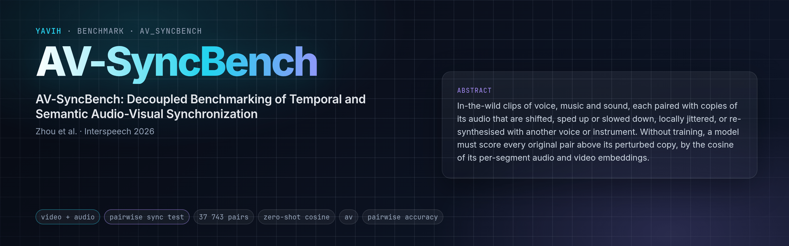
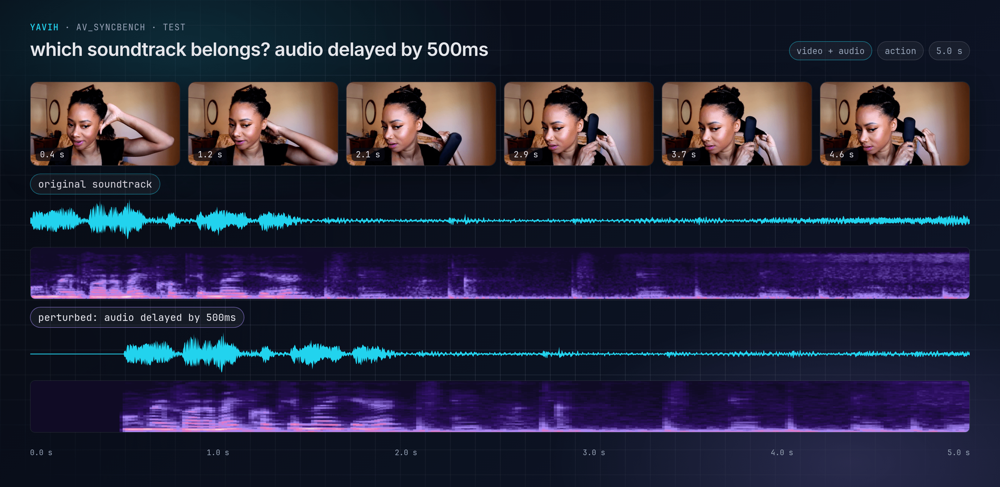

TODO: [Paper](https://…) · [Homepage](https://…) · [Dataset](https://…) · [Licence](https://…) · [setup.md](setup.md)

<!-- yavih:glance begin (generated from benchmark.yaml: python -m yavih.doctables --glance av_syncbench --write) -->
| At a glance | av_syncbench |
|---|---|
| **Task** | Cross-modal retrieval · audio-visual, retrieval |
| **Modality** | Video + audio |
| **Size** | 15 440 test |
| **Headline** | Recall at rank 1 (`r@1`) · chance 0.0065 % |
| **Data** | Public download; media on request from the data owner · 31 GB of media · how: [setup.md](setup.md) |
| **Licence** | VGGSound: CC BY 4.0 (the listing; the media are YouTube clips fetched by the user, subject to YouTube's terms). The CAV-MAE Sync subset list: BSD-2-Clause (the authors' repository). |
| **Protocol** | Version 1 · scorer `av_syncbench` (the folder's own) · needs yavih >=1.1,<2 · `yavih bench fetch av_syncbench` |
<!-- yavih:glance end -->

## The task

TODO: what a model is asked to do, in human terms, for a reader deciding whether this benchmark is for them: one
example input and the answer it expects. How to write this page: https://github.com/Bizilizi/yavih/blob/main/docs/writing-a-readme.md

<!-- once rendered (python -m yavih.previews av_syncbench --suggest --write, then python -m yavih.previews av_syncbench), un-comment:

-->

## The data

TODO: what the recordings are and where they come from, the official splits in prose, the licence in words.
(Scaffolded from `vggsound_retrieval`: the glance above shows `vggsound_retrieval`'s numbers until this benchmark's manifest replaces them.)

## How it is scored

TODO: the metric and why it fits the task; chance and the floor in words; what is not this benchmark (variants,
aliases, near-misses), one sentence each.

## Reference numbers

TODO: published numbers with their citation and why they are (not) comparable to a frozen-feature probe; or delete
this optional section.

## Citation

```bibtex
TODO: the BibTeX entry of the paper
```
