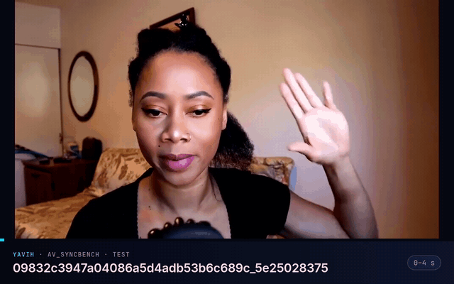

[Paper](https://arxiv.org/abs/2607.00726) · [Homepage](https://duck-boss.github.io/AV-SyncBench/) · [Dataset](https://modelscope.cn/datasets/coming245/AVSyncBench) · [Code](https://github.com/fgt7t6g/AV-SyncBench) · [setup.md](setup.md)

<!-- yavih:glance begin (generated from benchmark.yaml: python -m yavih.doctables --glance av_syncbench --write) -->
| At a glance | AV-SyncBench |
|---|---|
| **Task** | Pairwise sync test · audio-visual, temporal |
| **Modality** | Video + audio |
| **Size** | 37 743 test |
| **Headline** | `acc_task_mean` · chance 50 % |
| **Data** | Public download; fetched unattended · 70 GB of media · how: [setup.md](setup.md) |
| **Licence** | MIT, as the ModelScope and Hugging Face dataset cards declare. The clips are in-the-wild videos from public platforms; the authors do not address the rights of the original creators. … |
| **Protocol** | Version 1 · scorer `av_syncbench` (the folder's own) · needs yavih >=1.1,<2 · `yavih bench fetch av_syncbench` |
<!-- yavih:glance end -->

## The task

Does the sound belong to this video, at this moment? Each test item is a pair: a short in-the-wild clip with its
own soundtrack, and the same clip with a doctored soundtrack. The doctoring is either temporal (the audio shifted
50 to 500 ms early or late, played 0.80 to 1.25 times as fast, or locally jittered inside a window) or semantic
(the voice re-synthesised as another speaker, or the music re-rendered on another instrument, with the timing kept).
A model passes the item when it scores the original soundtrack as a better match for the pictures than the doctored
one.

Nothing is trained. The model embeds the video and each soundtrack segment by segment, every 0.64 s, in its own
shared audio-visual space; a soundtrack's score is the mean cosine similarity between each video segment and the
audio segment at the same time.


 · [mp4](assets/clip.mp4)

## The data

AV-SyncBench (Zhou et al., Interspeech 2026) collects clips of 2.5 to 13 seconds from public video platforms in ten
scenarios: solo instruments and ensembles, object and action sounds, ambient and animal sounds, single speakers,
groups, dialogue and singing. The clips were filtered automatically and checked by hand so that the sound source is
on screen. The perturbed soundtracks were generated from the originals: the temporal ones by shifting, resampling
and window jitter, the timbre ones with OpenVoice V2 (voices) and DDSP (instruments).

The public release holds 37 743 pairs: 14 600 offset pairs (five magnitudes, both directions), 14 570 speed pairs
(ten factors), 7 755 jitter pairs (three magnitude ranges), 589 voice-timbre and 229 instrument-timbre pairs. Their
originals are 3 494 mp4 files: 2 676 shared by the temporal pairs, one per video, and 818 in the timbre part, where
every pair has its own copy of its original. Those files show 3 003 distinct videos (`video_id`): the 818 timbre
copies are 552 videos, 225 of which are also among the temporal ones. These differ slightly from the paper's own count of 38 390. There is no training split:
every pair is a test pair.

The dataset card declares the MIT licence. The clips themselves come from public platforms, and the authors do not
address the rights of their original creators.

## How it is scored

Each pair is right when the original soundtrack's score is strictly higher than the doctored one's, so chance is 50 %
and a tie counts as wrong. Within a temporal challenge the accuracy is averaged over its magnitude levels, as in the
paper's tables; the timbre accuracy pools its pairs. The headline is the mean of the four challenge accuracies
(offset, jitter, speed, timbre), every level is reported, and the scoring code is the authors' own evaluation toolkit
([fgt7t6g/AV-SyncBench](https://github.com/fgt7t6g/AV-SyncBench)), copied into the folder.

Not this benchmark: the offset classifiers of the paper (Synchformer, SparseSync) are scored there by their
probability of zero offset rather than by a cosine, which this folder does not do; and the toolkit's
`official_0p64` mode scores every segment of a pair instead of at most 18 (how much that changes the numbers has
not been measured).

## Reference numbers

The paper's accuracies of the three models scored by segment cosine (Tables 2 and 4; the temporal columns are
averages over the levels):

| model | offset | jitter | speed | timbre |
|---|---:|---:|---:|---:|
| ImageBind | 0.505 | 0.618 | 0.602 | 0.859 |
| CAV-MAE (Scale++) | 0.506 | 0.768 | 0.677 | 0.826 |
| CAV-MAE-Sync | 0.500 | 0.636 | 0.486 | 0.628 |

They come from the paper's own preprocessing of each model and from the full 38 390 pairs. The release this folder
scores has 37 743, so the numbers are comparable but not identical. The paper does not define how its timbre
"Overall" is computed, so the folder's `acc_timbre` (voice and instrument pairs pooled) is only roughly comparable
with that column.

## Citation

```bibtex
@inproceedings{zhou26g_interspeech,
  title     = {{AV-SyncBench: Decoupled Benchmarking of Temporal and Semantic Audio-Visual Synchronization}},
  author    = {Tianhong Zhou and Mingyang Han and Boyu Li and Yuxuan Jiang and Jiaxin Ye and Dongxiao Wang and Haoxiang Shi and Kunpeng Wang and Jun Song and Cheng Yu and Bo Zheng},
  year      = {2026},
  booktitle = {{Interspeech 2026}},
  pages     = {1137--1141},
  doi       = {10.21437/Interspeech.2026-2177}
}
```
