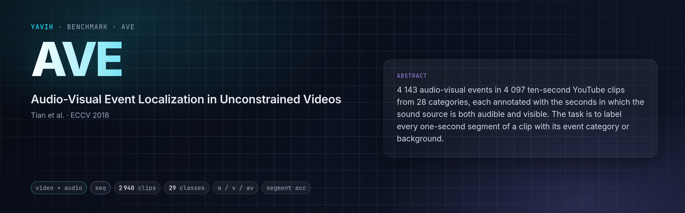
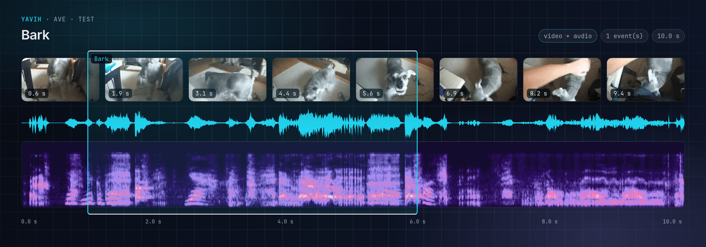
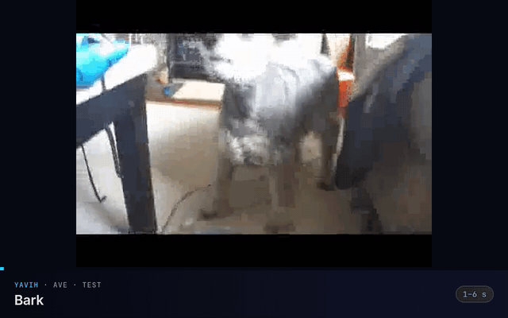

[Paper](https://arxiv.org/abs/1803.08842) · [Homepage](https://github.com/YapengTian/AVE-ECCV18) · [Dataset](https://huggingface.co/datasets/Helios1208/AVE_Dataset) · [setup.md](setup.md)

<!-- yavih:glance begin (generated from benchmark.yaml: python -m yavih.doctables --glance ave --write) -->
| At a glance | AVE |
|---|---|
| **Task** | Audio-visual event localisation, one label per segment · audio-visual, temporal |
| **Modality** | Video + audio |
| **Size** | 2 624 train / 316 test · 29 classes |
| **Headline** | Segment accuracy (`seg_acc`) · chance 3.4 % |
| **Readings** | Audio · video · audio+video |
| **Data** | Public download; fetched unattended · 4 GB of media · how: [setup.md](setup.md) |
| **Licence** | No licence is recorded for the AVE data on the AVE-ECCV18 GitHub repository or the HF mirror Helios1208/AVE_Dataset; check both before redistribution. Media are YouTube clips (AudioSet segments) subject to YouTube's terms; research use … |
| **Protocol** | Version 1 · scorer `seq` · needs yavih >=1.1,<2 · `yavih bench fetch ave` |
<!-- yavih:glance end -->

## The task

Watch and hear a ten-second video and say, for every second of it, which event is happening, or that nothing is.
An event counts only while its source is both audible and visible: a dog that barks off screen, or a church bell
that is shown but silent, is background. There are 28 event categories (church bell, barking dog, acoustic guitar,
a man speaking, a fixed-wing aircraft, …), so each second gets one of 29 answers.



The hard part is the edges. Most clips show one event for all ten seconds, and there the task reduces to naming the
clip; the clips where the event starts late or stops early ask the model to find the seconds where sound and
picture agree.

 · [mp4](assets/clip.mp4)

## The data

AVE (Tian, Shi, Li, Duan and Xu, ECCV 2018) has 4 143 annotated events in 4 097 YouTube videos of ten seconds,
drawn from AudioSet. Annotators marked each event as a range of whole seconds in which the source is both heard
and seen. The videos run mostly at 25 to 30 frames per second with 44.1 kHz audio; a few are shorter than ten seconds.

The authors split the events 3 339 / 402 / 402 into train, validation and test, but their splits are not
video-disjoint (a few videos sit in two of them), and many AVE videos are also in VGGSound's training set, which
audio-visual encoders are often trained on. yavih drops every video that is in VGGSound train and every validation
or test video that also appears in AVE train. That leaves 2 624 training events and 316 test videos with one event
each; the validation split is kept in the manifest but never used.

No licence is recorded for the annotations on the authors' repository or the Hugging Face mirror; the videos are
YouTube clips under YouTube's terms, for research use. The data is a public download: one 13.4 GB archive, of which the 2 924 videos
yavih uses are 4 GB.

## How it is scored

A probe on frozen audio-visual features labels each of the ten seconds of every test video, and the score is the
accuracy over all of those seconds pooled, background seconds included. This is the official AVE metric, the one
computed by the authors' code. Chance is 1 in 29 (3.4 %); always answering "background" scores 17.2 %.

That floor is misleadingly low: since about two thirds of the events cover the whole clip, a model that names the
clip's event on every second scores around 83 % without locating anything. Read the headline next to the clip-level
accuracy and the accuracy on the 104 test videos whose event is shorter than the clip, where always answering
background already scores 52 %. The features must carry the video with a time axis, so an audio-only model is not applicable.

Not this benchmark: AVE's weakly-supervised setting (video-level labels for training), the cross-modality
localization tasks (find the visual segment for a sound, or the reverse), the unfiltered official test set of 402
videos, scores on part of the clip, and the AudioSet-mirror copy of AVE (frames at 1.5 fps). Published AVE results
fine-tune the encoder or train a task-specific head, mostly on the unfiltered test set, so they are not comparable
with a frozen-feature probe here.

## Citation

```bibtex
@inproceedings{tian2018ave,
  title     = {Audio-Visual Event Localization in Unconstrained Videos},
  author    = {Tian, Yapeng and Shi, Jing and Li, Bochen and Duan, Zhiyao and Xu, Chenliang},
  booktitle = {Proceedings of the European Conference on Computer Vision (ECCV)},
  pages     = {247--263},
  year      = {2018}
}
```
