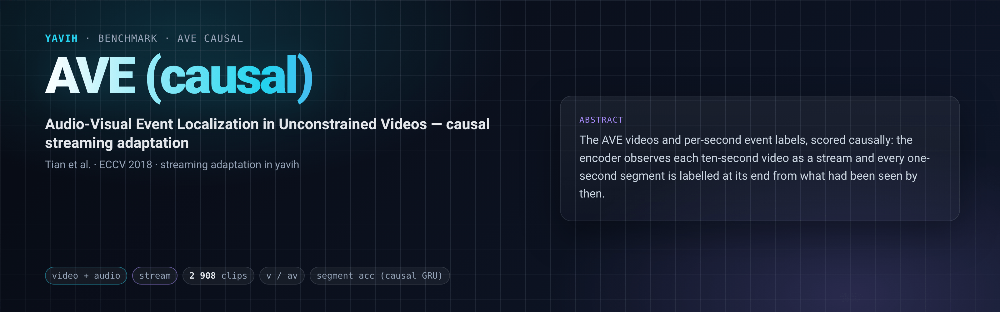

[Paper](https://arxiv.org/abs/1803.08842) · [Homepage](https://github.com/YapengTian/AVE-ECCV18) · [Dataset](https://huggingface.co/datasets/Helios1208/AVE_Dataset) · [setup.md](setup.md)

## Description

AVE (Tian, Shi, Li, Duan, Xu; ECCV 2018) labels every second of 4 097 ten-second YouTube clips with one of 28
audio-visual event categories or `background`. This folder is a **causal streaming adaptation** of it
(`ave_causal_v1`), not the original protocol: the encoder observes each clip as a stream, one update every 0.5 s,
and every one-second segment `[s, s + 1)` is labelled at its end, `t = s + 1`, from the prediction that was available
by then. It validates a streaming pipeline end to end on short clips; it says little about long-range memory, since
a clip lasts ten seconds.

## Citation

```bibtex
@inproceedings{tian2018ave,
  title     = {Audio-Visual Event Localization in Unconstrained Videos},
  author    = {Tian, Yapeng and Shi, Jing and Li, Bochen and Duan, Zhiyao and Xu, Chenliang},
  booktitle = {Proceedings of the European Conference on Computer Vision (ECCV)},
  pages     = {247--263},
  year      = {2018}
}
```

## In yavih

### Protocol

`scorer: stream`, `protocol_version: 1`. One row per video: the train and test videos of the packaged `ave`
folder (its leakage-filtered manifest), minus the 16 train videos that carry two events over the same seconds.

| split value | role | videos | notes |
|---|---|---|---|
| `train` | train | 2 592 | the stream scorer carves its validation recordings from train |
| `test` | eval | 316 | every test video carries one event |

The bridge returns each video's update sequence (one embedding per 0.5 s cutoff, with the input support it read;
[streaming](https://github.com/Bizilizi/yavih/blob/main/docs/streaming.md)). The `stream` scorer trains two heads per seed, a linear head on the held
embedding and a causal GRU over the updates, and reads at every segment end the latest prediction available then
(its cutoff in the causal mode; its `ready_at` in a `-rt` real-time reading). Targets: segment `s` carries the
video's event class iff `event_start <= s < event_end`, else `background` (index 28), from the manifest's `seconds`
column.

Headline **`sec_acc_gru`**: accuracy over every segment of every test video, background included (AVE's
`compute_acc`, on causal predictions), for the causal GRU head; `sec_acc_linear` for the linear head. Also
`event_map_gru` / `event_map_linear`: mean one-vs-rest average precision over the event classes that have a positive test segment (background excluded). Floors: the train
prior at every segment (`sec_acc_floor`, `event_map_floor`). Intervals: 95 % percentile bootstrap over test VIDEOS
(2 000 resamples, seed 0). Numbers are not comparable with the `ave` folder's (bidirectional probe over the whole
clip) or with published AVE results.

### Variants and aliases

No aliases. Each bridge reading is causal (`av`, `v`) or real time (`av-rt`, `v-rt`, one row per device in the
report); they share the protocol hash and are different rows.

### Reference numbers

None: the task is defined here.

### Re-freezing the manifest

`python "$(yavih bench path ave_causal)/make_manifest.py" --check` re-derives `manifest.csv.gz` from the packaged
`ave` folder's manifest and classes (sha256-pinned) and compares byte for byte; without `--check` it rewrites it
(gzip `mtime=0`). Folder tests: `pytest "$(yavih bench path ave_causal)/tests"`.
