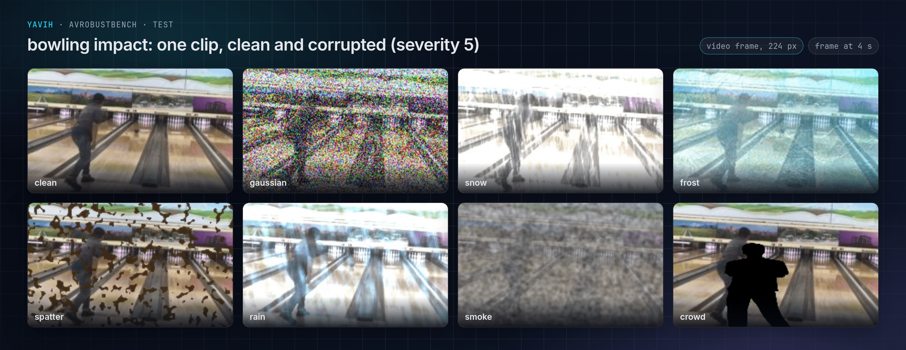
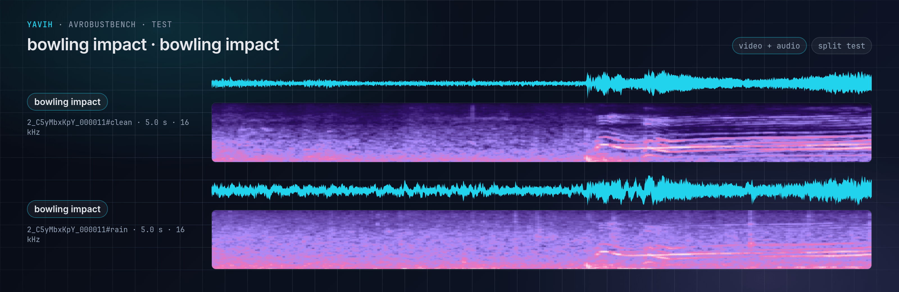

[Paper](https://arxiv.org/abs/2506.00358) · [Homepage](https://sarthaxxxxx.github.io/AVROBUSTBENCH/index.html) · [Code](https://github.com/sarthaxxxxx/AV-C-Robustness-Benchmark) · [Dataset](https://huggingface.co/datasets/sakshamsingh1/av_robust_data) · [VGGSound](https://www.robots.ox.ac.uk/~vgg/data/vggsound/) · [setup.md](setup.md)

<!-- yavih:glance begin (generated from benchmark.yaml: python -m yavih.doctables --glance avrobustbench --write) -->
| At a glance | AVROBUSTBENCH |
|---|---|
| **Task** | 309-way classification · audio-visual |
| **Modality** | Video + audio |
| **Size** | 20 000 train / 224 736 test · 309 classes |
| **Headline** | `macc` · chance 0.32 % |
| **Readings** | Audio · video · audio+video |
| **Data** | Derived from another dataset; media on request from the data owner · 1 GB of media · how: [setup.md](setup.md) |
| **Licence** | Derived from VGGSound (annotations CC BY 4.0; the media are YouTube clips fetched by the user, subject to YouTube's terms). Corruption code and noise/overlay assets: AVROBUSTBENCH repository, MIT (its noise recordings come from ESC-50 and … |
| **Protocol** | Version 1 · scorer `clf` · needs yavih >=1.1,<2 · `yavih bench fetch avrobustbench` · alias `vggsound_2c` |
<!-- yavih:glance end -->

## The task

Name the sound source of a ten-second VGGSound clip (309 classes: a dog barking, a train horn, someone playing the
cello) when both what you see and what you hear are degraded at the same time. Each corruption pairs a visual
degradation with a matching sound: snow on the lens and the hiss of falling snow, a rain-streaked frame and rain,
a smoky haze and crackling fire with a siren, a crowd of people blocking the view and crowd chatter, a tilted
picture and dropouts in the audio. A classifier is trained once on clean clips and then asked about the clean clip
and its 15 corrupted versions.





## The data

VGGSOUND-2C is one of the four datasets of AVROBUSTBENCH (Maharana et al., NeurIPS 2025 Datasets and Benchmarks).
It takes the 14 046 VGGSound test clips the authors could still download (of 15 446) and applies 15 corruptions at
the highest of five severities. Five are digital (Gaussian, impulse, shot and speckle noise, compression), six
environmental (snow, frost, spatter, wind, rain, underwater) and four human-related (concert, smoke, crowd,
interference). The visual side follows ImageNet-C where it can; the audio side mixes in recordings from ESC-50 and
Freesound or degrades the waveform directly.

Here the corrupted clips are made locally from a copy of VGGSound with the authors' own code. Each clip is reduced
to the ten frames CAV-MAE samples (one per second, 224 pixels), the form the authors corrupt, plus its 16 kHz audio,
and the random draws are seeded per clip so every site gets the same corruptions. The probe trains on 20 000 clean
VGGSound train clips, about 65 per class. VGGSound's annotations are CC BY 4.0, while the clips themselves are
YouTube videos that decay over time, so the benchmark needs an existing copy of the corpus. The corruption code and
assets are MIT.

## How it is scored

The score is top-1 accuracy, averaged over the 15 corruptions with equal weight, as in the paper's main table. The
classes are nearly balanced, so accuracy is meaningful and chance is about 0.3 %. The floor is a model that always
names the most frequent training class, also about 0.3 %. Next to it come the clean accuracy of the same probe, the
accuracy under each corruption and per group, and the two robustness ratios of the paper: absolute robustness, one
minus the drop, and relative robustness, the corrupted accuracy as a share of the clean one.

The corruption code is the authors' own, with a few changes to make it run and to seed it, and the frame sampling
is CAV-MAE's. The authors released no scoring code, so the robustness ratios follow the implementation the paper
cites for them (Schiappa et al., NeurIPS 2022).

Not this benchmark: the authors' downloadable VGGSOUND-2C files, which hold 14 of the 15 corruptions with compressed
44.1 kHz audio; severities other than 5; and the other three AVROBUSTBENCH datasets (AUDIOSET-2C, KINETICS-2C,
EPICKITCHENS-2C).

## Reference numbers

At severity 5 the paper reports a mean accuracy of 35.5 % for CAV-MAE (65.5 % clean), 33.8 % for EquiAV and 27.4 %
for UAVM. The zero-shot models score lower: 11.1 % for AudioCLIP and 10.3 % for ImageBind. Those models were
fine-tuned or linear-probed on all of VGGSound train and saw the corrupted frames without video compression, so a
frozen-feature probe trained on 20 000 clips is not directly comparable.

## Citation

```bibtex
@inproceedings{maharana2025avrobustbench,
  title     = {{AVROBUSTBENCH}: Benchmarking the Robustness of Audio-Visual Recognition Models at Test-Time},
  author    = {Maharana, Sarthak Kumar and Kushwaha, Saksham Singh and Zhang, Baoming and Rodriguez, Adrian and
               Wei, Songtao and Tian, Yapeng and Guo, Yunhui},
  booktitle = {The Thirty-ninth Annual Conference on Neural Information Processing Systems},
  year      = {2025}
}

@inproceedings{chen2020vggsound,
  title     = {{VGGSound}: A Large-scale Audio-Visual Dataset},
  author    = {Chen, Honglie and Xie, Weidi and Vedaldi, Andrea and Zisserman, Andrew},
  booktitle = {IEEE International Conference on Acoustics, Speech and Signal Processing (ICASSP)},
  year      = {2020}
}

@inproceedings{gong2023cavmae,
  title     = {Contrastive Audio-Visual Masked Autoencoder},
  author    = {Gong, Yuan and Rouditchenko, Andrew and Liu, Alexander H. and Harwath, David and Karlinsky, Leonid and
               Kuehne, Hilde and Glass, James R.},
  booktitle = {International Conference on Learning Representations (ICLR)},
  year      = {2023}
}

@inproceedings{schiappa2022robustness,
  title     = {Robustness Analysis of Video-Language Models Against Visual and Language Perturbations},
  author    = {Schiappa, Madeline C. and Vyas, Shruti and Palangi, Hamid and Rawat, Yogesh S. and Vineet, Vibhav},
  booktitle = {Advances in Neural Information Processing Systems (NeurIPS) Datasets and Benchmarks Track},
  year      = {2022}
}
```
