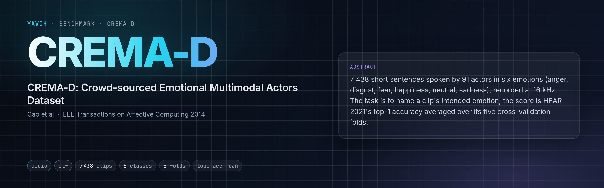
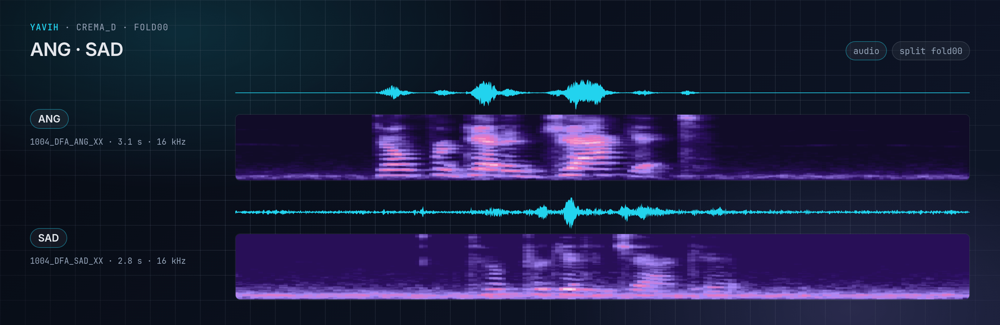

[Paper](https://doi.org/10.1109/TAFFC.2014.2336244) · [Dataset](https://github.com/CheyneyComputerScience/CREMA-D) · [HEAR](https://hearbenchmark.com) · [Licence](https://opendatacommons.org/licenses/odbl/1-0/) · [setup.md](setup.md)

<!-- yavih:glance begin (generated from benchmark.yaml: python -m yavih.doctables --glance crema_d --write) -->
| At a glance | CREMA-D |
|---|---|
| **Task** | Sound classification · audio |
| **Modality** | Audio |
| **Size** | 1 488 fold fold00 / 1 488 fold fold01 / 1 488 fold fold02 / 1 487 fold fold03 / 1 487 fold fold04 · 6 classes |
| **Headline** | `top1_acc_mean` · chance 17 % |
| **Data** | Public download; fetched unattended · 0.61 GB of media · how: [setup.md](setup.md) |
| **Licence** | Open Database License (ODbL) 1.0 for the database; Database Contents License (DbCL) 1.0 for its contents (upstream LICENSE.txt) |
| **Protocol** | Version 1 · scorer `clf` · needs yavih >=1.1,<2 · `yavih bench fetch crema_d` |
<!-- yavih:glance end -->

## The task

Hear an actor say one short sentence and name the emotion they were asked to express: anger, disgust, fear,
happiness, sadness, or a neutral reading. The words carry no emotion ("It's eleven o'clock", "Don't forget a
jacket"): the same twelve sentences are spoken in every emotion, so only the voice (pitch, energy, timing, voice
quality) tells them apart. Every clip has exactly one answer.



## The data

CREMA-D (Cao et al., IEEE Transactions on Affective Computing 2014) is a crowd-sourced emotional corpus of 91 actors
(48 men, 43 women, aged 20 to 74, of several ethnic backgrounds) reading 12 sentences in six emotions; one sentence
("It's eleven o'clock") is also spoken at low, medium and high intensity. This benchmark uses its audio: 7 438 clips of 16 kHz mono speech, 1.3 to 5.0 seconds
long, about 2.5 seconds on average. The six emotions are near balanced (1 270 clips each, 1 086 neutral). The labels
are the emotion the actor was asked to act, as in the file names, not the perceived emotion that the corpus's
crowd raters also give.

The splits are HEAR 2021's: the clip list of TensorFlow Datasets' `crema_d` (the 7 442 clips of the corpus minus
four that were missing from its repository) cut into five folds of about 1 488 clips. HEAR draws the folds over
files, not over actors, so every actor's voice appears in every fold. The corpus is public on GitHub under the Open
Database License, with its contents under the Database Contents License; 0.6 GB of audio, fetched unattended.

## How it is scored

Each fold is held out once: a probe trained on frozen features of the other four folds names the emotion of the
held-out clips, and the score is HEAR's top-1 accuracy, averaged over the five folds. The scoring code is HEAR's own
([hear-eval-kit](https://github.com/hearbenchmark/hear-eval-kit)), and the folds are re-derived from the public CREMA-D
files exactly as [hear-preprocess](https://github.com/hearbenchmark/hear-preprocess) and TensorFlow Datasets built
them, so the benchmark does not need HEAR's 1.5 GB build of the task; that build is public on
[Zenodo](https://doi.org/10.5281/zenodo.6332517), and the folds can be checked against it clip by clip. With six
near-balanced classes, chance is one in six (16.7 %); the floor, always answering the most frequent training
emotion, is 15.7 %.

Not this benchmark: speaker-independent splits (TensorFlow Datasets' own 70/10/20 split by actor, or
leave-actors-out folds) are harder and give other numbers; so do the audio-visual and
video-only CREMA-D tasks, and scores against the crowd's perceived emotion. Scores computed on HEAR's first CREMA-D release, withdrawn in
January 2022 for an audio-amplitude bug in its preprocessing, are not comparable either. HEAR's own leaderboard trains an MLP on
three folds with a grid search where this probe trains on four, so its numbers are close relatives, not the same
numbers.

## Citation

```bibtex
@article{cao2014crema,
  title = {{CREMA-D}: Crowd-sourced Emotional Multimodal Actors Dataset},
  author = {Cao, Houwei and Cooper, David G. and Keutmann, Michael K. and Gur, Ruben C. and Nenkova, Ani and Verma, Ragini},
  journal = {IEEE Transactions on Affective Computing},
  volume = {5},
  number = {4},
  pages = {377--390},
  year = {2014},
  doi = {10.1109/TAFFC.2014.2336244}
}

@inproceedings{turian2022hear,
  title = {{HEAR}: Holistic Evaluation of Audio Representations},
  author = {Turian, Joseph and Shier, Jordie and Khan, Humair Raj and Raj, Bhiksha and Schuller, Bj{\"o}rn W. and Steinmetz, Christian J. and Malloy, Colin and Tzanetakis, George and Velarde, Gissel and McNally, Kirk and Henry, Max and Pinto, Nicolas and Noufi, Camille and Clough, Christian and Herremans, Dorien and Fonseca, Eduardo and Engel, Jesse and Salamon, Justin and Esling, Philippe and Manocha, Pranay and Watanabe, Shinji and Jin, Zeyu and Bisk, Yonatan},
  booktitle = {Proceedings of the NeurIPS 2021 Competitions and Demonstrations Track},
  series = {Proceedings of Machine Learning Research},
  volume = {176},
  pages = {125--145},
  year = {2022}
}
```
