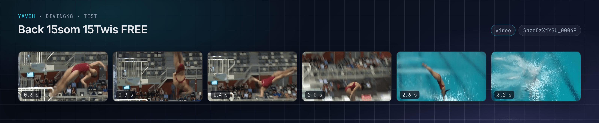

TODO: [Paper](https://…) · [Homepage](https://…) · [Dataset](https://…) · [Licence](https://…) · [setup.md](setup.md)

<!-- yavih:glance begin (generated from benchmark.yaml: python -m yavih.doctables --glance diving48 --write) -->
| At a glance | Diving48 |
|---|---|
| **Task** | Video classification · visual, temporal |
| **Modality** | Video |
| **Size** | 15 027 train / 1 970 test · 48 classes |
| **Headline** | Accuracy (`acc`) · chance 2.1 % |
| **Data** | Public download; fetched unattended · 9 GB of media · how: [setup.md](setup.md) |
| **Licence** | No licence is stated on the official Diving48 page (checked 2026-11-15); the clips are segments of online videos of diving competitions, distributed by UCSD SVCL for research. Cite the ECCV 2018 paper. |
| **Protocol** | Version 1 · scorer `clf` · needs yavih >=1.1,<2 · `yavih bench fetch diving48` |
<!-- yavih:glance end -->

## The task

TODO: what a model is asked to do, in human terms, for a reader deciding whether this benchmark is for them: one
example input and the answer it expects. How to write this page: https://github.com/Bizilizi/yavih/blob/main/docs/writing-a-readme.md

<!-- once rendered (python -m yavih.previews diving48 --suggest --write, then python -m yavih.previews diving48), un-comment:

-->

## The data

TODO: what the recordings are and where they come from, the official splits in prose, the licence in words.
(Scaffolded from `ssv2`: the glance above shows `ssv2`'s numbers until this benchmark's manifest replaces them.)

## How it is scored

TODO: the metric and why it fits the task; chance and the floor in words; what is not this benchmark (variants,
aliases, near-misses), one sentence each.

## Reference numbers

TODO: published numbers with their citation and why they are (not) comparable to a frozen-feature probe; or delete
this optional section.

## Citation

```bibtex
TODO: the BibTeX entry of the paper
```
