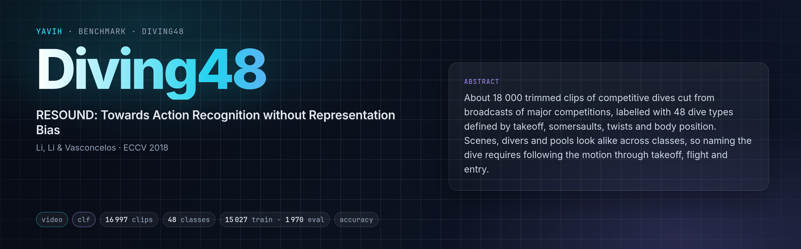
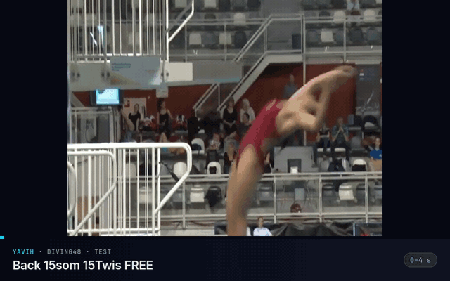

[Paper](https://openaccess.thecvf.com/content_ECCV_2018/papers/Yingwei_Li_RESOUND_Towards_Action_ECCV_2018_paper.pdf) · [Homepage](http://www.svcl.ucsd.edu/projects/resound/dataset.html) · [Reference protocol (VideoGLUE)](https://github.com/tensorflow/models/tree/master/official/projects/videoglue) · [setup.md](setup.md)

<!-- yavih:glance begin (generated from benchmark.yaml: python -m yavih.doctables --glance diving48 --write) -->
| At a glance | Diving48 |
|---|---|
| **Task** | Video classification · visual, temporal |
| **Modality** | Video |
| **Size** | 15 027 train / 1 970 test · 48 classes |
| **Headline** | Accuracy (`acc`) · chance 2.1 % |
| **Data** | Public download; fetched unattended · 9.6 GB of media · how: [setup.md](setup.md) |
| **Licence** | No licence is stated on the official Diving48 page (checked 2026-11-15); the clips are segments of online videos of diving competitions, distributed by UCSD SVCL for research. Cite the ECCV 2018 paper. |
| **Protocol** | Version 1 · scorer `clf` · needs yavih >=1.1,<2 · `yavih bench fetch diving48` |
<!-- yavih:glance end -->

## The task

Watch one competitive dive and name it. Each clip shows a single dive from the moment the diver leaves the board
or platform until they enter the water, and the label is the dive as the international rules define it: the
takeoff (forward, back, reverse, inward), the number of somersaults, the number of twists and the body position
(straight, pike, tuck or free). `Back 25som NoTwis TUCK` is a back dive with two and a half somersaults in tuck
position; `Forward 35som NoTwis PIKE` is three and a half forward somersaults in pike. There are 48 such dive
types, and every clip has exactly one.

The pool, the platform, the crowd and the diver's appearance are nearly the same in every class, so a single
frame says little: two dives that differ by half a somersault or one twist look alike until the motion is followed
through takeoff, flight and entry. The benchmark was built to measure exactly that, which is why yavih tags it
temporal as well as visual.

<!-- once rendered (python -m yavih.previews diving48 --chrome <chrome>), un-comment:


 · [mp4](assets/clip.mp4)
-->

## The data

Diving48 (Yingwei Li, Yi Li and Nuno Vasconcelos, ECCV 2018) cut about 18 000 clips out of online videos of major
diving competitions and transcribed each label from the information board shown before the dive. The clips are
640 x 480 h264 mp4 files without sound, a few seconds long, at the frame rate of their source broadcast (mostly
25 or 60 fps). In 2020 the authors released corrected annotations (V2): poorly segmented clips were removed and
many labels fixed. yavih uses V2, as VideoGLUE does: 15 027 training and 1 970 test clips, split at random by the
authors. One of the 48 dive types (`Forward Dive NoTwis STR`) has no clip left in V2 but stays in the label space.
The classes are unbalanced, from 33 to 1 053 training clips each.

The data is a public download of about 10 GB from the authors' page, with no account or agreement. The page states
no licence; the clips come from broadcast footage, so treat them as research data and cite the paper.

## How it is scored

A probe trained on frozen video features of the training clips names the dive of each test clip, and the score is
top-1 accuracy over the 1 970 test clips. The task, the splits, the 48-way label space and the metric are those of
VideoGLUE (Yuan et al.), the evaluation of video foundation models whose
[code](https://github.com/tensorflow/models/tree/master/official/projects/videoglue) yavih follows for Diving48.
Chance is 1 in 48 (2.1 %); the floor, a model that always answers the most frequent training dive, scores 3.5 %
on the test clips.

Not this benchmark: numbers on the original V1 annotations (2 096 test clips, older labels), on the optical-flow
release, or with several clips and crops averaged per video at test time are different numbers.

## Reference numbers

VideoGLUE (Table 4) reports Diving48 top-1 accuracy with frozen backbones and a single attention-pooling head:
VideoMAE 59.5, InternVideo 55.6, VATT 49.7, FLAVA 45.9, CLIP 44.1, DINOv2 40.4, CoCa 34.1. Its head and training
recipe differ from yavih's probe and it averages 4 clips x 3 crops per test video, so these numbers place a model
but are not directly comparable. Fine-tuned end to end, the same models reach 70.2 to 79.6 (Table 3), and the
best task-specialised model the paper lists, AIM, 88.9.

## Citation

```bibtex
@inproceedings{li2018resound,
  title     = {{RESOUND}: Towards Action Recognition without Representation Bias},
  author    = {Li, Yingwei and Li, Yi and Vasconcelos, Nuno},
  booktitle = {Proceedings of the European Conference on Computer Vision (ECCV)},
  year      = {2018}
}

@misc{yuan2023videoglue,
  title         = {{VideoGLUE}: Video General Understanding Evaluation of Foundation Models},
  author        = {Yuan, Liangzhe and Gundavarapu, Nitesh Bharadwaj and Zhao, Long and Zhou, Hao and Cui, Yin and
                   Jiang, Lu and Yang, Xuan and Jia, Menglin and Weyand, Tobias and Friedman, Luke and
                   Sirotenko, Mikhail and Wang, Huisheng and Schroff, Florian and Adam, Hartwig and
                   Yang, Ming-Hsuan and Liu, Ting and Gong, Boqing},
  year          = {2023},
  eprint        = {2307.03166},
  archivePrefix = {arXiv},
  note          = {Accepted to Transactions on Machine Learning Research}
}
```
