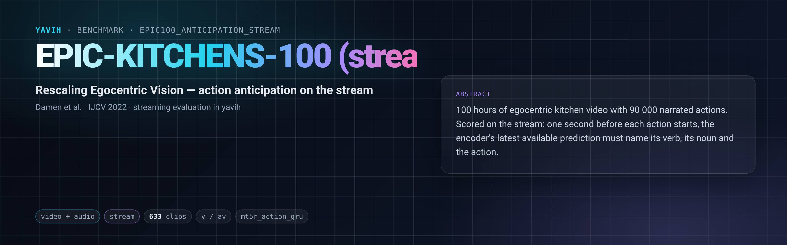

[Paper](https://arxiv.org/abs/2006.13256) · [Homepage](https://epic-kitchens.github.io/) · [Annotations](https://github.com/epic-kitchens/epic-kitchens-100-annotations) · [Streaming anticipation](https://arxiv.org/abs/2306.16682) · [setup.md](setup.md)

## Description

EPIC-KITCHENS-100 (Damen et al.; IJCV 2022) is 100 hours of egocentric kitchen video (700 videos, 45 kitchens) with
90 000 narrated action segments, each a verb (97 classes) and a noun (300 classes). Action anticipation asks, one
second before an action starts (`tau_a = 1 s`), for its verb, its noun and the action; the official measure is
class-mean top-5 recall, overall, on unseen participants and on tail classes. Furnari and Farinella (2023) showed that
charging each model's processing time changes the ranking of anticipation methods. This folder scores anticipation
**on the stream**: the encoder observes each video as a stream, and the prediction scored for an action is the latest
one available one second before it starts.

## Citation

```bibtex
@article{damen2022rescaling,
  title   = {Rescaling Egocentric Vision: Collection, Pipeline and Challenges for EPIC-KITCHENS-100},
  author  = {Damen, Dima and Doughty, Hazel and Farinella, Giovanni Maria and Furnari, Antonino and Kazakos, Evangelos and
             Ma, Jian and Moltisanti, Davide and Munro, Jonathan and Perrett, Toby and Price, Will and Wray, Michael},
  journal = {International Journal of Computer Vision (IJCV)},
  year    = {2022}
}
@article{furnari2023streaming,
  title   = {Streaming egocentric action anticipation: An evaluation scheme and approach},
  author  = {Furnari, Antonino and Farinella, Giovanni Maria},
  journal = {Computer Vision and Image Understanding},
  year    = {2023}
}
```

## In yavih

### Protocol

`scorer: stream`, `protocol_version: 1`. One row per video of the train and validation annotations (the test labels
are not public: validation is the evaluation split, as in the streaming anticipation literature).

| split value | role | videos | segments |
|---|---|---|---|
| `train` | train | 495 | 67 217 |
| `validation` | eval | 138 | 9 668 |

The bridge returns each video's update sequence, one update every 0.5 s ([streaming](https://github.com/Bizilizi/yavih/blob/main/docs/streaming.md)). Every narrated segment
starting at `s` is an anchor scored at `s - 1` from the latest prediction available then: its cutoff in the causal
mode, its `ready_at` in a `-rt` real-time reading (the runtime-aware condition). A segment starting within the first
second is scored from the train prior, as the official evaluation scores every validation segment. The `stream`
scorer trains a linear head and a causal GRU per seed, with a verb (97) and a noun (300) output.

Headline **`mt5r_action_gru`**: the official class-mean top-5 recall for actions (epic-kitchens/C3-Action-Anticipation
`evaluate_anticipation_json_ek100.py` @ 73b8a00, transcribed in `eval.py` and checked against it), with action scores
derived from the verb and noun outputs as the evaluator derives them (top-100 x top-100 products). Also `mt5r_verb`,
`mt5r_noun`, their `_unseen` (participants P18 and P32, absent from train) and `_tail` variants, for both heads;
bootstrap intervals over validation videos for the overall ones. Floors: the train prior on every anchor.

The constant-runtime shift of Furnari and Farinella (observation ending at `s - 1 - L` for a runtime `L`) is not a
separate result in this version: the `-rt` reading measures availability directly.

### Variants and aliases

No aliases. Each bridge reading is causal (`av`, `v`) or real time (`av-rt`, `v-rt`, one row per device).

### Reference numbers

None quoted: published anticipation results train task heads on their own features, often with optical flow and
object detections, at unspecified update rates.

### Re-freezing the manifest

`python "$(yavih bench path epic100_anticipation_stream)/make_manifest.py" --annotations <media_root>/annotations --check`
re-derives `manifest.csv.gz` from the pinned annotation csvs and compares byte for byte; without `--check` it rewrites
it (gzip `mtime=0`). Folder tests: `pytest "$(yavih bench path epic100_anticipation_stream)/tests"`.
