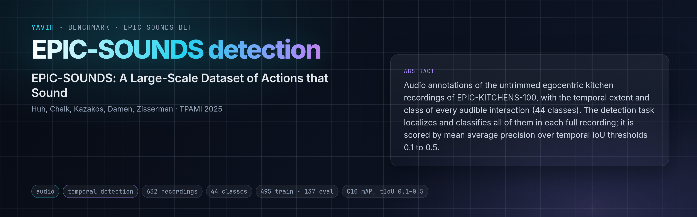
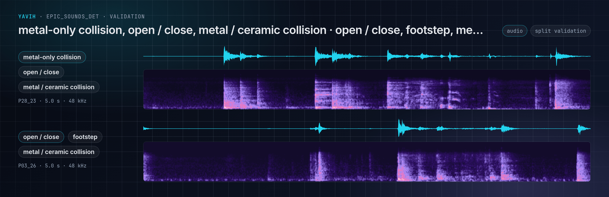

[Paper](https://arxiv.org/abs/2302.00646) · [Homepage](https://epic-kitchens.github.io/epic-sounds/) · [Dataset](https://github.com/epic-kitchens/epic-sounds-annotations) · [Licence](https://creativecommons.org/licenses/by-nc/4.0/) · [setup.md](setup.md)

<!-- yavih:glance begin (generated from benchmark.yaml: python -m yavih.doctables --glance epic_sounds_det --write) -->
| At a glance | EPIC-SOUNDS detection |
|---|---|
| **Task** | Temporal detection, multi-label · audio, temporal |
| **Modality** | Audio |
| **Size** | 495 train / 137 validation · 44 classes |
| **Headline** | mAP averaged over tIoU thresholds (`map_avg`) |
| **Data** | Public download; fetched unattended · 6.3 GB of media · how: [setup.md](setup.md) |
| **Licence** | EPIC-SOUNDS annotations and EPIC-KITCHENS-100 videos are both CC BY-NC 4.0 (non-commercial; credit the authors). Cite Huh et al. (TPAMI 2025) and Damen et al. (IJCV 2022). |
| **Protocol** | Version 1 · scorer `epic_sounds_det` (the folder's own) · needs yavih >=1.1,<2 · `yavih bench fetch epic_sounds_det` · alias `epic_sounds_detection` |
<!-- yavih:glance end -->

## The task

Listen to a whole, untrimmed recording of someone working in their kitchen, from ten seconds to an hour long, and
find every audible interaction in it: when it starts, when it ends and what it is. A pan lid clanks onto the hob (a
metal-only collision), a cupboard door opens and shuts (open / close), a knife works through a carrot (cut / chop),
the tap runs (water). Each answer is a (start, end, class) triple with a confidence, and one recording can hold
hundreds of them; the median sound lasts about a second, but some last minutes.



## The data

EPIC-SOUNDS (Huh, Chalk, Kazakos, Damen and Zisserman, TPAMI 2025) annotates the audio of EPIC-KITCHENS-100, 100
hours of head-mounted camera recordings in 45 kitchens (Damen et al., IJCV 2022). Annotators marked the temporal
extent of every audible interaction, and the sounds were grouped into 44 classes: collisions named by the materials
that meet (metal-only, metal / ceramic, plastic / wood, ...), scrub / scrape, cut / chop, open / close, water, pour,
footstep, rustle, beep, sizzling / boiling, a background class and more. The release holds 78.4 k categorised
segments and 39.2 k segments that could not be placed in a class.

The official splits are train (495 recordings, 60 055 segments) and validation (137 recordings, 8 035 segments),
whose labels are public, and two test splits whose labels stay on the challenge server (23 recordings for
detection). Here a detector learns on train and is scored on validation; the test splits are not used. The audio
is the 48 kHz stereo track of each EPIC-KITCHENS-100 video, kept as recorded. Annotations and videos are both
licensed CC BY-NC 4.0: free for non-commercial use, with credit to the authors. The data is a public download
without an account, but each video is fetched in full (1.1 TB in all) to keep its audio (6 GB in all).

## How it is scored

A predicted segment is a hit when it has the right class and overlaps a not yet matched true segment of the same
recording by at least a given temporal IoU. Average precision is computed per class over all validation
recordings, averaged over the classes, and averaged again over the IoU thresholds 0.1, 0.2, 0.3, 0.4 and 0.5; the
headline is that mean, in percent. Mean average precision is the standard detection score because it rewards both
finding every sound and ranking confident, well-placed segments first. The official challenge leaves the
background class out of the ground truth; the paper's Table V keeps it; both readings are reported.

The number is computed by a transcription of the EPIC-SOUNDS authors' own challenge scorer,
[`audio_based_interaction_detection.py`](https://github.com/epic-kitchens/C10-epic-sounds-detection/tree/196e7cf2c4f17946279fb57d9ff24516b7403344/EvaluationCode)
of the C10 detection challenge, itself adapted from the ActivityNet detection evaluation.

yavih scores frozen features: a fixed temporal detection head is trained on the model's audio tokens, so the score
measures how well the features place sounds in time, not how well a detector can be fine-tuned. Detection has no
chance level; the floor is a detector that knows only the training labels (how often each class sounds and how
long it lasts) and never hears the audio.

Not this benchmark: EPIC-SOUNDS sound recognition, where the segment boundaries are given and only the class is
predicted, is a different task with a different score; and numbers on the detection test split come from the
challenge server, on other recordings.

## Reference numbers

The paper reports ActionFormer on auditory SlowFast features fine-tuned on EPIC-SOUNDS at 16.5 / 15.2 / 13.7 / 12.0
/ 10.1 mAP at IoU 0.1 to 0.5 on validation, 13.5 on average, with background kept (Huh et al., TPAMI 2025, Table
V); the same predictions score 13.8 under the challenge's rule. They come from a detector trained on
fine-tuned features and are not comparable with a frozen-feature probe.

## Citation

```bibtex
@article{EPICSOUNDS2025,
  title   = {{EPIC-SOUNDS}: {A} {L}arge-{S}cale {D}ataset of {A}ctions that {S}ound},
  author  = {Huh, Jaesung and Chalk, Jacob and Kazakos, Evangelos and Damen, Dima and Zisserman, Andrew},
  journal = {IEEE Transactions on Pattern Analysis and Machine Intelligence (TPAMI)},
  year    = {2025}
}
@article{Damen2022RESCALING,
  title   = {Rescaling Egocentric Vision: Collection, Pipeline and Challenges for {EPIC-KITCHENS-100}},
  author  = {Damen, Dima and Doughty, Hazel and Farinella, Giovanni Maria and Furnari, Antonino and Ma, Jian and
             Kazakos, Evangelos and Moltisanti, Davide and Munro, Jonathan and Perrett, Toby and Price, Will and
             Wray, Michael},
  journal = {International Journal of Computer Vision (IJCV)},
  volume  = {130},
  pages   = {33--55},
  year    = {2022}
}
```
