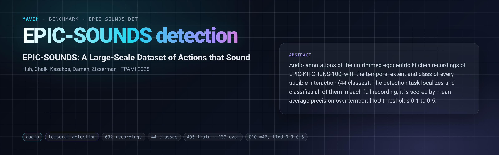

[Paper](https://arxiv.org/abs/2302.00646) · [Homepage](https://epic-kitchens.github.io/epic-sounds/) · [Dataset](https://github.com/epic-kitchens/epic-sounds-annotations) · [setup.md](setup.md)

## Description

EPIC-SOUNDS annotates the audio of the untrimmed egocentric kitchen recordings of EPIC-KITCHENS-100 (100 hours,
700 recordings of 45 kitchens) with the temporal extent and a class of every audible interaction: 78.4 k
categorised segments in 44 classes (collisions by material pair, scrub / scrape, cut / chop, open / close, water,
footstep, background, ...) and 39.2 k uncategorised ones. Two challenges are defined on it. In sound recognition
the segment boundaries are given and only the class is predicted. In sound detection, the task here, the model
sees the whole recording and predicts every (start, end, class) triple; it is scored by mean average precision
over the classes, averaged over temporal IoU thresholds 0.1, 0.2, 0.3, 0.4 and 0.5. The official splits are
train (495 recordings, 60 055 segments) and validation (137 recordings, 8 035 segments) with public labels, and
two test splits whose labels are held by the challenge server (detection test: 23 recordings).

## Citation

```bibtex
@article{EPICSOUNDS2025,
  title   = {{EPIC-SOUNDS}: {A} {L}arge-{S}cale {D}ataset of {A}ctions that {S}ound},
  author  = {Huh, Jaesung and Chalk, Jacob and Kazakos, Evangelos and Damen, Dima and Zisserman, Andrew},
  journal = {IEEE Transactions on Pattern Analysis and Machine Intelligence (TPAMI)},
  year    = {2025}
}
@article{Damen2022RESCALING,
  title   = {Rescaling Egocentric Vision: Collection, Pipeline and Challenges for {EPIC-KITCHENS-100}},
  author  = {Damen, Dima and Doughty, Hazel and Farinella, Giovanni Maria and Furnari, Antonino and Ma, Jian and
             Kazakos, Evangelos and Moltisanti, Davide and Munro, Jonathan and Perrett, Toby and Price, Will and
             Wray, Michael},
  journal = {International Journal of Computer Vision (IJCV)},
  volume  = {130},
  pages   = {33--55},
  year    = {2022}
}
```

## In yavih

One row per untrimmed recording: train 495 (role `train`) and validation 137 (role `eval`); no train draw. Scorer
`epic_sounds_det`, the folder's own temporal-detection scorer (see below); headline `map_avg`, the official C10 score: mean AP
over the 43 non-background classes and tIoU 0.1 to 0.5, in percent, with `map@0.1` ... `map@0.5` and
`map_avg_paper` (background kept, the paper's Table V convention). Floor `map_avg_floor` (a label-only prior
detector); no chance value, no interval. `protocol_version` 1. The bridge gets the whole recording's AAC track
(m4a, 10 s to 62 min) and returns one fixed `[N, D]` token set with media times `t`; see [setup.md](setup.md).

The scorer is the folder's own (`eval.py` and `detection.py`; `yavih bench info epic_sounds_det` names it on its
`extends:` line), shared byte for byte with the other folders that detect timed events. A dense query head
(`dense_query_v1`) with `T = 1024` time queries tiles each recording (`readout_params.T`: 0.5 s per bin at the mean
recording length, 3.6 s on the longest) and reads every token at the fraction of the recording it lies at; per bin
it predicts the 44 class logits and the distances to the segment start and end (sigmoid focal loss plus a 1-D GIoU
loss). A pinned decoder (score threshold, top 2 000, per-class NMS at tIoU 0.5, 100 segments per recording) turns the
outputs into scored segments, which the official scorer below scores on the validation recordings. The floor is the
label-only constant output (per bin the train frequency of each class and the median train extents), decoded and
scored the same way.

The official scorer (C10 `audio_based_interaction_detection.py`) is not installable and needs numpy < 1.24, so
`eval.py` transcribes it in numpy, including its tie order and the background rule. Scoring the C10 baseline
file `actionformer_baseline_validation.json` with it gives 16.48 / 15.15 / 13.70 / 11.99 / 10.12 (average 13.49)
with background kept, the published ActionFormer validation row (16.5 / 15.2 / 13.7 / 12.0 / 10.1, 13.5; Huh et
al., TPAMI 2025, Table V), and 16.74 / 15.48 / 14.01 / 12.26 / 10.35 (13.77) under the C10 rule. Those numbers come
from fine-tuned auditory SlowFast features with ActionFormer, not from a frozen-feature probe.

Not this benchmark: the EPIC-SOUNDS recognition task (segment boundaries given), and the detection test split
(labels on the challenge server only).

Re-freezing the manifest: `make_manifest.py` derives `manifest.csv.gz` and `classes.csv` byte-identically from
the two public label CSVs (and counts the two test files), pinned by sha256 at epic-sounds-annotations `57a922f`;
`python make_manifest.py --no-media --metadata <dir> --check` re-derives without media, and `tests/test_folder.py`
runs it on a copy rebuilt from the committed manifest.
