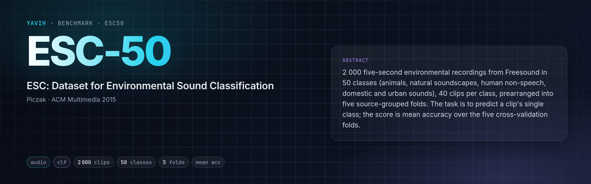
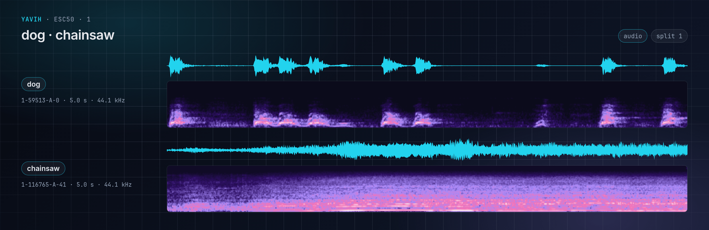

[Paper](https://dl.acm.org/doi/10.1145/2733373.2806390) · [Homepage](https://github.com/karolpiczak/ESC-50) · [Dataset](https://dx.doi.org/10.7910/DVN/YDEPUT) · [setup.md](setup.md)

<!-- yavih:glance begin (generated from benchmark.yaml: python -m yavih.doctables --glance esc50 --write) -->
| At a glance | ESC-50 |
|---|---|
| **Task** | Sound classification · audio |
| **Modality** | Audio |
| **Size** | 2 000 in folds 1–5 (400 each) · 50 classes |
| **Headline** | Mean accuracy over the folds (`acc_mean`) · chance 2 % |
| **Data** | Public download; fetched unattended · 0.88 GB of media · how: [setup.md](setup.md) |
| **Licence** | CC BY-NC 3.0 for the dataset as a whole; the ESC-10 subset (esc10 == True, 400 clips) CC BY 3.0; per-clip Freesound attributions in the upstream LICENSE file |
| **Protocol** | Version 1 · scorer `clf` · needs yavih >=1.1,<2 · `yavih bench fetch esc50` |
<!-- yavih:glance end -->

## The task

Hear a five-second recording and name the one environmental sound in it: a dog barking, rain, a chainsaw, a
crackling fire, a clock ticking. There are 50 classes in five broad groups (animals; natural soundscapes and water;
human non-speech sounds; domestic sounds; urban noises), and every clip belongs to exactly one.



## The data

ESC-50 (Karol J. Piczak, ACM Multimedia 2015) is 2 000 clips cut from public field recordings on Freesound, 40 per
class, each exactly 5.0 s of 44.1 kHz mono audio. The authors arranged them into five folds of 400 clips, eight per
class per fold, keeping the clips cut from one source recording in one fold where possible, so the standard protocol
is five-fold cross-validation. The dataset is licensed CC BY-NC 3.0 (non-commercial); the 400-clip ESC-10 subset is
CC BY 3.0. It is a public download of 0.88 GB of audio.

## How it is scored

Each fold is held out once: a probe trained on the other four folds names the classes of the held-out 400 clips, and
the score is the accuracy averaged over the five folds. The classes are perfectly balanced, so accuracy is
meaningful and chance is 2 %; the floor, a model that always answers the most frequent training class, is also 2 %.

Not this benchmark: the ESC-10 subset (10 classes, 400 clips) and an accuracy on a single fold are different
numbers, and the upstream numeric class ids follow another order than yavih's class list.

## Reference numbers

The ESC-50 repository lists human listeners at 81.3 % (Piczak 2015), AST at 95.7 % (Gong et al., Interspeech 2021)
and BEATs at 98.1 % (Chen et al., ICML 2023). These models are fine-tuned end to end; a frozen-feature probe is
not comparable with them.

## Citation

```bibtex
@inproceedings{piczak2015dataset,
  title = {{ESC}: {Dataset} for {Environmental Sound Classification}},
  author = {Piczak, Karol J.},
  booktitle = {Proceedings of the 23rd {Annual ACM Conference} on {Multimedia}},
  year = {2015},
  pages = {1015--1018},
  doi = {10.1145/2733373.2806390}
}
```
