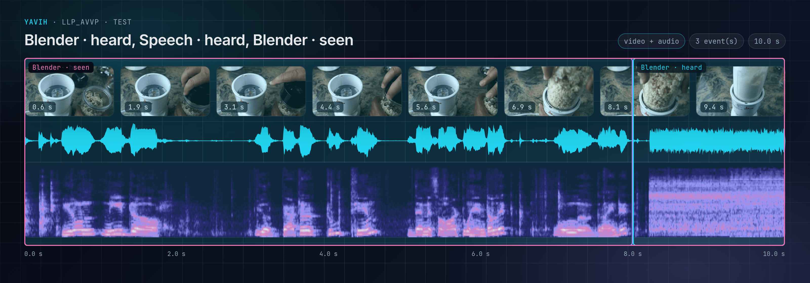

[Paper](https://arxiv.org/abs/2007.10558) · [Homepage](https://github.com/YapengTian/AVVP-ECCV20) · [Dataset](https://huggingface.co/datasets/CserDu123/LLP-dataset) · [Licence](https://www.gnu.org/licenses/gpl-3.0.html) · [setup.md](setup.md)

<!-- yavih:glance begin (generated from benchmark.yaml: python -m yavih.doctables --glance llp_avvp --write) -->
| At a glance | LLP (AVVP) |
|---|---|
| **Task** | A / v / av event parsing, multi-label · audio-visual, temporal |
| **Modality** | Video + audio |
| **Size** | 10 000 train / 649 val / 1 200 test · 25 classes |
| **Headline** | `seg_type_av` |
| **Readings** | Audio · video · audio+video |
| **Data** | Public download; fetched unattended · 14 GB of media · how: [setup.md](setup.md) |
| **Licence** | LLP annotations and code (YapengTian/AVVP-ECCV20): GNU GPL v3.0, as the repository README states (no LICENSE file in the repository). Media: YouTube videos (AudioSet segments) that stay their uploaders'; the authors distribute none. … |
| **Protocol** | Version 1 · scorer `llp_avvp` (the folder's own) · needs yavih >=1.1,<2 · `yavih bench fetch llp_avvp` |
<!-- yavih:glance end -->

## The task

Watch and listen to a ten-second clip and write down, second by second, which events can be heard and which can be
seen: a man speaks off screen for the first four seconds while a dog is visible and barking throughout. The same
class may be audible without being visible (the speaker), visible without a sound (a parked car), or both at once
(the barking dog, an audio-visual event). There are 25 everyday classes, from speech, singing and musical
instruments to dogs, cars, vacuum cleaners and frying food, and a clip often holds two or three of them.

The catch is the supervision: training clips only say which classes occur somewhere in the clip, not when or in
which modality. A model has to learn from these video-level labels to parse the test clips into audio, visual and
audio-visual events with their seconds.

<!-- once rendered (python -m yavih.previews llp_avvp --chrome <chrome>), un-comment:

-->

## The data

LLP, the Look, Listen and Parse dataset (Tian, Li and Xu, ECCV 2020), is 11 849 ten-second YouTube clips taken from
AudioSet segments of 25 classes. All clips carry the classes they contain; the 1 849 clips of the validation (649)
and test (1 200) splits were further annotated second by second, separately for the audio and the visual track, by
the authors. The remaining 10 000 clips are for training and have only the clip-level labels. The clips themselves
are not distributed by the authors, who publish the annotations and pre-extracted features: the cut clips used here
are a public copy on Hugging Face, H.264 video at their original YouTube resolution and frame rate with stereo or
mono 44.1 kHz audio.

The annotations and the authors' code are released under the GNU GPL v3; the videos remain their YouTube
uploaders', so the benchmark is for research use. Every clip comes from AudioSet, which many audio and audio-visual
models are pretrained on.

## How it is scored

Each test clip's prediction is a 25 × 10 grid per modality: which classes are heard, and which are seen, in each
second. It is compared with the annotation by the authors' own F-scores, computed per clip and averaged over clips:
segment-level F-scores count the matching (class, second) cells, event-level F-scores count events (runs of
consecutive seconds) that overlap an annotated event with an IoU of at least 0.5. Each comes for audio events,
visual events and audio-visual events (both at once). The headline, Type@AV, averages the audio, visual and
audio-visual segment-level F-scores, the criterion the authors select their model on; Event@AV pools the audio and
visual events of a clip instead. A clip with nothing annotated and nothing predicted in a modality counts as a
perfect score, so the floor, a model that predicts nothing, is not zero.

The features are frozen: the authors' parsing network, the Hybrid Attention Network with multimodal
multiple-instance pooling, is trained on top of them with their recipe and the video-level labels only, and the
epoch with the best validation Type@AV is kept. The scoring is the authors' implementation
([AVVP-ECCV20](https://github.com/YapengTian/AVVP-ECCV20)), copied into the folder.

Not this benchmark: numbers on the validation split; models fine-tuned end to end or trained with more than the
video-level labels (the dense validation labels, modality-aware pseudo-labels from other models); and audio-visual
event localization on AVE (one event per clip, also by Tian et al.).

## Reference numbers

The authors report, on the test split with their HAN model trained on frozen VGGish, ResNet-152 and R(2+1)D-18
features: segment-level F-scores of 60.1 (audio), 52.9 (visual), 48.9 (audio-visual), 54.0 (Type@AV) and 55.4
(Event@AV); event-level 51.3, 48.9, 43.0, 47.7 and 48.0 (Tian et al. 2020, Table 1). Those numbers come from the same
readout and recipe on their own features; a bridge changes only the features, so they are the closest published
point of comparison, not the same experiment.

## Citation

```bibtex
@inproceedings{tian2020avvp,
  title = {Unified Multisensory Perception: Weakly-Supervised Audio-Visual Video Parsing},
  author = {Tian, Yapeng and Li, Dingzeyu and Xu, Chenliang},
  booktitle = {Proceedings of the European Conference on Computer Vision (ECCV)},
  year = {2020}
}
```
