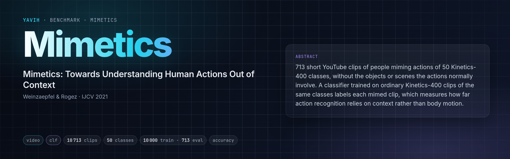
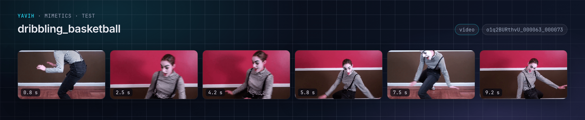
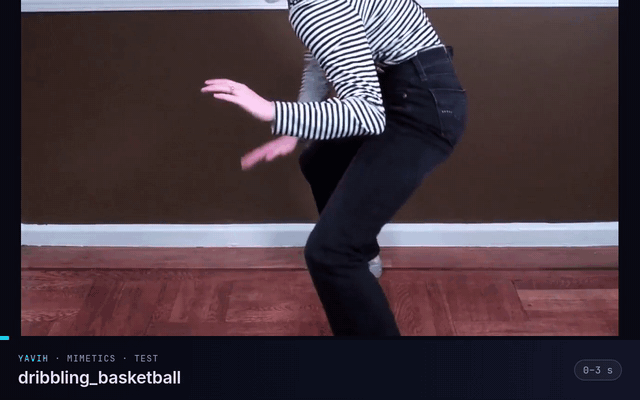

[Paper](https://arxiv.org/abs/1912.07249) · [Homepage](https://europe.naverlabs.com/research/computer-vision/mimetics/) · [Dataset](https://europe.naverlabs.com/wp-content/uploads/2019/12/Mimetics_release_v1.0.zip) · [setup.md](setup.md)

<!-- yavih:glance begin (generated from benchmark.yaml: python -m yavih.doctables --glance mimetics --write) -->
| At a glance | Mimetics |
|---|---|
| **Task** | 50-way action classification · visual |
| **Modality** | Video |
| **Size** | 10 000 train / 713 test · 50 classes |
| **Headline** | Accuracy (`acc`) · chance 2 % |
| **Data** | Public download; fetched unattended · 5.6 GB of media · how: [setup.md](setup.md) |
| **Licence** | Mimetics v1.0 (NAVER LABS Europe): the release (README, page) states no licence and asks to cite the paper. The Mimetics media are YouTube videos the user downloads and trims, subject to YouTube's terms and the uploaders' rights. … |
| **Protocol** | Version 1 · scorer `clf` · needs yavih >=1.1,<2 · `yavih bench fetch mimetics` |
<!-- yavih:glance end -->

## The task

Watch a short clip of someone miming an everyday or sporting action, with no guitar, no bow, no basketball and
often no court or stage, and name the action: `playing guitar`, `archery`, `dribbling basketball`, `brushing teeth`.
The 50 answers are Kinetics-400 classes, and the classifier is trained on ordinary Kinetics-400 clips of those
classes, where the object and the scene are in view. A model that recognises actions from the body's motion keeps
much of its accuracy on the mimed clips; one that recognises the guitar or the court loses it.



 · [mp4](assets/clip.mp4)

## The data

Mimetics (Philippe Weinzaepfel and Grégory Rogez, NAVER LABS Europe; IJCV 2021) is 713 clips of mimed actions cut
from 560 YouTube videos: mime artists, actors, people imitating sports or instruments, 8 to 27 clips per class. The
release is a list of YouTube ids with start and end seconds in the Kinetics format; each clip lasts 1 to 10 s and is
downloaded and trimmed by the user. The release also flags, per clip, whether a relevant object or scene is visible
and whether the actor is a mime artist. It is a test set only: there is no Mimetics training data. YouTube videos
disappear, so a copy made today holds fewer than 713 clips.

The training side is the 50 matching classes of Kinetics-400, read from the same Academic-Torrents release the
`k400` benchmark uses: a fixed draw of 200 clips per class, 10 000 in all. The Mimetics release states no licence
(the authors ask to be cited); the media are YouTube videos, subject to YouTube's terms. The Kinetics-400 annotations
are CC BY 4.0.

## How it is scored

A probe trained on frozen features of the Kinetics-400 clips names each Mimetics clip's class among the 50, and the
headline is top-1 accuracy over all scored clips, as the IntegralAction implementation
([mks0601/IntegralAction_RELEASE](https://github.com/mks0601/IntegralAction_RELEASE)) computes it; no evaluation code
was released with the dataset. Top-5 accuracy is reported next to it, and so are the paper's class-averaged
metrics: mean per-class top-1 and top-5, and its mAP, the inverse rank of the true class averaged per class. Chance
is 2 % top-1 among 50 classes; the floor, always answering the most frequent training class, is near 3 %, since the
training draw is balanced.

Not this benchmark: the paper's main table trains on all 400 Kinetics classes and ranks all 400 at test time,
which gives much lower numbers than a 50-way classifier; accuracy on Kinetics-400 itself is the `k400` benchmark.

## Reference numbers

With a classifier trained on the Kinetics-400 clips of the 50 Mimetics classes, the paper's pose-based SIP-Net
reaches 25.1 % mean top-1, 51.4 % mean top-5 and 38.3 % mAP (its Table 9), and IntegralAction (RGB and pose)
26.5 % top-1 and 50.5 % top-5 over 596 clips (its repository's README). Trained on all 400 classes, the paper's RGB
3D-ResNeXt-101 reaches 8.6 % mean top-1 (Table 6). These models are trained end to end and average several views
per clip, on whichever clips their authors could still download; a frozen-feature probe is not directly comparable.

## Citation

```bibtex
@article{weinzaepfel2021mimetics,
  title = {Mimetics: Towards Understanding Human Actions Out of Context},
  author = {Weinzaepfel, Philippe and Rogez, Gr{\'e}gory},
  journal = {International Journal of Computer Vision},
  volume = {129},
  pages = {1675--1690},
  year = {2021},
  doi = {10.1007/s11263-021-01446-y}
}

@inproceedings{moon2021integralaction,
  title = {IntegralAction: Pose-driven Feature Integration for Robust Human Action Recognition in Videos},
  author = {Moon, Gyeongsik and Kwon, Heeseung and Lee, Kyoung Mu and Cho, Minsu},
  booktitle = {Proceedings of the IEEE/CVF Conference on Computer Vision and Pattern Recognition Workshops},
  year = {2021}
}
```
