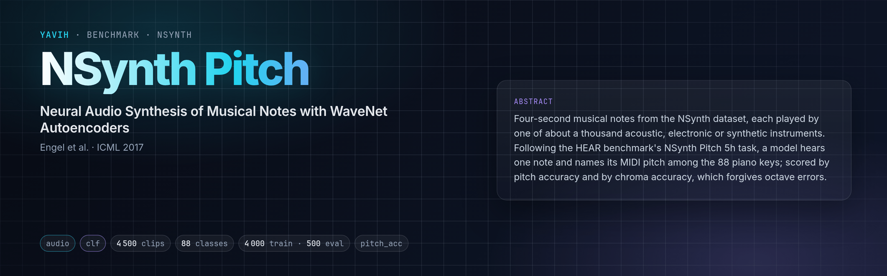
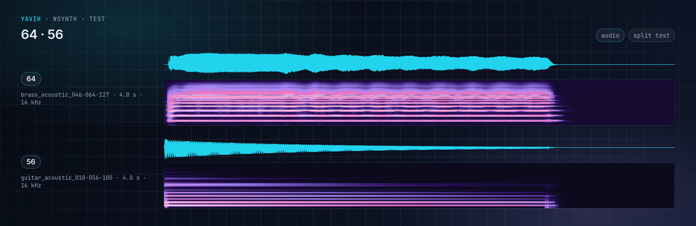

[Paper](https://proceedings.mlr.press/v70/engel17a.html) · [Homepage](https://magenta.tensorflow.org/datasets/nsynth) · [HEAR task](https://hearbenchmark.com/hear-tasks.html) · [Licence](https://creativecommons.org/licenses/by/4.0/) · [setup.md](setup.md)

<!-- yavih:glance begin (generated from benchmark.yaml: python -m yavih.doctables --glance nsynth --write) -->
| At a glance | NSynth Pitch |
|---|---|
| **Task** | Sound classification · audio |
| **Modality** | Audio |
| **Size** | 4 000 train / 500 test · 88 classes |
| **Headline** | `pitch_acc` · chance 1.1 % |
| **Data** | Public download; fetched unattended · 0.64 GB of media · how: [setup.md](setup.md) |
| **Licence** | CC BY 4.0 (NSynth, Google Magenta) |
| **Protocol** | Version 1 · scorer `clf` · needs yavih >=1.1,<2 · `yavih bench fetch nsynth` |
<!-- yavih:glance end -->

## The task

Hear one musical note, four seconds long, and name its pitch: one of the 88 keys of a piano, from A0 (MIDI 21) to
C8 (MIDI 108). The note may come from a grand piano, a plucked bass, a flute, a synthesizer lead or an organ, played
softly or hard, and it may fade out long before the four seconds end. A model answers `60` for middle C,
`69` for the A above it.



## The data

NSynth (Engel et al., ICML 2017, Google Magenta) is 305 979 notes rendered from about a thousand commercial sample
libraries: every pitch of each instrument's range at five velocities, each note held for three seconds and recorded
for four, as 16 kHz mono audio. Each note is labelled with its instrument, its family (bass, brass, flute, guitar,
keyboard, mallet, organ, reed, string, synth lead, vocal), its source (acoustic, electronic, synthetic), its MIDI
pitch and velocity. The official training split shares no instrument with the validation and test splits, which
are two disjoint sets of notes from the same 53 instruments.

This benchmark is the NSynth Pitch task of the HEAR benchmark (Turian et al., NeurIPS 2021 competition track) in
its five-hour form: of the notes with a piano-range pitch, HEAR draws 4 000 training, 500 validation and 500 test
notes with a fixed seed, every one of the 88 pitches present in each split. The dataset is licensed CC BY 4.0 and
is a public download (25 GB of archives, of which this benchmark keeps 0.64 GB).

## How it is scored

A probe trained on the frozen features of the 4 000 training notes names the pitch of each of the 500 test notes,
played by instruments it has never heard. The headline is pitch accuracy, the share of test notes whose pitch is
named exactly; HEAR's second score, chroma accuracy, also counts an answer one or more octaves off as correct (C4
for C5). Both are computed by the score functions of HEAR's evaluation kit
([hear-eval-kit](https://github.com/hearbenchmark/hear-eval-kit)), and the 5 000 notes are drawn by HEAR's own
preprocessing code ([hear-preprocess](https://github.com/hearbenchmark/hear-preprocess)). Chance is about 1.1 % for
pitch and 8.3 % for chroma; the floor, a model that always answers the most frequent training pitch, is close to
chance, since the pitches are spread almost evenly. The 500 validation notes are not used: they come from the test
instruments, and HEAR uses them only to pick its classifier's settings.

Not this benchmark: HEAR's 50-hour NSynth Pitch (40 000 training notes, the whole test set), NSynth instrument
family or source classification, and numbers from HEAR's own evaluation kit, which trains a small MLP on one
embedding per clip and picks its settings on the validation notes; yavih trains its fixed probe instead.

## Citation

```bibtex
@inproceedings{engel2017neural,
  title     = {Neural Audio Synthesis of Musical Notes with {WaveNet} Autoencoders},
  author    = {Engel, Jesse and Resnick, Cinjon and Roberts, Adam and Dieleman, Sander and Norouzi, Mohammad and
               Eck, Douglas and Simonyan, Karen},
  booktitle = {Proceedings of the 34th International Conference on Machine Learning},
  series    = {Proceedings of Machine Learning Research},
  volume    = {70},
  pages     = {1068--1077},
  year      = {2017}
}

@inproceedings{turian2022hear,
  title     = {{HEAR}: Holistic Evaluation of Audio Representations},
  author    = {Turian, Joseph and Shier, Jordie and Khan, Humair Raj and Raj, Bhiksha and Schuller, Bj{\"o}rn W. and
               Steinmetz, Christian J. and Malloy, Colin and Tzanetakis, George and Velarde, Gissel and McNally, Kirk and
               Henry, Max and Pinto, Nicolas and Noufi, Camille and Clough, Christian and Herremans, Dorien and
               Fonseca, Eduardo and Engel, Jesse and Salamon, Justin and Esling, Philippe and Manocha, Pranay and
               Watanabe, Shinji and Jin, Zeyu and Bisk, Yonatan},
  booktitle = {Proceedings of the NeurIPS 2021 Competitions and Demonstrations Track},
  series    = {Proceedings of Machine Learning Research},
  volume    = {176},
  pages     = {125--145},
  year      = {2022}
}
```
