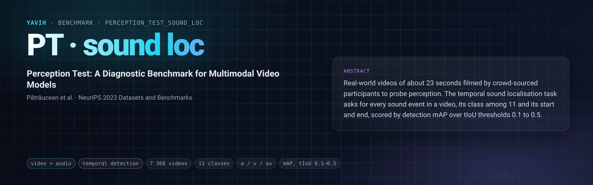

[Paper](https://arxiv.org/abs/2305.13786) · [Homepage](https://github.com/google-deepmind/perception_test) · [Dataset](https://github.com/google-deepmind/perception_test#download-the-data-and-annotations) · [setup.md](setup.md)

## Description

The Perception Test (Pătrăucean et al., NeurIPS 2023 Datasets and Benchmarks) is a diagnostic benchmark of 11.6 k
real-world videos (about 23 s each, 6.7 to 36 s) filmed by crowd-sourced participants to show perceptually
interesting situations, annotated for six tasks. In the temporal sound localisation task a model receives a video
and must localise and classify every sound event in it: each event is a class among a fixed vocabulary plus its
start and end time. The yearly Perception Test challenge (eval.ai) uses 11 sound classes (human speech,
animal sound, animal walking, clapping, fluid, dropping, hitting, rolling, breaking, opening/closing, object sound),
trains on 2 009 videos and evaluates on a 5 359-video validation split (public labels) and a held-out test split
(hidden labels). The metric is detection mean average precision averaged over temporal IoU thresholds 0.1, 0.2,
0.3, 0.4 and 0.5 (the official ActionFormer baseline's `ANETdetection`). The data is CC-BY 4.0.

## Citation

```bibtex
@inproceedings{patraucean2023perception,
  title     = {Perception Test: A Diagnostic Benchmark for Multimodal Video Models},
  author    = {P{\u{a}}tr{\u{a}}ucean, Viorica and Smaira, Lucas and Gupta, Ankush and Recasens Continente, Adri{\`a} and
               Markeeva, Larisa and Banarse, Dylan and Koppula, Skanda and Heyward, Joseph and Malinowski, Mateusz and
               Yang, Yi and Doersch, Carl and Matejovicova, Tatiana and Sulsky, Yury and Miech, Antoine and
               Fr{\'e}chette, Alex and Klimczak, Hanna and Koster, Raphael and Zhang, Junlin and Winkler, Stephanie and
               Aytar, Yusuf and Osindero, Simon and Damen, Dima and Zisserman, Andrew and Carreira, Jo{\~a}o},
  booktitle = {Advances in Neural Information Processing Systems (Datasets and Benchmarks Track)},
  year      = {2023},
  url       = {https://openreview.net/forum?id=HYEGXFnPoq}
}
```

## In yavih

### Protocol

Scorer `perception_test_sound_loc`, the folder's own temporal-detection scorer (`eval.py` and `detection.py`; `yavih bench info perception_test_sound_loc`
names it on its `extends:` line), `T = 128`: the probe reads frozen tokens that carry a time coordinate, places
each at its absolute second relative to the clip's annotated duration, and predicts on 128 bins over the clip which
of the 11 classes is active and, per bin, the distance to the event's start and end; trained with a sigmoid focal plus a 1-D GIoU loss; the decoded
segments are scored like the challenge. `protocol_version: 1`.

| split value | role | rows (videos) | events | notes |
|---|---|---|---|---|
| `train` | train | 2 009 | 13 289 | `challenge_sound_localisation_train_annotations.zip`, every video; the probe carves its validation split from it |
| `valid` | eval | 5 359 | 35 625 | `challenge_sound_localisation_valid_annotations.zip` = `localisation_challenge_valid_id_list.csv`; 10 of the 11 classes occur (no `Animal:walking`) |

One row per video; nothing excluded or capped. The challenge test split (3 233 videos) has hidden labels and is not
in the manifest.

Headline **`tmap`** = the challenge metric: per class present in the eval ground truth, the detection AP at a tIoU
threshold (predictions sorted by score, greedy one-to-one matching inside each video, VOC-2011 interpolated
precision), averaged over classes and over the thresholds 0.1 to 0.5 (`protocol.tiou_thresholds`); `tmap_per_tiou`
lists the five. It is a transcription of `ANETdetection` from the baseline repository
(github.com/ptchallenge-workshop/actionformer_release_PT at `10684a4`, `libs/utils/metrics.py`), which is not
pip-installable; one documented difference: a prediction of a class absent from the eval ground truth is dropped,
where the reference would alias it onto another class through `DataFrame.replace`. Floor **`tmap_floor` = 0.023**
(per bin and class, the train frequency of that class at that relative time with the median train extents, decoded
and scored the same way). Clip-bootstrap 95 % interval for `tmap` (1 000 resamples, seed 0). Disclosures:
`n_events` (35 625), `n_eval`. No chance value, no controls. The pinned decoding (threshold 0.001, top 2 000
candidates, class-wise NMS at tIoU 0.5, 100 segments per clip) reaches `tmap` = 0.82, not 1.0, when fed the eval
targets themselves: one regression per bin cannot separate overlapping or abutting events of one class
(`Interaction:hitting` alone has 19 104 eval events). Read numbers against that ceiling.

The bridge gets two streams: `video`, the stored mp4 (H.264 up to 1920x1080, ~30 fps, with an AAC track), and
`audio`, the official 32-bit PCM wav (44.1 or 48 kHz, mono or stereo); frames, windows, crop and audio front end are the bridge's. It
returns a fixed `[N, D]` per clip with `pos.t` in media coordinates; tokens tagged `audio` with `t` are required
(`requires.streams: [audio]`), so the readings are `a` (headline, like the official audio baseline) and `av`; a
video-only reading is not applicable. Details: [setup.md](setup.md).

### Variants and aliases

No aliases. Sibling benchmark: `perception_test_action_loc` (the same videos, temporal action localisation, 63
classes). Not this benchmark: the README's non-challenge `sound_localisation_train_annotations.zip` (2 149 videos,
17 classes including `Other`, `Muted` and background sounds), the hidden-label test split (eval.ai), and numbers
from models fine-tuned on the task.

### Reference numbers

None quoted: the published baselines (ActionFormer on MMV audio features, and the challenge entries) train a
detector end to end on top of pre-extracted features, not a pinned frozen probe, so they are not comparable to a
yavih number.

### Re-freezing the manifest

`python "$(yavih bench path perception_test_sound_loc)/make_manifest.py" --check` re-derives `manifest.csv.gz`
and `classes.csv` from the two public annotation zips (sha256-pinned; `yavih bench prepare
perception_test_sound_loc 01` puts them under `<media_root>/annotations`) and prints the `manifest.upstream` block.
`tests/test_folder.py` re-checks the derivation on a stand-in rebuilt from the committed manifest, the curation
sums, the events cells and the reader on synthetic media.
