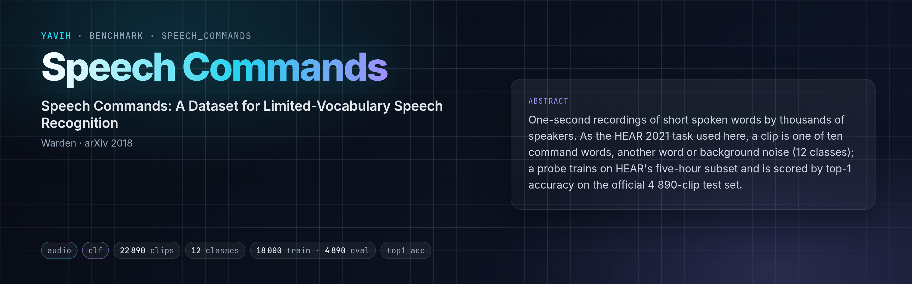
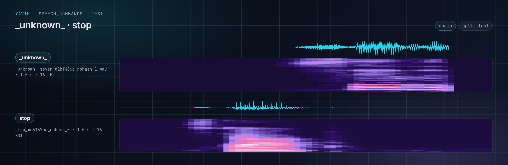

[Paper](https://arxiv.org/abs/1804.03209) · [HEAR](https://hearbenchmark.com) · [Dataset](http://download.tensorflow.org/data/speech_commands_v0.02.tar.gz) · [Licence](https://creativecommons.org/licenses/by/4.0/) · [setup.md](setup.md)

<!-- yavih:glance begin (generated from benchmark.yaml: python -m yavih.doctables --glance speech_commands --write) -->
| At a glance | Speech Commands |
|---|---|
| **Task** | Sound classification · audio |
| **Modality** | Audio |
| **Size** | 16 000 train / 2 000 valid / 4 890 test · 12 classes |
| **Headline** | `top1_acc` · chance 8.3 % |
| **Data** | Public download; fetched unattended · 0.72 GB of media · how: [setup.md](setup.md) |
| **Licence** | CC BY 4.0 (Speech Commands v0.02, Google; the archives' LICENSE file) |
| **Protocol** | Version 1 · scorer `clf` · needs yavih >=1.1,<2 · `yavih bench fetch speech_commands` |
<!-- yavih:glance end -->

## The task

Hear one second of audio and say which of twelve answers it is: one of ten short commands ("yes", "no", "up",
"down", "left", "right", "on", "off", "stop", "go"), some other word ("bird", "sheila", "seven", … all folded
into `_unknown_`), or no speech at all (`_silence_`, background noise such as running water or a dishwasher).
This is the keyword-spotting task a voice interface runs on device, in the form the HEAR 2021 benchmark of
audio representations evaluates it.



## The data

Speech Commands v0.02 (Pete Warden, Google, 2018) is 105 829 one-second recordings of 35 words, spoken by 2 618
volunteers through their own browsers and microphones, so the audio quality varies; each clip is 16 kHz mono and
at most one second long. Six longer background recordings come with it. A separate test archive of 4 890 clips
holds the ten commands, unknown words and silence in near-equal parts (about 408 each), from speakers never
heard in training.

HEAR (Turian et al., 2022) builds its task from these two archives: the test archive is the test set; the
release's validation list plus silence cut from one background recording is the validation split; everything
else, plus silence cut from the other five recordings, is the training split. Its "5 hour" variant, used here,
keeps a fixed random 16 000 training and 2 000 validation clips (five hours together). The recordings are
licensed CC BY 4.0 and are a public download of 2.5 GB.

## How it is scored

A probe trained on HEAR's five hours of clips names the class of each of the 4 890 test clips, and the score
is top-1 accuracy, computed by HEAR's own scorer (`Top1Accuracy` from
[hear-eval-kit](https://github.com/hearbenchmark/hear-eval-kit), copied into this folder). The test set is
balanced over the twelve classes, so accuracy is meaningful and chance is one in twelve (8.3 %); the floor, a
model that always answers the most frequent training class (`_unknown_`, 63 % of the training clips), also
scores 8.3 % on the balanced test set.

yavih scores frozen features with its own attentive probe, whereas HEAR trains a small grid-searched MLP on one
embedding per clip, so numbers from the HEAR leaderboard are not these numbers. Not this benchmark either: HEAR's
"full" variant (all 95 613 training and validation clips), the 35-word classification task, and Speech Commands
v0.01 (30 words); each gives different numbers.

## Citation

```bibtex
@article{warden2018speech,
  title   = {Speech Commands: A Dataset for Limited-Vocabulary Speech Recognition},
  author  = {Warden, Pete},
  journal = {arXiv preprint arXiv:1804.03209},
  year    = {2018}
}

@inproceedings{turian2022hear,
  title     = {{HEAR}: Holistic Evaluation of Audio Representations},
  author    = {Turian, Joseph and Shier, Jordie and Khan, Humair Raj and Raj, Bhiksha and Schuller, Bj{\"o}rn W. and
               Steinmetz, Christian J. and Malloy, Colin and Tzanetakis, George and Velarde, Gissel and McNally, Kirk and
               Henry, Max and Pinto, Nicolas and Noufi, Camille and Clough, Christian and Herremans, Dorien and
               Fonseca, Eduardo and Engel, Jesse and Salamon, Justin and Esling, Philippe and Manocha, Pranay and
               Watanabe, Shinji and Jin, Zeyu and Bisk, Yonatan},
  booktitle = {Proceedings of the NeurIPS 2021 Competitions and Demonstrations Track},
  series    = {Proceedings of Machine Learning Research},
  volume    = {176},
  pages     = {125--145},
  year      = {2022}
}
```
