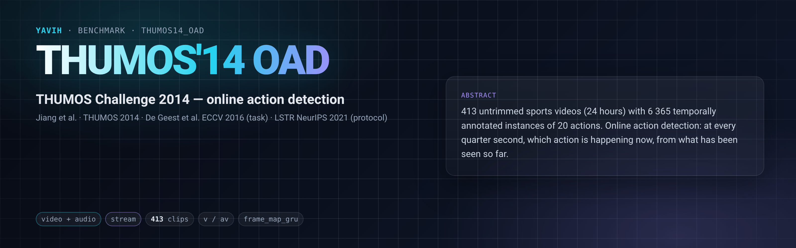

[Challenge](https://www.crcv.ucf.edu/THUMOS14/) · [Online action detection](https://arxiv.org/abs/1604.06506) · [LSTR](https://arxiv.org/abs/2107.03377) · [setup.md](setup.md)

## Description

THUMOS'14 (Jiang et al., 2014) gives temporal annotations for 20 sports actions in 200 validation and 213 test
videos, untrimmed, with long background between instances. Online action detection (De Geest et al., ECCV 2016) asks at
every moment which action is happening now, from the frames seen so far. The established protocol (LSTR, Xu et al.,
NeurIPS 2021, and its successors) trains on the 200 validation videos, evaluates on the 213 test videos, and scores
per-frame mean average precision on a 4 fps grid (6-frame chunks at 24 fps), ambiguous frames removed. This folder
keeps that protocol and its evaluator and runs it on the stream: every quarter second is scored from the prediction
available at its end.

## Citation

```bibtex
@misc{jiang2014thumos,
  title        = {THUMOS Challenge: Action Recognition with a Large Number of Classes},
  author       = {Jiang, Yu-Gang and Liu, Jingen and Roshan Zamir, Amir and Toderici, George and Laptev, Ivan and Shah, Mubarak and Sukthankar, Rahul},
  howpublished = {\url{http://crcv.ucf.edu/THUMOS14/}},
  year         = {2014}
}
@inproceedings{degeest2016online,
  title     = {Online Action Detection},
  author    = {De Geest, Roeland and Gavves, Efstratios and Ghodrati, Amir and Li, Zhenyang and Snoek, Cees and Tuytelaars, Tinne},
  booktitle = {European Conference on Computer Vision (ECCV)},
  year      = {2016}
}
```

## In yavih

### Protocol

`scorer: stream`, `protocol_version: 1`. One row per video an official temporal annotation file names.

| split value | role | videos | hours | notes |
|---|---|---|---|---|
| `validation` | train | 200 | 11.6 | the stream scorer carves its validation recordings from these |
| `test` | eval | 213 | 12.8 | one video holds only an Ambiguous segment |

The bridge returns each video's update sequence, one update every 0.25 s ([streaming](https://github.com/Bizilizi/yavih/blob/main/docs/streaming.md)). Chunk `k` covers
`[k / 4, (k + 1) / 4)` and is scored at its end from the latest prediction available then; its ground truth is the
multi-hot of the classes covering its centre over 22 columns (background, the 20 actions, Ambiguous: LSTR's order). The
`stream` scorer trains a linear head and a causal GRU per seed on 21 classes (background and the 20 actions;
ambiguous chunks are not trained on).

Headline **`frame_map_gru`**: LSTR's `perframe_average_precision` with its THUMOS post-processing (ambiguous chunks
removed, AP per class over every remaining chunk of every test video, background and Ambiguous columns skipped,
classes without a positive left out; no smoothing, no class switch), for the causal GRU head; `frame_map_linear` for
the linear head; bootstrap intervals over test videos (2 000 resamples, seed 0). Floor `frame_map_floor`: the train
class frequencies on every chunk. These numbers are RGB (or audio-visual) results from a frozen encoder: they are not
comparable with published RGB plus optical flow results, which also fine-tune or use dedicated features.

### Variants and aliases

No aliases. Bridge readings: `v`, `av` (the videos carry audio), `v-rt`, `av-rt` (real time, one row per device).

### Reference numbers

None quoted (see above: published numbers combine RGB and optical flow features from fine-tuned two-stream networks).

### Re-freezing the manifest

`python "$(yavih bench path thumos14_oad)/make_manifest.py" --root <media_root> --check` re-derives `manifest.csv.gz`
from the official annotation files and the video headers and compares byte for byte; without `--check` it rewrites it
(gzip `mtime=0`). Folder tests: `pytest "$(yavih bench path thumos14_oad)/tests"`.
