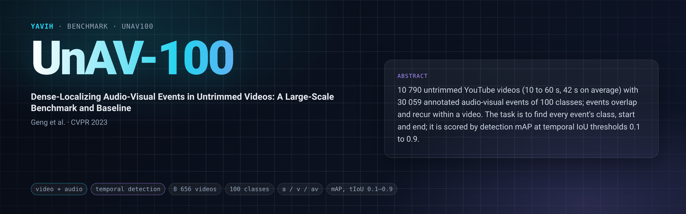

[Paper](https://openaccess.thecvf.com/content/CVPR2023/html/Geng_Dense-Localizing_Audio-Visual_Events_in_Untrimmed_Videos_A_Large-Scale_Benchmark_and_CVPR_2023_paper.html) · [Homepage](https://unav100.github.io/) · [Dataset](https://huggingface.co/datasets/ttgeng233/UnAV-100) · [Code](https://github.com/ttgeng233/UnAV) · [setup.md](setup.md)

## Description

UnAV-100 (Untrimmed Audio-Visual) is a benchmark for dense-localizing audio-visual events: given an untrimmed video,
find every event that is both visible and audible, with its class and its start and end. It holds 10 790 YouTube
videos (selected from VGGSound's source videos; 10 to 60 s, 42.1 s on average, over 126 hours) with 30 059 events of
100 classes covering human activities, music, animals, vehicles, tools and natural sounds. A video has 2.8 events on
average (up to 23); about 60 % of the videos hold more than one event and about 25 % hold events that co-occur.
The official split is 3:1:1 (multi-label stratified): train 6 489 videos / 18 123 events, validation 2 134 / 6 036,
test 2 167 / 5 900. The metric is mean Average Precision of the detected segments at temporal IoU thresholds; the
paper reports mAP at tIoU 0.5, 0.6, 0.7, 0.8, 0.9 and the average mAP over 0.1:0.1:0.9, on the test set, with the
model selected on the validation set.

## Citation

```bibtex
@inproceedings{geng2023dense,
  title     = {Dense-Localizing Audio-Visual Events in Untrimmed Videos: A Large-Scale Benchmark and Baseline},
  author    = {Geng, Tiantian and Wang, Teng and Duan, Jinming and Cong, Runmin and Zheng, Feng},
  booktitle = {Proceedings of the IEEE/CVF Conference on Computer Vision and Pattern Recognition (CVPR)},
  pages     = {22942--22951},
  year      = {2023}
}
```

## In yavih

Scorer `unav100`, the folder's own temporal-detection scorer (`eval.py` and `detection.py`; `yavih bench info unav100`
names it on its `extends:` line): a dense query head (`dense_query_v1`) with `T = 128` time queries tiling the annotated duration reads the frozen tokens at the
fraction of the clip they lie at and predicts, per bin, `C` class logits and the distances to the segment start and
end (sigmoid focal loss plus a 1-D GIoU loss); a pinned decoder (score threshold, top 2 000, per-class NMS at tIoU 0.5,
100 segments per clip) turns the outputs into scored segments, which are scored with the authors' detection mAP (transcribed from
`ttgeng233/UnAV@1609deba` `libs/utils/metrics.py`, with their `np.linspace(0.1, 0.9, 9)` thresholds).

- Splits and roles: train on `train` (6 489 videos; the probe's validation carve is a seeded 10 % of it), score
  `test` (2 167 videos, 5 900 events); the official `validation` split (2 134 videos) is `unused`. No train draw:
  every video is used.
- Headline `map_avg`: the detection mAP averaged over tIoU 0.1, 0.2, …, 0.9 (the paper's "Avg."), with a
  clip-bootstrap 95 % interval; also `map@0.5` and `map_tiou` (one value per threshold: the paper's 0.5–0.9 columns
  are its last five), `n_events` (5 900) and `n_eval`. Floor `map_avg_floor`: per bin the train frequency of each class and
  the median train extents, as a constant prediction for every clip, decoded and scored the same way. No chance value (detection mAP has none).
- `protocol_version` 1.
- The bridge gets the stored mp4 (video and audio tracks of one tar member) and returns a fixed `[N, D]` token set
  with `pos.t` in media coordinates; audio-only, visual-only and audio-visual readings are all eligible. See
  [setup.md](setup.md).

Deviations from the paper's protocol, each forced by the frozen-feature setting: the detector is yavih's pinned
probe, not the paper's trained pyramid transformer with NMS; model selection uses the probe's 10 % carve of train
instead of the official validation split. The scorer, the test split and the thresholds are the authors'.

Every UnAV-100 video is a VGGSound video (its full source YouTube video): of the 2 167 test videos, 1 661 are in
VGGSound train and 506 in VGGSound test (train: 5 028 / 1 461), checked against VGGSound's `vggsound.csv`. A model
pretrained on VGGSound has seen 10 s of most test videos; the official splits are kept (filtering would remove three
quarters of the test set) and the overlap must be disclosed with any number.
No aliases; there is no other variant.

Reference numbers: the paper's model (I3D RGB+flow and VGGish features, trained end to end) reaches on the test set
mAP 50.6 / 45.8 / 39.8 / 32.4 / 21.1 at tIoU 0.5 / 0.6 / 0.7 / 0.8 / 0.9 and 47.8 average (Geng et al., 2023,
Table 2). A frozen-feature probe is a different setting: these numbers are context, not a target.

Re-freezing the manifest: `make_manifest.py` re-derives `manifest.csv.gz` and `classes.csv` byte-identically from
the HF parquets at revision `daeb88bc` (needs `pyarrow`) or from the authors' `unav100_annotations.json` (same
bytes); `--check` compares without writing, and `tests/test_folder.py` re-derives them from rows rebuilt from the
committed manifest.
