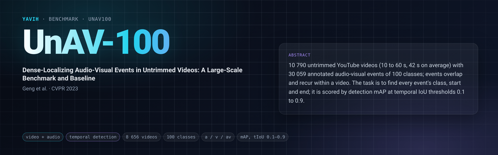
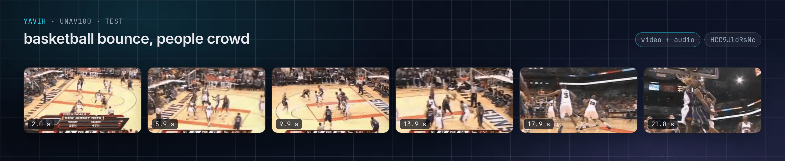
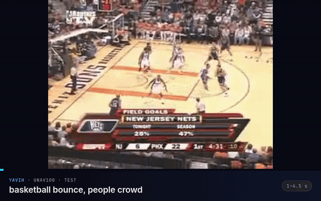

[Paper](https://openaccess.thecvf.com/content/CVPR2023/html/Geng_Dense-Localizing_Audio-Visual_Events_in_Untrimmed_Videos_A_Large-Scale_Benchmark_and_CVPR_2023_paper.html) · [Homepage](https://unav100.github.io/) · [Dataset](https://huggingface.co/datasets/ttgeng233/UnAV-100) · [Code](https://github.com/ttgeng233/UnAV) · [Licence](https://creativecommons.org/licenses/by-nc-sa/4.0/) · [setup.md](setup.md)

<!-- yavih:glance begin (generated from benchmark.yaml: python -m yavih.doctables --glance unav100 --write) -->
| At a glance | UnAV-100 |
|---|---|
| **Task** | Temporal detection, multi-label · audio-visual, temporal |
| **Modality** | Video + audio |
| **Size** | 6 489 train / 2 167 test · 100 classes |
| **Headline** | mAP averaged over tIoU thresholds (`map_avg`) |
| **Readings** | Audio · video · audio+video |
| **Data** | Public download; fetched unattended · 53 GB of media · how: [setup.md](setup.md) |
| **Licence** | The HF dataset card (ttgeng233/UnAV-100) declares CC BY-NC-SA 4.0 (non-commercial, share-alike); the project page shows a CC BY 4.0 badge; the code repository is MIT. The media are YouTube videos (VGGSound sources) subject to YouTube's … |
| **Protocol** | Version 1 · scorer `unav100` (the folder's own) · needs yavih >=1.1,<2 · `yavih bench fetch unav100` |
<!-- yavih:glance end -->

## The task

Watch and listen to an untrimmed video, ten seconds to a minute long, and find every event that is both visible and
audible: its class, where it starts and where it ends. Events of one video overlap and recur. In a 24-second clip of
a basketball game, the crowd is heard from the start to 17 s while the ball bounces from 0 to 6 s and again from 9
to 15 s; a model has to report all three segments, each with its own boundaries.



 · [mp4](assets/clip.mp4)

## The data

UnAV-100 (Geng et al., CVPR 2023) is 10 790 YouTube videos taken from the source videos of VGGSound, 10 to 60 s long
and 42 s on average, over 126 hours in total. Annotators marked 30 059 audio-visual events of 100 classes covering
human activities, music, animals, vehicles, tools and natural sounds. A video holds 2.8 events on average and up to
23; about 60 % of the videos hold more than one event and about 25 % hold events that happen at the same time.

The authors split the videos 3:1:1 with multi-label stratification: 6 489 videos for training, 2 134 for validation
and 2 167 (5 900 events) for test; numbers are reported on the test set. The annotations and the videos are a
public, ungated download from the authors' Hugging Face dataset (about 66 GB). The dataset card declares CC BY-NC-SA
4.0, which forbids commercial use and asks for share-alike, while the project page shows a CC BY 4.0 badge; the
videos themselves remain subject to YouTube's terms.

Every UnAV-100 video is a full VGGSound source video, and about three quarters of the test videos are in VGGSound's
training set. A model pretrained on VGGSound has seen ten seconds of most of them, so that overlap belongs next to
any number.

## How it is scored

Predicted segments are matched to the annotated events of the same class by temporal overlap (tIoU), and average
precision is computed per class and averaged over the classes. The headline averages that mAP again over nine
overlap thresholds, 0.1 to 0.9, which is the paper's "Avg." column; mAP at tIoU 0.5 is reported beside it.
Detection mAP has no chance level. The floor is a constant prediction built from the training labels alone (how
often each class occurs at each point of a clip, and the typical event length), scored the same way.

The score is computed by a transcription of the UnAV-100 authors' own evaluation code,
[`libs/utils/metrics.py` in ttgeng233/UnAV](https://github.com/ttgeng233/UnAV/blob/1609deba/libs/utils/metrics.py),
with their thresholds and their test split. The detector is not the paper's: yavih reads frozen features of the
model under test with a fixed, small temporal detection head trained on the training split.

Not this benchmark: the ActivityNet-style average over tIoU 0.5 to 0.95, a number on the validation split, and
yavih's `unav100_causal`, which uses the same videos for online, second-by-second recognition instead of segment
detection.

## Reference numbers

The paper's model, a pyramid transformer trained end to end on I3D (RGB and optical flow) and VGGish features,
reaches on the test set mAP 50.6 / 45.8 / 39.8 / 32.4 / 21.1 at tIoU 0.5 / 0.6 / 0.7 / 0.8 / 0.9 and 47.8 on
average (Geng et al., 2023, Table 2). A frozen-feature probe is a different setting: these numbers are context, not
a target.

## Citation

```bibtex
@inproceedings{geng2023dense,
  title     = {Dense-Localizing Audio-Visual Events in Untrimmed Videos: A Large-Scale Benchmark and Baseline},
  author    = {Geng, Tiantian and Wang, Teng and Duan, Jinming and Cong, Runmin and Zheng, Feng},
  booktitle = {Proceedings of the IEEE/CVF Conference on Computer Vision and Pattern Recognition (CVPR)},
  pages     = {22942--22951},
  year      = {2023}
}
```
