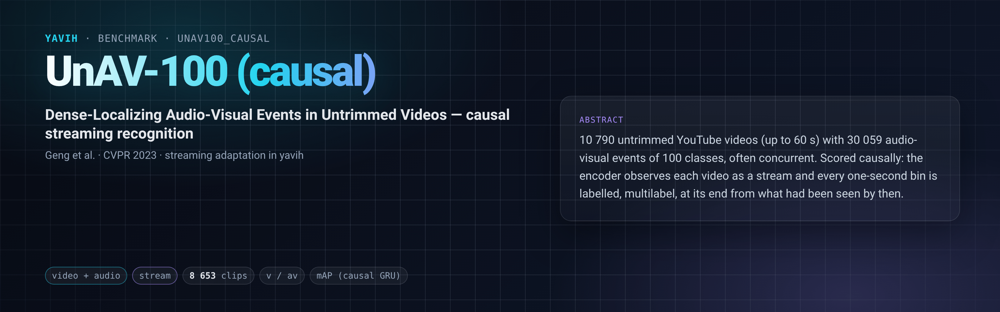

[Paper](https://arxiv.org/abs/2303.12930) · [Homepage](https://unav100.github.io/) · [Dataset](https://huggingface.co/datasets/ttgeng233/UnAV-100) · [Code](https://github.com/ttgeng233/UnAV) · [setup.md](setup.md)

## Description

UnAV-100 (Geng, Wang, Duan, Cong, Zheng; CVPR 2023) has 10 790 untrimmed YouTube videos (VGGSound
sources, trimmed by the authors to at most 60 s) with 30 059 annotated audio-visual events of 100 classes, events that
are both audible and visible, often overlapping in time. Its original task is dense temporal localization, scored by
mAP at temporal IoU thresholds 0.5 to 0.9. This folder is a **causal streaming adaptation** of it,
`unav100_causal_recognition_v1`, not the original protocol: the encoder observes each video as a stream, one update
every 0.5 s, and every one-second bin is labelled, multilabel, at its end from what had been seen by then.

## Citation

```bibtex
@inproceedings{geng2023dense,
  title     = {Dense-Localizing Audio-Visual Events in Untrimmed Videos: A Large-Scale Benchmark and Baseline},
  author    = {Geng, Tiantian and Wang, Teng and Duan, Jinming and Cong, Runmin and Zheng, Feng},
  booktitle = {Proceedings of the IEEE/CVF Conference on Computer Vision and Pattern Recognition (CVPR)},
  year      = {2023}
}
```

## In yavih

### Protocol

`scorer: stream`, `protocol_version: 1`. One row per video, from the annotation parquets of the pinned Hugging Face
revision (identical to the official annotation json).

| split value | role | videos | hours | notes |
|---|---|---|---|---|
| `train` | train | 6 487 | 76.0 | the stream scorer carves its validation recordings from train |
| `validation` | unused | 2 133 | 24.9 | in the manifest, never read |
| `test` | eval | 2 166 | 25.3 | official test minus 1 video (below) |

Excluded at freeze: 4 videos whose file duration differs from the annotated duration by more than 1 s (2 train, 1
validation, 1 test). Durations are the video track's, as yavih's header probe reads them (9.5 to 60.1 s, mean 42 s).

Targets: a video of duration `D` is cut into one-second bins `[b, min(b + 1, D))`; a class is positive in a bin when
the union of its intervals covers at least half the bin's actual length (`protocol.positive_coverage`). A bin is
scored at its end from the latest prediction available then ([streaming](https://github.com/Bizilizi/yavih/blob/main/docs/streaming.md)): the bridge returns each video's update
sequence, and the `stream` scorer trains a linear head and a causal GRU per seed (multilabel, binary cross-entropy).

Headline **`map_gru`**: per-class average precision over every test bin, macro-averaged over the 100 classes, for the
causal GRU head; `map_linear` for the linear head; 95 % bootstrap intervals over test videos (2 000 resamples, seed
0). Floor `bin_map_floor`: the train prevalence of every class on every bin. Diluting short events is a property of
one-second bins, so the AP is also reported with positives restricted to merged events shorter than 3 s, 3 to 10 s and
10 s or longer (`map_short`, `map_medium`, `map_long`). Onset diagnostic at one operating point: a global threshold
chosen on the scorer's held-out train recordings to keep false alerts at or below 60 per hour of video; then
`onset_recall` (merged test events detected), `onset_delay_s` (median seconds from event start to the first alert of
its class within `[start, end + 1 s]`) and `false_alerts_per_h`. The original temporal-IoU localization mAP is not
reported: it needs a localization head, a later extension.

### Variants and aliases

No aliases. Each bridge reading is causal (`av`, `v`) or real time (`av-rt`, `v-rt`, one row per device in the
report). A finer bin grid is a different protocol, not a variant of this one.

### Reference numbers

None: the task is defined here. Published UnAV-100 numbers are localization mAP.

### Re-freezing the manifest

`python "$(yavih bench path unav100_causal)/make_manifest.py" --root <media_root> --check` re-derives
`manifest.csv.gz` from the pinned annotation parquets and the video headers and compares byte for byte (it needs
pyarrow and PyAV); without `--check` it rewrites it (gzip `mtime=0`). Folder tests:
`pytest "$(yavih bench path unav100_causal)/tests"`.
