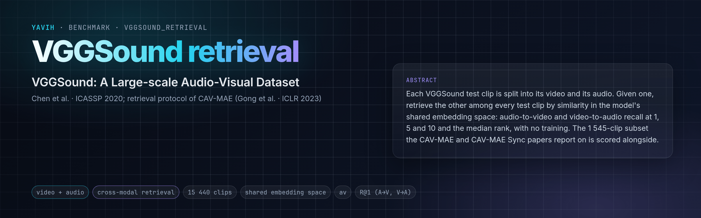

[Paper (VGGSound)](https://arxiv.org/abs/2004.14368) · [Paper (CAV-MAE)](https://arxiv.org/abs/2210.07839) · [Dataset](https://www.robots.ox.ac.uk/~vgg/data/vggsound/) · [Subset list](https://github.com/edsonroteia/cav-mae-sync) · [setup.md](setup.md)

## Description

Audio–visual retrieval on the VGGSound test split: each of the 15 446 test clips (10 s YouTube clips over 309
classes, Chen et al., ICASSP 2020) is split into its video and its audio; given one, retrieve the other among every
test clip. The protocol follows CAV-MAE (Gong et al., ICLR 2023): the two modalities are embedded independently into
the model's shared space and ranked by cosine similarity, audio-to-video and video-to-audio, with recall at 1, 5 and
10 and the median rank. CAV-MAE and CAV-MAE Sync (Araujo et al., CVPR 2025) report on a 1 545-clip subset (5 per
class); this folder scores the whole test split and that subset alongside.

## Citation

```bibtex
@inproceedings{chen2020vggsound,
  title     = {VGGSound: A Large-scale Audio-Visual Dataset},
  author    = {Chen, Honglie and Xie, Weidi and Vedaldi, Andrea and Zisserman, Andrew},
  booktitle = {IEEE International Conference on Acoustics, Speech and Signal Processing (ICASSP)},
  pages     = {721--725},
  year      = {2020}
}

@inproceedings{gong2023cavmae,
  title     = {Contrastive Audio-Visual Masked Autoencoder},
  author    = {Gong, Yuan and Rouditchenko, Andrew and Liu, Alexander H. and Harwath, David and Karlinsky, Leonid and Kuehne, Hilde and Glass, James},
  booktitle = {International Conference on Learning Representations (ICLR)},
  year      = {2023}
}
```

## In yavih

### Protocol

`protocol_version: 1`. **Training-free**: the folder's own scorer (`retrieval.py`) L2-normalises the bridge's `audio_emb` and
`video_emb` of every row, computes the cosine similarity of every audio against every video, and records per row
the rank of its true pair in both directions (the average tie rank, `1 + #(candidates scored strictly higher) +
#(other candidates scored equal) / 2`: ties are measure-zero for real embeddings, but a degenerate query, say the
zero embedding of one of the 120 silent test wavs, then ranks in the middle of the gallery rather than first). The
gallery is the whole split: 15 440 candidates per query.

| split | role | rows | content |
|---|---|---|---|
| `test` | eval (never capped; nothing is trained) | 15 440 | every VGGSound test clip whose source has no train clip; 309 classes, 48–50 clips each |

- Headline **`metrics.headline: r@1`** = the mean of `r@1_a2v` and `r@1_v2a` (bootstrap CI over queries, gallery
  fixed); per direction `r@1`, `r@5`, `r@10` (Wilson CIs) and `medr` (the median rank, lower is better).
- **The CAV-MAE Sync subset** (`*_cavmae`, the folder's `eval.py`): the 1 545 rows flagged `cavmae_sync_5pc` (5 per
  class, the authors' `vgg_test_5_per_class_for_retrieval` datafile at commit 0add2e7) ranked among themselves:
  `r@1_a2v_cavmae` … `medr_v2a_cavmae`. These are the numbers to put next to the CAV-MAE papers'; the full-split
  numbers are ten times harder (ten times the gallery) and are the ones to compare models on.
- Chance: `r@k = k / n` (`metrics.chance`: `r@1` 0.0000648 on the full split, 0.000647 on the subset). No floor
  (`metrics.floors: []`) and no control: nothing is trained, and a model's two spaces either are aligned or are not.
- Population: the 15 446 test rows of the official listing minus the 6 clips whose YouTube source also has a clip
  in the train split (source level). No duration or content filter: every row is a query of both directions.
- Noise at n = 15 440: `r@1` Wilson ≈ ±0.005 at 0.1; the subset's `r@1_cavmae` ≈ ±0.02 at 0.2.
- The bridge gets the stored VGGSound mp4 (`video`) and 16 kHz mono wav (`audio`), untouched, with media facts;
  frames, crop, audio span and front end are its decisions. It returns `audio_emb [D]` and `video_emb [D]`, one
  clip's two projections into the model's shared space, from two independent forwards. `output_contract.isolation`
  makes `bridge check` swap one stream for another clip's and blank the mp4's own audio track: an embedding that
  depends on the other modality fails `E_MODALITY_LEAK`. Details in [setup.md](setup.md).
- Not applicable: a model without a shared audio–visual space (no projection the two modalities were aligned in,
  e.g. a masked-reconstruction model without a contrastive head). Mean-pooled encoder tokens of two unaligned
  towers score at chance; write no bridge for it.
- No `classes.csv` (`label.kind: none`): a row's VGGSound class is the `extra` column `class_name`, never handed
  over and never scored.

### Variants and aliases

- No aliases. `vggsounder` is the classification benchmark on the same test split (a trained probe); its numbers
  are a different question.
- A text–audio or text–video variant is not this folder; the scorer's keys are `audio_emb` / `video_emb`.

### Reference numbers

CAV-MAE and CAV-MAE Sync report VGGSound retrieval R@1 / R@5 / R@10 on the 1 545-clip subset in their papers
(`*_cavmae` here). The released CAV-MAE Sync checkpoint, scored on that subset through an independent frame
extraction (2026-07), reached A→V R@1 22.4 and V→A R@1 25.7, below the paper's numbers (a different frame grid):
expect a bridge's number to depend on its declared frames and audio window. No published numbers exist for the
full 15 440-clip gallery.

### Re-freezing the manifest

`make_manifest.py` re-derives `manifest.csv.gz` from VGGSound's `metadata/vggsound.csv` (pinned) and the shipped
`cavmae_sync_subset.csv` (pinned); presence is read from the VGGSound `video/` and `audio/` listings. `--check`
(also `yavih bench prepare vggsound_retrieval 02`) compares the manifest bytes and the yaml's `budget.clips` /
`manifest.upstream.curation` with a re-derivation:

```sh
FOLDER=$(yavih bench path vggsound_retrieval)
python "$FOLDER/make_manifest.py" --check            # byte identity + yaml facts, exit 1 on drift
python "$FOLDER/make_manifest.py"                    # rewrite manifest.csv.gz (in a git checkout)
pytest "$FOLDER/tests" -q -p no:cacheprovider        # folder tests; the re-derivation test skips without data
```

Curation: `15 440` listed `+ leakage 6 = 15 446` upstream test rows. No frozen source is a VGGSound-train ytid; all
1 545 subset clips are rows.
