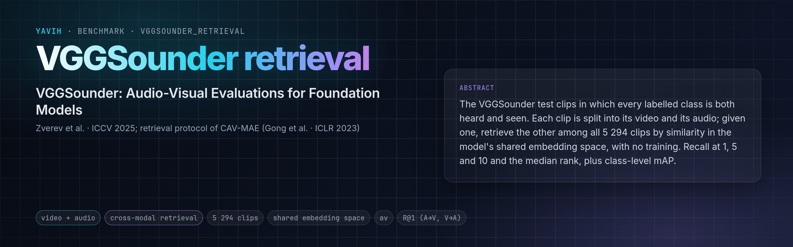
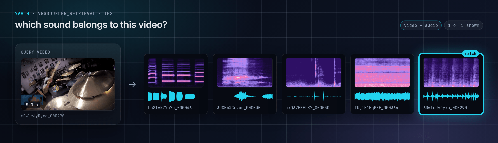
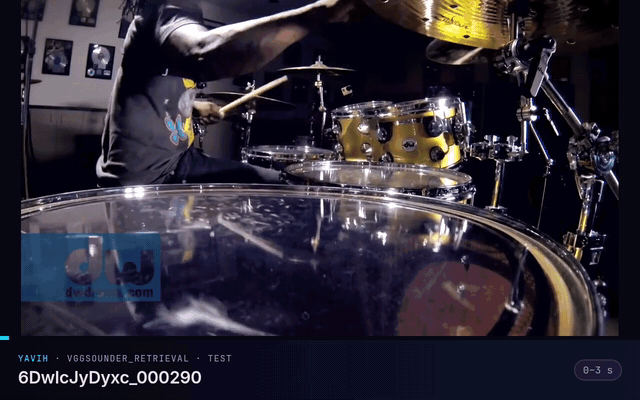

[Paper](https://vggsounder.github.io/static/vggsounder.pdf) · [Homepage](https://vggsounder.github.io) · [Labels](https://github.com/Bizilizi/VGGSounder) · [Dataset](https://www.robots.ox.ac.uk/~vgg/data/vggsound/) · [setup.md](setup.md)

<!-- yavih:glance begin (generated from benchmark.yaml: python -m yavih.doctables --glance vggsounder_retrieval --write) -->
| At a glance | VGGSounder retrieval |
|---|---|
| **Task** | Cross-modal retrieval · audio-visual, retrieval |
| **Modality** | Video + audio |
| **Size** | 5 294 test |
| **Headline** | Recall at rank 1 (`r@1`) · chance 0.019 % |
| **Data** | Public download; media on request from the data owner · 11 GB of media · how: [setup.md](setup.md) |
| **Licence** | VGGSound: CC BY 4.0 (the listing; the media are YouTube clips fetched by the user, subject to YouTube's terms). VGGSounder annotations and package: Apache-2.0 (github.com/Bizilizi/VGGSounder LICENCE). |
| **Protocol** | Version 1 · scorer `vggsounder_retrieval` (the folder's own) · needs yavih >=1.1,<2 · `yavih bench fetch vggsounder_retrieval` |
<!-- yavih:glance end -->

## The task

Each clip is ten seconds of a YouTube video with its sound. The model embeds the soundtrack and the frames
separately, into the space where it aligned the two modalities. Given the audio of one clip (a dog barking, a man
speaking, an engine revving), it has to find that clip's own video among all 5 294 videos, and the other way round.
Nothing is trained: the clips are ranked by the cosine similarity of the two embeddings.

The clips are chosen so that this is a fair question. VGGSounder marks every class of a test clip as audible,
visible or both; this benchmark keeps only the clips in which every class is both heard and seen, so the audio and
the video describe the same events and the match can be made from either side.



 · [mp4](assets/clip.mp4)

## The data

The clips are the VGGSound test split (Chen et al., ICASSP 2020): 10 s excerpts of YouTube videos, H.264 at their
native size (mostly 360p to 720p, ~30 fps) with the audio as 16 kHz mono wav. VGGSounder (Zverev et al., ICCV 2025)
re-annotated those test clips with every class that occurs, each marked audible, visible or both. Of its 12 008
test clips (12 014 minus 6 whose YouTube video also feeds the VGGSound training split), 5 294 have at least one
class that is both audible and visible and none that is only one of the two; they span 308 of the 309 classes.

Nothing else is removed. The classes are unbalanced: "male speech, man speaking" holds 697 clips and 50 classes
have fewer than ten. Most clips carry one or two classes, a few up to thirteen. 270 clips come in pairs from the
same YouTube video (135 videos).

The VGGSound listing is CC BY 4.0 and the VGGSounder labels Apache-2.0; the media are YouTube clips that each user
fetches, under YouTube's terms. There is one split, `test`.

## How it is scored

The headline is instance-level recall at 1, averaged over the two directions: the share of audio queries whose own
video ranks first among the 5 294, and of video queries whose own audio does. Recall at 5 and 10 and the median
rank are reported per direction. This is the retrieval protocol of CAV-MAE (Gong et al., ICLR 2023), scored by the
same code as yavih's whole-test-set [VGGSound retrieval](https://github.com/Bizilizi/yavih/tree/main/benchmarks/vggsound_retrieval).
Chance is one in 5 294.

Alongside, a class-level view: the query's own clip is set aside, and a retrieved clip counts when it shares an
audible-and-visible class with the query. Class-level mAP follows the multi-label cross-modal retrieval mAP of
[DCMH](https://github.com/jiangqy/DCMH-CVPR2017) (Jiang & Li, CVPR 2017), and class-level recall at k (a match of
the class among the top k) the Recall@k of [Roth et al.](https://github.com/Confusezius/Revisiting_Deep_Metric_Learning_PyTorch)
(ICML 2020); both are copied into the folder. A random ranking already finds a same-class clip first 3.6 % of the
time, mostly through the speech classes.

What this is not: the VGGSounder classification benchmark (a trained probe over all 12 008 clips, yavih's
`vggsounder`), or VGGSound retrieval over all 15 440 test clips, whose gallery mixes clips where the sound source is
off screen. Numbers from the three are not comparable. A model without a shared audio-visual space has nothing to
score here.

## Citation

```bibtex
@inproceedings{zverevwiedemer2025vggsounder,
  author    = {Daniil Zverev and Thadd{\"a}us Wiedemer and Ameya Prabhu and Matthias Bethge and Wieland Brendel and A. Sophia Koepke},
  title     = {VGGSounder: Audio-Visual Evaluations for Foundation Models},
  booktitle = {Proceedings of the IEEE/CVF International Conference on Computer Vision (ICCV)},
  year      = {2025}
}

@inproceedings{chen2020vggsound,
  author    = {Honglie Chen and Weidi Xie and Andrea Vedaldi and Andrew Zisserman},
  title     = {VGGSound: A Large-scale Audio-Visual Dataset},
  booktitle = {IEEE International Conference on Acoustics, Speech and Signal Processing (ICASSP)},
  year      = {2020}
}

@inproceedings{gong2023cavmae,
  title     = {Contrastive Audio-Visual Masked Autoencoder},
  author    = {Gong, Yuan and Rouditchenko, Andrew and Liu, Alexander H. and Harwath, David and Karlinsky, Leonid and Kuehne, Hilde and Glass, James},
  booktitle = {International Conference on Learning Representations (ICLR)},
  year      = {2023}
}

@inproceedings{jiang2017dcmh,
  title     = {Deep Cross-Modal Hashing},
  author    = {Jiang, Qing-Yuan and Li, Wu-Jun},
  booktitle = {Proceedings of the IEEE Conference on Computer Vision and Pattern Recognition (CVPR)},
  year      = {2017}
}

@inproceedings{roth2020revisiting,
  title     = {Revisiting Training Strategies and Generalization Performance in Deep Metric Learning},
  author    = {Roth, Karsten and Milbich, Timo and Sinha, Samarth and Gupta, Prateek and Ommer, Bj{\"o}rn and Cohen, Joseph Paul},
  booktitle = {Proceedings of the 37th International Conference on Machine Learning (ICML)},
  year      = {2020}
}
```
