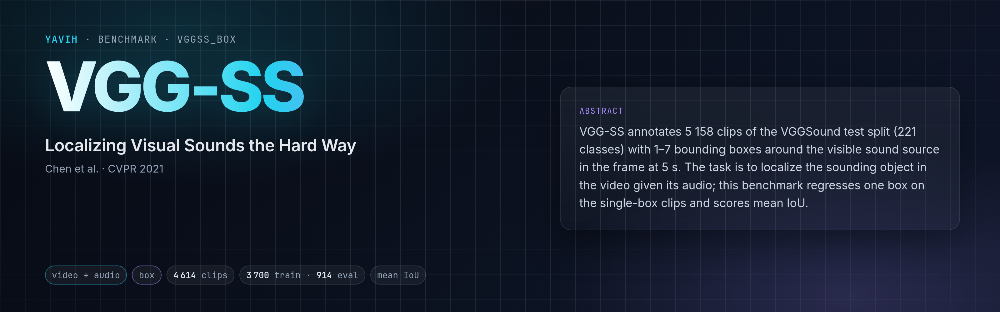
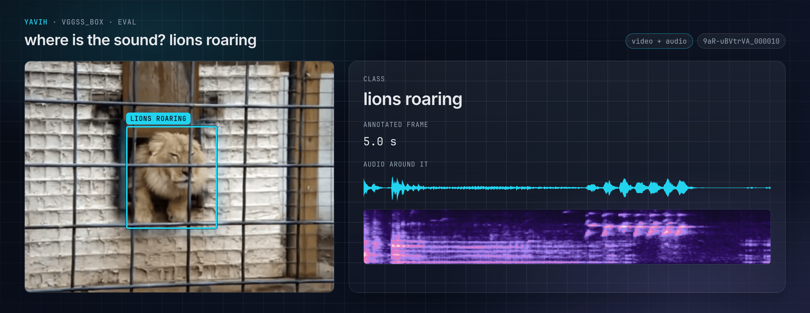
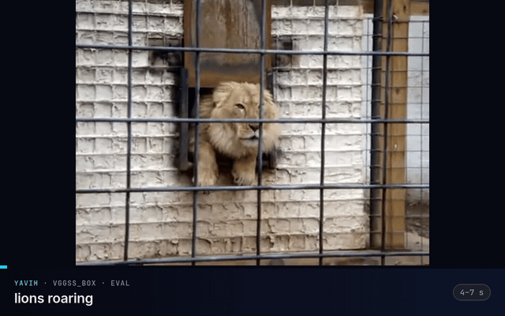

[Paper](https://arxiv.org/abs/2104.02691) · [Homepage](https://www.robots.ox.ac.uk/~vgg/research/lvs/) · [Dataset](https://github.com/hche11/Localizing-Visual-Sounds-the-Hard-Way) · [setup.md](setup.md)

<!-- yavih:glance begin (generated from benchmark.yaml: python -m yavih.doctables --glance vggss_box --write) -->
| At a glance | VGG-SS |
|---|---|
| **Task** | Sound-source localisation with a box · audio-visual, spatial |
| **Modality** | Video + audio |
| **Size** | 3 700 train / 914 eval |
| **Headline** | Mean IoU of the predicted box (`iou_mean`) |
| **Data** | Public download; media on request from the data owner · 9.3 GB of media · how: [setup.md](setup.md) |
| **Licence** | VGG-SS annotations (Chen et al., CVPR 2021) are distributed through the authors' GitHub repository, which states no licence; check it before redistributing the boxes. VGGSound listing: CC BY 4.0; the media are YouTube clips fetched by the … |
| **Protocol** | Version 1 · scorer `box` · needs yavih >=1.1,<2 · `yavih bench fetch vggss_box` |
<!-- yavih:glance end -->

## The task

Where is the thing making this sound? Given a ten-second video with its audio, draw one box around the object
that is sounding in the frame at five seconds: the roaring lion behind the bars, or the violin rather than the
face of the child playing it. The answer is a box in fractions of the full frame, and it is scored against
the box the annotators drew.



Picture and sound have to work together. A model that only looks at the frame can often guess the most salient
object, so the benchmark also runs the same model with every clip's audio swapped for another clip's and reports
whether the audio helped.

 · [mp4](assets/clip.mp4)

## The data

VGG-SS (Chen, Xie, Afouras, Nagrani, Vedaldi and Zisserman, CVPR 2021) annotates 5 158 clips of the VGGSound test
split, from 221 sound classes, with one to seven boxes around the visible sound source in the frame at 5.0 s. The
clips are ten-second YouTube videos with their audio; the annotations are one public JSON file.

VGG-SS is an evaluation set and has no training split. yavih keeps the 4 614 clips with exactly one usable box
(538 have several boxes, 2 are degenerate) and drops the 4 whose YouTube source also appears in VGGSound's
training set. It then splits them 80/20 by source video, stratified by class, into 3 700 training and 914
evaluation clips, so no YouTube source is on both sides.

The annotations come from the authors' GitHub repository, which states no licence. The videos are VGGSound test
clips under YouTube's terms (the VGGSound listing is CC BY 4.0); they must come from an existing VGGSound copy,
since part of them is no longer on YouTube.

## How it is scored

A probe on frozen audio-visual features predicts one box per clip, and the headline is the mean
intersection-over-union with the annotated box on the 914 evaluation clips. Also reported: the share of clips
with IoU at least 0.5 and at least 0.3, and the share whose predicted centre falls inside the annotated box.

There is no chance level for a box, so the reference point is a floor: predicting the average training box, a
large box in the middle of the frame, for every clip already scores a mean IoU of 0.343, because sounding objects
tend to be big and central. A model has to clear that clearly. The audio-swap control says whether it did so by
listening: when the swapped audio scores as well as the real one, the model found salient objects, not sounding
ones.

Not this benchmark: the paper's protocol, which scores localization heatmaps with consensus IoU and AUC on all 5 158
clips, multi-box included; numbers from VGG-SS papers are not comparable with these. No box-regression numbers have
been published for this protocol, so the floor is the only reference.

## Citation

```bibtex
@inproceedings{chen2021localizing,
  title     = {Localizing Visual Sounds the Hard Way},
  author    = {Chen, Honglie and Xie, Weidi and Afouras, Triantafyllos and Nagrani, Arsha and Vedaldi, Andrea and Zisserman, Andrew},
  booktitle = {Proceedings of the IEEE/CVF Conference on Computer Vision and Pattern Recognition (CVPR)},
  pages     = {16867--16876},
  year      = {2021}
}

@inproceedings{chen2020vggsound,
  title     = {VGGSound: A Large-scale Audio-Visual Dataset},
  author    = {Chen, Honglie and Xie, Weidi and Vedaldi, Andrea and Zisserman, Andrew},
  booktitle = {IEEE International Conference on Acoustics, Speech and Signal Processing (ICASSP)},
  pages     = {721--725},
  year      = {2020}
}
```
