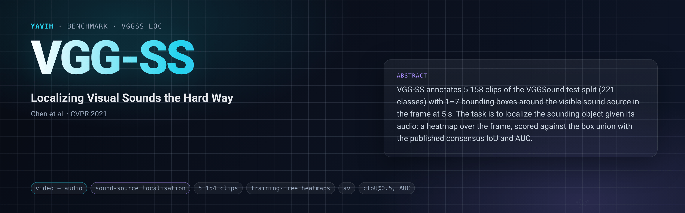

[Paper](https://arxiv.org/abs/2104.02691) · [Homepage](https://www.robots.ox.ac.uk/~vgg/research/lvs/) · [Dataset](https://github.com/hche11/Localizing-Visual-Sounds-the-Hard-Way) · [setup.md](setup.md)

## Description

"Where is the thing making this sound?" VGG-SS (Chen et al., CVPR 2021) annotates 5 158 clips of the VGGSound
**test** split (221 classes) with 1–7 bounding boxes around the sounding object in the frame at **t = 5.0 s**.
The annotations are one public JSON file (`vggss.json`); the media are the VGGSound clips themselves (YouTube,
10 s, video + audio). VGG-SS is an evaluation set: there is no train split. The paper scores sound-source
localization heatmaps against the union of the boxes with consensus IoU (cIoU@0.5) and the AUC of the cIoU curve;
every later localization paper (EZ-VSL, SLAVC, …) reuses that evaluator.

## Citation

```bibtex
@inproceedings{chen2021localizing,
  title     = {Localizing Visual Sounds the Hard Way},
  author    = {Chen, Honglie and Xie, Weidi and Afouras, Triantafyllos and Nagrani, Arsha and Vedaldi, Andrea and Zisserman, Andrew},
  booktitle = {Proceedings of the IEEE/CVF Conference on Computer Vision and Pattern Recognition (CVPR)},
  pages     = {16867--16876},
  year      = {2021}
}

@inproceedings{chen2020vggsound,
  title     = {VGGSound: A Large-scale Audio-Visual Dataset},
  author    = {Chen, Honglie and Xie, Weidi and Vedaldi, Andrea and Zisserman, Andrew},
  booktitle = {IEEE International Conference on Acoustics, Speech and Signal Processing (ICASSP)},
  pages     = {721--725},
  year      = {2020}
}
```

## In yavih

### Protocol

`protocol_version: 1`. `vggss_loc` is the paper's heatmap readout, **training-free**: the folder's own scorer takes the
cosine similarity between a clip's audio embedding and each visual token of the frame at 5.0 s, both in the
model's own shared space, averages it per cell of a 14 × 14 grid over the full original frame (a cell no token
falls in scores below every filled cell) and scores the map exactly as the published evaluator does
(the folder's `loc.py`, a transcription of the authors' `test.py`): bilinear upsample to 224 × 224, binarise
strictly above the upper median (half the pixels), `cIoU = |pred ∧ gt| / (|gt| + |pred ∧ ¬gt|)` against the
rasterised box union (`int(224 · x)` of the `max(x, 0)`-sanitised fractions).

| split | role | rows | content |
|---|---|---|---|
| `test` | eval (never capped; nothing is trained) | 5 154 | every VGG-SS entry whose source has no VGGSound-train clip; 221 classes; 538 entries with 2–7 boxes |

- Headline **`metrics.headline: ciou@0.5`** (the fraction of clips with cIoU ≥ 0.5, Wilson CI); also `auc` (the
  trapezoid area of the fraction with cIoU ≥ τ over τ = 0, 0.05, …, 1), `ciou_mean` (bootstrap CI), `n_empty_gt`
  (2: the entries whose boxes have no extent after sanitisation; they score 0 and stay in every denominator),
  `n_eval` (5 154).
- **A ceiling of the published metric.** The prediction is always half the frame, so a clip can reach
  cIoU ≥ 0.5 only when its box union covers at least a quarter of the frame: 2 603 of the 5 154 entries do
  (median union area 0.253, mean 0.312), so **`ciou@0.5` cannot exceed 0.505** here, and a perfect localizer of
  small sources scores like a mediocre one. `auc` and `ciou_mean` do not saturate; read all three.
- No chance level (`metrics.chance: {}`). Floor **`ciou_floor` = 0.345** (`ciou_mean` 0.377): every clip's map is
  the mean rasterised box union of the *other* 5 153 clips pooled to the grid (the dataset's centre / size prior),
  through the same pipeline. A `ciou@0.5` whose CI overlaps 0.345 is not a localization result.
- Controls **`ciou_shuffled` / `audio_blind`**: the same maps with every clip's audio embedding swapped for another
  clip's (seeded derangement, `shuffle_seed 20260913`); `audio_blind = true` means the headline does not beat the
  shuffled arm by more than 3 McNemar σ on paired cIoU ≥ 0.5 successes. Then the map is visual saliency (a
  foreground object the visual tokens find on their own), not audio-visual localization; say so.
- Population: every VGG-SS entry except the 4 leaked into VGGSound train (source level); multi-box entries kept,
  the 12 corrupt coordinates (`-2.8823e16`) zeroed by the official rule, 2 empty ground truths kept. No crop or
  duration filter.
- Noise at n = 5 154: `ciou@0.5` Wilson ≈ ±0.014; a gap below ≈ 0.02 is not meaningful.
- The bridge gets the stored VGGSound mp4 (`video`) and 16 kHz mono wav (`audio`), untouched, with media facts and
  the fact `annotated_second: 5.0`; frames, crop, audio span and front end are its decisions. It returns the
  audio embedding `audio_emb [D]`, the visual tokens of the annotated frame `video_tokens [N, D]` in the same
  space and their centres `video_pos [N, 2]` as `(y, x)` fractions of the ORIGINAL frame; the scorer refuses a set
  whose tokens cover fewer than a quarter of the cells (median). `output_contract.isolation` makes `bridge check`
  swap one stream for another clip's and blank the mp4's own audio track: an `audio_emb` that depends on the video
  or a `video_tokens` that depends on the audio fails `E_MODALITY_LEAK`. Details in [setup.md](setup.md).
- Not applicable: a model without a shared audio–visual space (no projection the two modalities were aligned
  in). Its tokens are not comparable across modalities and the map is noise; write no bridge for it.
- No `classes.csv` (`label.kind: none`): a row's VGG-SS class is the `extra` column `class_name`, never handed over
  and never scored; the boxes are the `label_aux` column `boxes`.

### Variants and aliases

- No aliases. `vggss_box` is the other VGG-SS folder: a trained box-regression head on the single-box clips with a
  train/eval split; its numbers are not comparable with this folder's.
- Crop vs squash are two bridge declarations scored against the same full-frame boxes: a Resize(256) +
  CenterCrop(224) bridge leaves the cells outside its crop at the bottom of the map, the literature's
  Resize((224, 224)) squash covers every cell. Two configurations, two `model` names.

### Reference numbers

Published VGG-SS numbers (LVS: cIoU 34.4 / AUC 38.2; EZ-VSL: 38.85 / 39.54; both trained on VGGSound-144k with an
audio-visual correspondence objective and scored on all 5 158 entries with a 224 × 224 squash) are the same
evaluator over the same boxes, but not row-comparable: they include the 4 leaked entries and their localization
heads were trained for it. This folder's numbers are the model's own shared space, trained on whatever it was
trained on. The floor (0.345) is the number to read a result against.

### Re-freezing the manifest

`make_manifest.py` re-derives `manifest.csv.gz` from the public `vggss.json` (annotations root, sha256-pinned) and
VGGSound's `metadata/vggsound.csv` (the leakage rule, pinned); presence is read from the VGGSound `video/` and
`audio/` listings. `--check` (also `yavih bench prepare vggss_loc 03`) compares the manifest bytes and the yaml's
`budget.clips` / `manifest.upstream.curation` with a re-derivation:

```sh
FOLDER=$(yavih bench path vggss_loc)
python "$FOLDER/make_manifest.py" --check            # byte identity + yaml facts, exit 1 on drift
python "$FOLDER/make_manifest.py"                    # rewrite manifest.csv.gz (in a git checkout)
pytest "$FOLDER/tests" -q -p no:cacheprovider        # folder tests; the re-derivation test skips without data
```

Curation: `5 154` listed `+ leakage 4 = 5 158` upstream entries. No frozen source is a VGGSound-train ytid.
