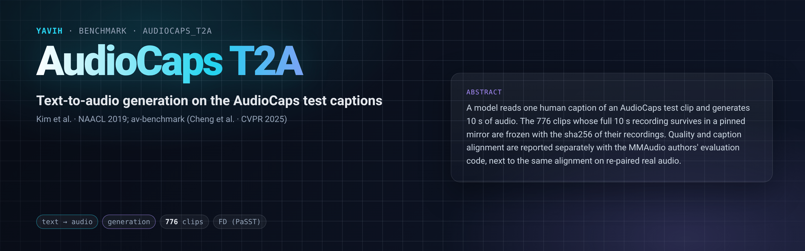

[Paper](https://aclanthology.org/N19-1011/) · [Dataset](https://audiocaps.github.io/) · [Evaluation code](https://github.com/hkchengrex/av-benchmark) · [setup.md](setup.md)

## Description

Text-to-audio generation: a model reads one human-written caption and generates ten seconds of audio. The captions
are the AudioCaps test captions (Kim et al., NAACL 2019), written for AudioSet clips; each clip has five, and the
benchmark hands over the first. A generation is compared with the clip's recording (distributional quality and
paired class agreement) and with its caption (text-audio alignment in two CLAP models), using the evaluation code
the MMAudio authors released.

This folder follows the evaluation protocol and report format proposed in *Audio generative models in the multimodal
era* (Mitsufuji et al., in preparation): the evaluation manifest freezes the clips that survive in a pinned mirror
with the sha256 of each recording, and states how many were lost; text alignment is reported separately from quality;
distributional distance is reported under three embeddings and two estimators, FD and KAD; every alignment number is
shown next to the same number on real recordings re-paired with the wrong caption (a controlled error), and next to
the correctly paired recordings; the generation budget and selection rule are declared by every bridge and recorded
with every number, and the clip-level metrics carry bootstrap intervals and per-clip values for paired comparisons.

## Citation

```bibtex
@inproceedings{kim2019audiocaps,
  author    = {Chris Dongjoo Kim and Byeongchang Kim and Hyunmin Lee and Gunhee Kim},
  title     = {{AudioCaps}: Generating Captions for Audios in the Wild},
  booktitle = {Proceedings of the 2019 Conference of the North American Chapter of the Association for Computational Linguistics (NAACL-HLT)},
  year      = {2019}
}

@inproceedings{cheng2024taming,
  author    = {Ho Kei Cheng and Masato Ishii and Akio Hayakawa and Takashi Shibuya and Alexander Schwing and Yuki Mitsufuji},
  title     = {MMAudio: Taming Multimodal Joint Training for High-Quality Video-to-Audio Synthesis},
  booktitle = {CVPR},
  year      = {2025}
}

@article{mitsufuji2026audio,
  author  = {Yuki Mitsufuji and Takashi Shibuya and Prem Seetharaman and Tingle Li and Masato Ishii and Daniil Zverev and A. Sophia Koepke},
  title   = {Audio generative models in the multimodal era},
  note    = {in preparation},
  year    = {2026}
}
```

## In yavih

### Protocol

`scorer: audiocaps_t2a` (the folder's own scorer, `eval.py`, kind `direct`: nothing is trained). `protocol_version: 1`.

| split | role | rows | content |
|---|---|---|---|
| `test` | eval | 776 | the AudioCaps test clips whose full 10 s recording survives in the OpenSound mirror at revision `b29b324` (92 of 975 lost to YouTube decay, 1 excluded for carrying two different recordings, 106 shorter than 10 s), each with its first caption in the official `test.csv` |

The bridge receives the caption as a cell field (`Sample.cells["caption"]`, no file) and returns one mono wav of
exactly `audio_length` = 10 s per caption. It declares its generation budget in `describe()["sampling"]` (seed,
steps, guidance, candidates per caption, selection rule); generation must be seeded and reproducible, which
`bridge check` verifies.

Every number is a value [av-benchmark](https://github.com/hkchengrex/av-benchmark) returns (`external`, a git
checkout pinned to commit `f351b9a`; setup.md "## Dependencies"), on the generations against the clips' recordings
and captions:

| metric | what it measures | better |
|---|---|---|
| `fd_passt` (headline), `fd_panns`, `fd_vgg` | Fréchet distance to the recordings in PaSST, PANNs and VGGish embeddings | lower |
| `kad_passt`, `kad_panns` | kernel audio distance to the recordings on the same PaSST and PANNs embeddings (kadtk's estimator: Gaussian kernel, median-distance bandwidth, ×100; computed by `eval.py` from av-benchmark's cached embeddings) | lower |
| `kl_passt`, `kl_panns` | mean paired KL between the recording's and the generation's class posteriors | lower |
| `is_passt`, `is_panns` | inception score of the generations (reference-free) | higher |
| `clap_laion`, `clap_ms` | mean cosine between the caption and the generated audio in LAION-CLAP and MS-CLAP (text alignment) | higher |

Floors (`metrics.floors`): `clap_laion_floor`, `clap_ms_floor` and `kl_passt_floor` are the same metrics on the
recordings re-paired with another clip's caption by a seeded derangement (`floor_seed: 0`). A generation that does not
beat a real recording on the wrong caption is not aligned, and the report greys it. Disclosures `clap_laion_ref` and
`clap_ms_ref` are the correctly paired recordings' values. The report's default table shows `fd_passt`, `kl_passt`,
`is_passt` and `clap_laion`; the rest are in `result.json` and the results store. Intervals (`metrics.ci`,
`metrics.bootstrap: {samples: 2000, seed: 0}`): `kl_passt`, `kl_panns`, `clap_laion` and `clap_ms` carry a 95 %
clip-level percentile bootstrap over their per-clip values, which `eval.py` recomputes from av-benchmark's cached
features and checks against av-benchmark's own means; `kad_passt` and `kad_panns` carry the same bootstrap with KAD
recomputed on each resample. FD and IS have no interval. `yavih eval run --log-samples` writes every clip's values to
the samples file, so two systems scored on the same clips can be compared by paired differences.

### Re-freezing the manifest

`make_manifest.py --root <source_root>` re-derives `manifest.csv.gz` byte for byte from the official `test.csv`
(sha256-pinned) and the mirror's test parquet files (prepare/01 downloads both); `--check` confirms it. The folder
tests pin the counts.
