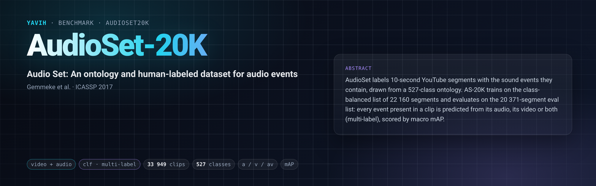

[Paper](https://www.semanticscholar.org/paper/5ba2218b708ca64ab556e39d5997202e012717d5) · [Homepage](https://research.google.com/audioset/) · [Dataset](https://huggingface.co/datasets/11hu83/audioset20k) · [setup.md](setup.md)

## Description

AudioSet labels 10-s YouTube segments with the sound events they contain, drawn from a 527-class ontology
(multi-label). "AS-20K" is the class-balanced training list (`balanced_train_segments.csv`, 22 160 segments)
scored on the official eval list (`eval_segments.csv`, 20 371 segments) by macro mAP over the 527 classes: the
standard small-scale AudioSet protocol of the self-supervised audio and audio-visual literature. No scorer ships
with AudioSet.

The media come from the Hugging Face dataset
[`11hu83/audioset20k`](https://huggingface.co/datasets/11hu83/audioset20k) at a pinned revision: the original
clip mp4s (video and audio in one file, original resolution and codecs) packed as WebDataset tars with a byte
index. It publishes 33 949 of the 42 531 listed segments; the other 8 582 (`MISSING.csv`) were no longer on
YouTube when the dataset was made.

## Citation

```bibtex
@inproceedings{gemmeke2017audioset,
  title     = {Audio Set: An ontology and human-labeled dataset for audio events},
  author    = {Gemmeke, Jort F. and Ellis, Daniel P. W. and Freedman, Dylan and Jansen, Aren and
               Lawrence, Wade and Moore, R. Channing and Plakal, Manoj and Ritter, Marvin},
  booktitle = {IEEE International Conference on Acoustics, Speech and Signal Processing (ICASSP)},
  pages     = {776--780},
  year      = {2017}
}
```

## In yavih

### Protocol

`scorer: clf`, `label.kind: multi` (BCE), `protocol_version: 1`. yavih predicts the 527 labels of each eval clip
from frozen features of the clip's video and/or audio track with the pinned attentive probe; the labels are audio
events whatever the reading, so a video-only bridge predicts sound events from pixels.

| split | role | rows | official list | content |
|---|---|---|---|---|
| `train` | train (the probe carves 10 % val) | 17 726 | 22 160 | every `balanced_train_segments.csv` segment the dataset publishes (2 without an audio track) |
| `eval` | eval (never capped, never trained on) | 16 223 | 20 371 | every `eval_segments.csv` segment the dataset publishes (1 without an audio track) |

- Headline `map` = macro AP over the fixed 527 classes (zero-positive classes count AP = 0; none here: every
  class has at least 28 eval positives, `effective_pos_classes` = 527). Also reported: `effective_pos_classes`,
  `n_eval`. Chance and floor coincide: `map_floor` (constant train-prevalence score) = mean per-class eval
  prevalence = **0.004855** (41 508 label instances / (527 × 16 223)); anything below about 0.01 is at the floor.
  No interval for macro AP (`ci: {}`): run at least 2 seeds. `min_eval_coverage: 0.95`.
- Train draw: none (`train_draw: null`), all 17 726 balanced-train clips. Row order = the dataset's `clips.csv`
  order (train then eval, each sorted by key); `clip_id` = the dataset key `<ytid>_<start ms, 7 digits>`; labels
  = `;`-joined mids in ontology order (`class_key: mid`). No clip is excluded.
- The bridge gets the published mp4 exactly as stored, as two streams `video` and `audio` over the same tar
  member, read in place; frames, window, resolution, crop, resampling and front end are its own declared
  choices. The 3 clips whose mp4 has no audio track are handed over with `audio.info.has_track: false`, and an
  audio or av bridge still returns one row for each. It returns any fixed `[N, D]`; no positions are required.
  Details: [setup.md](setup.md).
- `input_contract.handed_over` names the dataset and its revision, so another revision or another copy of the
  clips is another protocol.

### Variants and aliases

- One variant: the published dataset at revision `4a0055b2…`, 33 949 rows, both streams handed over for each.
  A model is normally read three ways (audio `a`, video `v`, both `av`): three bridges under one `model` name,
  scored on the same rows.
- Frame and audio geometries (8 × 1 s from the start, 16 frames over the whole clip, a model's own sampler) are
  bridge declarations under this one protocol, not variants.
- Not this benchmark: AudioSet-2M (the unbalanced training list), other AS-20K snapshots (e.g.
  `agkphysics/AudioSet`, other clip sets), and fine-tuned AS-20K numbers from the literature (about 0.3–0.4 audio
  mAP; a different protocol).

### Reading a number

- Check `n_eval` = 16 223 and `effective_pos_classes` = 527 before quoting a number.
- Video-only above audio-only would be suspicious (the labels are audio events), and `av` should not fall below
  `a` by more than noise. Cross-hardware / precision differences (fp16 vs fp32) are about 0.001–0.002 mAP; treat
  gaps below about 0.005 mAP as noise unless several seeds say otherwise.
- Budget: about 70 GPU-min to extract 33 949 clips for a 16-frame ViT-B A+V bridge (decoding original-resolution
  h264/av1/vp9 dominates); the probe takes about 10 min per seed on pooled features. Token stores grow fast:
  store fp16.

### Re-freezing the manifest

`make_manifest.py` re-derives `manifest.csv.gz` from the dataset's public release files (`clips.csv`,
`MISSING.csv`, `index.json`, `SHA256SUMS`, each pinned by sha256) and the committed `classes.csv` (AudioSet's
`class_labels_indices.csv`), stdlib only:

```sh
FOLDER=$(yavih bench path audioset20k)
python "$FOLDER/make_manifest.py" --check            # exit 1 unless byte-identical to the committed manifest
python "$FOLDER/make_manifest.py" --check --rescan   # also re-probe every member's tracks with PyAV
```

`--media-root` defaults to `yavih config get audioset20k.media_root`. It asserts the pinned sha256s, that
`clips.csv` + `MISSING.csv` are the official 22 160 + 20 371 segments, unique keys and ytids, no ytid in both
splits, every row an index member of the published size, every mid in `classes.csv` and every class with train
and eval positives, and prints the values `benchmark.yaml` carries (manifest sha256, curation counts, chance,
media bytes). The clips without an audio track are pinned in `make_manifest.py` (`NO_AUDIO_TRACK`); `--rescan`
refuses when the measured set differs. A re-freeze rewrites the folder, so run it in a checkout of
https://github.com/Bizilizi/yavih; the folder tests are `pytest "$FOLDER/tests"`.
