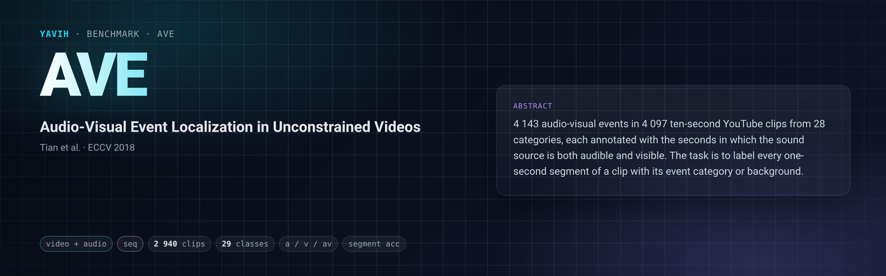

[Paper](https://arxiv.org/abs/1803.08842) · [Homepage](https://github.com/YapengTian/AVE-ECCV18) · [Dataset](https://huggingface.co/datasets/Helios1208/AVE_Dataset) · [setup.md](setup.md)

## Description

AVE (Tian, Shi, Li, Duan, Xu; ECCV 2018) has 4 143 annotated audio-visual events in 4 097 ten-second YouTube
clips (AudioSet segments), in 28 categories (church bell, dog barking, acoustic guitar, …). Each event is an
integer range of seconds `[StartTime, EndTime)` in which the sound source is both audible and visible. The task is
supervised audio-visual event localization: predict, for each one-second segment of the clip, the event category
or `background`. The official splits are the authors' `data/{train,val,test}_order.h5` files (3 339 / 402 / 402
events); they are not video-disjoint (8 videos are in both train and test, 10 in both train and val). The official
metric is the segment accuracy over every segment of the test set (`compute_acc` in the authors' code).

## Citation

```bibtex
@inproceedings{tian2018ave,
  title     = {Audio-Visual Event Localization in Unconstrained Videos},
  author    = {Tian, Yapeng and Shi, Jing and Li, Bochen and Duan, Zhiyao and Xu, Chenliang},
  booktitle = {Proceedings of the European Conference on Computer Vision (ECCV)},
  pages     = {247--263},
  year      = {2018}
}
```

## In yavih

### Protocol

`scorer: seq`, `T = 10`: the probe reads frozen audio-visual tokens that carry a time coordinate and predicts one
of 29 classes (28 events + `background` at index 28) for every one-second segment `s = 0 … 9` of the media;
segment `s` carries the row's category iff `event_start ≤ s < event_end`, else `background` (targets derived from
the manifest, never stored). `protocol_version: 1`.

| split value | role | rows | videos | short-event rows | notes |
|---|---|---|---|---|---|
| `train` | train | 2 624 | 2 608 | 838 | 16 videos carry two events (32 rows share media); uncapped, no draw |
| `test` | eval | 316 | 316 | 104 | official 402 minus 80 VGGSound-train leaks minus 6 cross-split videos |
| `val` | unused | 308 | 308 | 112 | in the manifest, never read (the probe carves its validation split from train) |

A row is one annotated event, `clip_id = <ytid>#<Annotations.txt row index>` (the index the official `*_order.h5`
files use). The freeze drops 886 rows whose video is in VGGSound train (715 train / 91 val / 80 test) and 9 val/test
rows whose video is also in AVE train (3 val / 6 test), leaving 3 248 rows over 3 232 videos; every eval video
carries one event.

Headline **`seg_acc`** = the official AVE accuracy (the authors' `compute_acc`: segment accuracy pooled over every
(video, segment) of the test set, all ten segments, background included; a folder test pins the transcription).
Chance `1/29 = 0.034`; floor **`seg_acc_floor` = 0.172** (always predict the most frequent train segment label,
`background`). Also reported: `clip_acc`, `seg_acc_boundary` on the 104 test rows whose event is shorter than the
clip (floor `seg_acc_boundary_floor` = 0.521), `n_boundary`, `n_eval`; clip-bootstrap 95 % intervals (2 000
resamples, seed 0) for `seg_acc` and `seg_acc_boundary`. No controls. The floor is low only because 2 194 of 3 248
events span the whole clip: a model that gets the clip class right on every segment scores ~0.83 without
localizing anything, so read `seg_acc` next to `clip_acc` and `seg_acc_boundary`. 316 test clips give about
±2.7 pp sampling error on `seg_acc` (~±5.5 pp as a 95 % half-width); `seg_acc_boundary` has n = 104 (±9.6 pp
half-width at p = 0.5).

The bridge gets the stored AVE mp4 (one member of `AVE_Datset.tar`, read in place) as two streams `video` and
`audio` of the same bytes, with header facts and `num_segments: 10`, `segment_seconds: 1.0`; frames, window, crop,
audio front end and padding are the bridge's. It returns a fixed `[N, D]` per clip with `pos.t` in media
coordinates; at least 8 of the 10 seconds must hold a timed `video` token (`t_bins: 8`), so an audio-only model is
not applicable. Details: [setup.md](setup.md).

### Variants and aliases

No aliases. The only variant shipped is the supervised, all-ten-seconds, official-split task on the
leakage-filtered test set (316 of the official 402 videos). Not this benchmark: AVE's weakly-supervised setting
(video-level labels for training); cross-modality localization (A2V / V2A); the unfiltered official test set of 402
videos (numbers on it are not comparable); scoring only part of the clip (e.g. seconds 1–8); the AudioSet-mirror
copy of AVE (1.5 fps frames).

### Reference numbers

None quoted: published AVE results fine-tune the encoder or train a task-specific head, often on the unfiltered
test set, so they are not comparable to a yavih frozen-probe number.

### Re-freezing the manifest

`python "$(yavih bench path ave)/make_manifest.py" --check` re-derives `manifest.csv.gz` and `classes.csv` from the
public files (the HF-root `Annotations.txt`, the three `*_order.h5` split files, the tar member set in `index.json`
and VGGSound's `metadata/vggsound.csv`; sha256-pinned) and compares them byte for byte; without `--check` it
rewrites them (gzip `mtime=0`) and prints the `manifest.upstream` block for `benchmark.yaml`. Inputs default to the
folder's `media_root` and `[datasets] vggsound`; `--media-root`, `--vggsound-csv` and `--out` override them; it
needs h5py. `prepare/05_make_manifest.sh` runs the check and `yavih bench verify ave --census`. The optional census
`yavih bench prepare ave 04 -- "$FOLDER/manifest.csv.gz" $ROOT/index.json census.jsonl 24` must report
`n_errors 0` and `short_clip_rows 74` (= `manifest.upstream.curation.short_clips`). Folder tests:
`pytest "$(yavih bench path ave)/tests"`.
