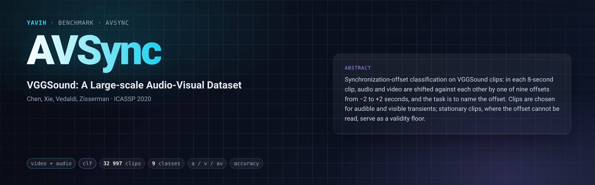

[Paper](https://arxiv.org/abs/2004.14368) · [Homepage](https://www.robots.ox.ac.uk/~vgg/data/vggsound/) · [setup.md](setup.md)

## Description

Audio-visual synchronization-offset classification on VGGSound. Each row is a VGGSound clip whose audio and video
tracks are shifted against each other by an **artificial offset δ** ∈ {−2.0, −1.5, …, +2.0} s ("video leads audio
by δ"); the task is to name which of the **9 offsets** was applied. The shift is split between the two streams:
the 8 s video window starts at 1 + δ/2 s and the 8 s audio window at 1 − δ/2 s of the source clip.

The source is VGGSound (about 200 000 ten-second YouTube clips, 309 classes, an official train/test split). The
offset task has no paper of its own; the clips, offsets and selection are derived data of this benchmark. Clips
were selected by a model-free curation (hand-written signal statistics, no learned model) for transient,
audio-visually correlated content, i.e. onsets you can hear and see, so that synchronization is readable at all.
A second population of **stationary** clips, where it is not, serves as a validity floor. Train clips come from
the VGGSound train split, eval and floor clips from the VGGSound test split.

## Citation

```bibtex
@inproceedings{chen2020vggsound,
  title     = {VGGSound: A Large-scale Audio-Visual Dataset},
  author    = {Chen, Honglie and Xie, Weidi and Vedaldi, Andrea and Zisserman, Andrew},
  booktitle = {IEEE International Conference on Acoustics, Speech and Signal Processing (ICASSP)},
  year      = {2020}
}
```

## In yavih

### Protocol

`readout: clf` (single label, cross-entropy), 9 classes = `offsets_seconds` (`classes.csv` index = bin,
`class_key: index`), `protocol_version` 1. Rows are `(clip, offset)` pairs, `clip_id = <vggsound_clip>#<bin>`.

| split | role | rows | clips | content | rows per bin |
|---|---|---|---|---|---|
| `train` | train (val carved by the probe, 10 %) | 24 000 | 12 000 | VGGSound-train, transient arm, 2 distinct offsets per clip | 2 667 × 6, 2 666 × 3 |
| `test` | eval | 3 000 | 3 000 | VGGSound-test, transient arm (top 3 000 by `av_corr`) | 334 × 3, 333 × 6 |
| `stationary` | floor (scored by the same probe, never trained on) | 5 997 | 5 997 | VGGSound-test, bottom-of-peakiness pool ranked by `av_corr` ascending | 667 × 3, 666 × 6 |

- **Headline** `acc` on 3 000 **transient-rich VGGSound-test** clips (word it exactly that way, never "on
  VGGSound"); chance **1/9 = 0.1111**; 95 % Wilson interval (`metrics.ci: {acc: binomial}`), ±0.011 at chance.
- **Floor** `acc_floor` = train-majority bin (bin 0, ties → lowest index) scored on eval = **0.1113** ≈ chance
  (bins balanced to ±1 row).
- **Control, read before anything:** the trained probe also scores the 5 997 `stationary` rows (median flux
  peakiness 2.10 vs 5.00 on the transient arms, median `av_corr` 0.03 vs 0.37: sync is unreadable there).
  `acc_floor_arm` must sit at chance; `floor_violated = 1` when it exceeds `1/9 + 3·sqrt((1/9)(8/9)/5997) = 0.1233`
  (`floor_sigmas: 3.0`), and then **`acc` is void**: the probe found a cue that needs no audio-visual
  understanding (file metadata such as the first-frame delay, a normalization leak, an edge effect, a cache) and
  that cue exists on the transient arm too. `report` greys the row.
- Also `acc_tol1` (±1 bin = ±0.5 s; chance 0.3086), `mae_seconds` (chance ≈ 1.48 s), `acc_coarse5` (predictions
  collapsed onto the 1 s grid, mass-preserving, scored only on whole-second targets; chance 0.2) with its
  population `n_coarse5` (1 667 of 3 000 eval rows), and `n_eval` (must be 3 000; `report` refuses below 0.95).
  `acc_coarse5` is the **only** number comparable between a 1 fps and a 2 fps reading. **`acc_tol1` and
  `mae_seconds` reward a collapsed probe:** always answering the centre bin scores `acc` 0.111 and `acc_coarse5`
  0.200 (chance) but `acc_tol1` 0.333 and `mae_seconds` 1.11 s, better than their uniform chance. Never read those
  two as evidence of sync.
- **Unimodal readings are controls.** An audio-only or video-only bridge sees one track and no partner; anything
  above chance there is a non-sync cue and should also show on the floor arm.
- **Frozen train draw** (`cap 24000, seed 0, balance: class`): the 12 000 VGGSound-train transient clips with the
  highest `av_corr` (motion ≥ 0.065111), × **2 distinct offsets** each, from `assign_offset_bins` (`numpy
  default_rng(0)` shuffle of `floor(N/9)` copies per bin; the `N mod 9` surplus takes bins `0..surplus−1` in
  clip-id order; per-clip collisions repaired by multiset-preserving swaps).

### What the bridge gets and returns

Per row ONE 8.0 s mp4, materialized at prepare time with a pinned ffmpeg recipe: the VGGSound video over
`[1 + δ/2, 9 + δ/2]` (re-encoded with libx264, source frame timing kept) and the VGGSound wav over
`[1 − δ/2, 9 − δ/2]` (sample-exact, lossless ALAC), handed over as two streams `video` and `audio`; the offset never
reaches the bridge. The bridge returns fixed `[N, D]` tokens per row; frames, crop, audio front end and
normalization are its declared choices. Details: [`setup.md`](setup.md). A row whose source video ends before its
window does is refused at materialization and stays missing, so a track's length never leaks δ.

### Variants and aliases

No aliases. One variant ships: 9 offsets on a 0.5 s grid over ±2 s, 8 s split-shifted windows, transient eval and
stationary floor. Not this benchmark: VGGSound classification (`vggsounder`); the synchronization benchmarks built
on VGGSound-Sparse (SparseSync, Synchformer: 21 offset classes on a 0.2 s grid over ±2 s, their own clip selection),
whose numbers are not comparable in either direction.

### Reference numbers

No published numbers exist under this protocol. Expect chance-level `acc` from 1 fps (8 frames over 8 s) readers,
which cannot resolve the 0.5 s grid; read them on `acc_coarse5`. A gap below ≈ 0.02 `acc` between two models is
not meaningful without seeds; `acc_coarse5` (n = 1 667) has ±0.019 at 0.2.

### Re-freezing the manifest

`make_manifest.py` freezes the rows from public inputs only: the official VGGSound listing
`metadata/vggsound.csv` (sha256 `ed9fdeed…f1f8`) and the VGGSound media, from which `make_manifest.py score`
computes the model-free per-clip statistics (audio: duration, spectral-flux peakiness, onset rate, flux in 0.25 s
bins; video, for the audio-selected candidates: frame count, fps, `grid_ok`, motion, `av_corr`); the freeze then
applies the gates of `protocol.curation` and draws the offsets. Scores of other media bytes (a fresh download) or
of a different CPU can differ in the last rounded digit, which moves clips that sit on a cut; a changed selection
is a new `protocol_version`, never a silent re-freeze.

```sh
FOLDER=$(yavih bench path avsync)                       # in a git checkout of https://github.com/Bizilizi/yavih
python "$FOLDER/make_manifest.py" score --workers 16    # audio scores of 199 176 clips, video of 80 175 candidates
python "$FOLDER/make_manifest.py" --check               # exit 1 on drift (files and benchmark.yaml values)
python "$FOLDER/make_manifest.py"                       # write manifest.csv.gz + classes.csv
python -m pytest "$FOLDER/tests" -q
```

Without a score directory, `--check` re-derives the rows from the committed manifest's clip selection (offset
draw, columns, split audit against `vggsound.csv`, presence of the source clips). `protocol.nominal_window_start`
(1.0) must equal `input_contract.materialize.pivot` (the folder tests assert it).
