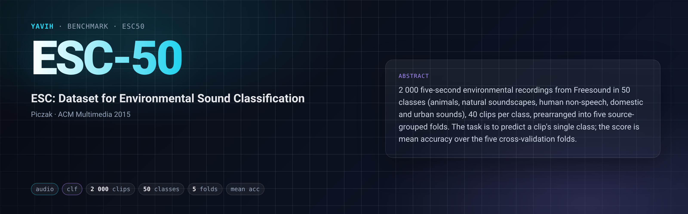

[Paper](https://dl.acm.org/doi/10.1145/2733373.2806390) · [Homepage](https://github.com/karolpiczak/ESC-50) · [Dataset](https://dx.doi.org/10.7910/DVN/YDEPUT) · [setup.md](setup.md)

## Description

ESC-50 (K. J. Piczak, ACM Multimedia 2015) is a labelled collection of 2 000 environmental recordings of
5.0 s, cut from public Freesound field recordings, in 50 classes (`dog`, `rain`, `chainsaw`, …) with 40
clips per class, loosely grouped into five major categories (animals; natural soundscapes and water; human
non-speech; interior/domestic; exterior/urban). The corpus is prearranged into five source-grouped folds of
400 clips (8 per class per fold) for comparable cross-validation. The task is to predict the one class of a
mono clip from its audio alone; the standard score is accuracy averaged over the five folds. Licence: CC
BY-NC 3.0 (the ESC-10 subset CC BY 3.0).

## Citation

```bibtex
@inproceedings{piczak2015dataset,
  title = {{ESC}: {Dataset} for {Environmental Sound Classification}},
  author = {Piczak, Karol J.},
  booktitle = {Proceedings of the 23rd {Annual ACM Conference} on {Multimedia}},
  date = {2015-10-13},
  url = {http://dl.acm.org/citation.cfm?doid=2733373.2806390},
  doi = {10.1145/2733373.2806390},
  location = {{Brisbane, Australia}},
  isbn = {978-1-4503-3459-4},
  publisher = {{ACM Press}},
  pages = {1015--1018}
}
```

## In yavih

### Protocol

Readout `clf` (single label, attentive probe) under 5-fold cross-validation, `protocol_version: 1`.
Features are extracted once for all 2 000 rows (one split per fold); five probes then each train on four
folds (1 600 clips; uncapped, `train_draw: null`) and score the held-out fold (400).

| manifest `split` | role | rows | per class |
|---|---|---|---|
| `"1"` | fold | 400 | 8 |
| `"2"` | fold | 400 | 8 |
| `"3"` | fold | 400 | 8 |
| `"4"` | fold | 400 | 8 |
| `"5"` | fold | 400 | 8 |

`splits.folds: ["1", "2", "3", "4", "5"]`; `train`/`eval` are empty by construction. Headline
**`acc_mean`** = mean over the five folds of micro top-1 accuracy, reported with `acc_pstd` (population
std), `acc_per_fold`, `n_folds` (must be 5) and `n_eval` (2 000), with a Wilson 95 % interval on the 2 000
pooled held-out predictions (`ci: {acc_mean: pooled_binomial}`). Chance = **0.02**; floor `acc_floor` =
**0.02** (the train-majority class: ESC-50 is perfectly balanced, so the floor is exactly chance). A CI that
overlaps 0.02 is no result. No controls, no `external` code (the ESC-50 repository ships no scorer). Probe:
`ProbeConfig.pinned("clf")`. The classes are `classes.csv` (sorted names). Frozen manifest sha256
`4846c6d167ff…`.

The bridge gets each clip's stored wav untouched (44.1 kHz mono PCM_16, 220 500 samples) with its header
facts, and returns fixed `[N, D]` tokens per clip; resampling, padding and the front end are the bridge's
declared decisions. See [setup.md](setup.md) ("Input contract", "Output contract", "Gotchas").

A frozen-feature probe is not comparable to the fine-tuned numbers of the literature.

### Variants and aliases

No aliases; one variant: all 50 classes under the official five folds, mean accuracy. The **ESC-10**
subset (the 400 clips with `esc10 == True`, 10 classes) is recorded as a manifest column but is not a
separate benchmark here; an ESC-10 number is not an ESC-50 number. A single-fold accuracy (train on four
folds, test on one) is not an ESC-50 result either. The upstream `target` digit (filename /
`meta/esc50.csv`) is a different class order from `classes.csv`; nothing in yavih uses it.

### Reference numbers

Published accuracies, as listed in the ESC-50 repository (human or fine-tuned, not frozen probes; not
comparable): human listeners 81.3 % (Piczak 2015), AST 95.7 % (Gong et al., Interspeech 2021), BEATs
98.1 % (Chen et al., ICML 2023). Noise:
the Wilson CI over 2 000 pooled rows is ±0.022 at 0.5 and ±0.016 at 0.85; one fold of 400 is ±0.035.
Treat gaps below ~0.015 at one seed as unresolved; run `--seeds 0,1,2` before claiming 1-point
differences. A number near the floor on one fold only (`acc_per_fold`) means a broken fold extraction:
check `features validate` coverage per fold.

### Re-freezing the manifest

`make_manifest.py` derives the 2 000 rows from the official `meta/esc50.csv` (ESC-50 @ `33c8ce9`, sha256
`ca660da6…`) in file order, writes `manifest.csv.gz` and `classes.csv` byte-identically, asserts 5 × 400
rows, 8 per class per fold, 50 classes and the four known cross-fold sources, reads every WAV header, and
prints the `manifest.upstream` block. It rewrites the folder, so run it in a git checkout of
https://github.com/Bizilizi/yavih installed with `pip install -e`:

```bash
FOLDER=$(yavih bench path esc50)
python "$FOLDER/make_manifest.py" --check     # re-derive from meta/esc50.csv and compare, write nothing
yavih bench prepare esc50 03                  # re-freeze, check the pinned sha256s, bench verify
pytest "$FOLDER/tests"                        # the folder tests
```
