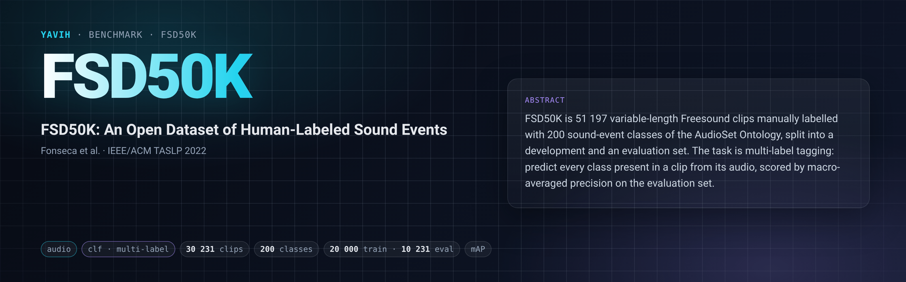

[Paper](https://arxiv.org/abs/2010.00475) · [Dataset](https://zenodo.org/records/4060432) · [setup.md](setup.md)

## Description

FSD50K (Fonseca, Favory, Pons, Font, Serra; IEEE/ACM TASLP 2022) is 51 197 Freesound clips (40 966
dev, 10 231 eval) annotated with 200 classes of the AudioSet ontology. The task is to predict the set
of sound-event classes present in a clip from its audio alone: weak clip-level labels, smeared (every
ancestor of a label is also positive; 1–22 labels per clip over the frozen rows, mean 3.1 — train 2.7,
eval 3.8), clips of variable length (0.300–64.133 s over the frozen rows; 44.1 kHz mono PCM16).
The dev set carries an official `train`/`val` sub-split for model selection; dev and eval share no
Freesound uploader. The paper's headline metric is the macro-averaged PR-AUC (= mAP) over the 200
classes on the official eval set.

## Citation

```bibtex
@article{fonseca2022fsd50k,
  title   = {{FSD50K}: An Open Dataset of Human-Labeled Sound Events},
  author  = {Fonseca, Eduardo and Favory, Xavier and Pons, Jordi and Font, Frederic and Serra, Xavier},
  journal = {IEEE/ACM Transactions on Audio, Speech, and Language Processing},
  volume  = {30},
  pages   = {829--852},
  year    = {2022},
  note    = {arXiv:2010.00475}
}
```

## In yavih

### Protocol

`scorer: clf` with `label.kind: multi` (BCE attentive probe on frozen features), `protocol_version: 1`.
Headline metric **`map`** = macro-averaged average precision over the fixed 200-class vocabulary on
the full official eval set; a class without eval positives would count AP = 0 (there is none:
`effective_pos_classes = 200`, minimum 32 positives per class). Chance `map ≈ 0.0189` (mean per-class
eval prevalence); the floor `map_floor` (constant train-prevalence score) equals the same 0.0189.
`ci95.map` is a seeded clip-level bootstrap (2 000 resamples, seed 0) that recomputes the macro AP over
the 200 classes per resample (`metrics.ci: {map: bootstrap_clip}`). No controls.

| split value | role | rows | source |
|---|---|---|---|
| `train` | train | 20 000 | seeded first-label-balanced draw of the official dev set (train + val, 40 966); the other 20 966 dev rows are `excluded.draw_remainder` |
| `eval` | eval | 10 231 | the full official eval set, never capped (`min_eval_coverage: 0.95`) |

Train draw: `cap: 20000, seed: 0, balance: first_label` — `yavih.freeze.class_balanced_subsample`
(one `torch.Generator(seed 0)`, per-class `randperm` in sorted-label order, round robin) over the
40 966 rows of the official `dev.csv` in file order, keyed by each row's FIRST label (the official
CSVs list the leaf label first); 196 first-label classes drawn, 2–124 rows each; 17 709 rows come from
the official `train` sub-split, 2 291 from `val` (`dev_split` column).

Manifest columns: `clip_id` (Freesound id), `labels` (`;`-joined class names, `class_key: name`),
`split`, `rel_path` (`dev_audio/<id>.wav` / `eval_audio/<id>.wav`), `dev_split` (official `train`/`val`
of a frozen train row; empty on eval rows), `duration_s` (WAV header, 3 decimals; 6 clips within 1 ms
of 10 s are counted as full). `classes.csv` = the official `vocabulary.csv` (`index,name,mid`) with a
header, in the official index order. That order happens to coincide with sorting the label names; do
not rely on it, read the `index` column. Frozen `manifest.csv.gz` sha256 (decompressed)
`e90a44a6aac640ca51ba66ac42454e952fbb40caf27fa07aa9725944c117338b`.

The bridge gets one stream, `audio`: the FSD50K wav exactly as stored (44.1 kHz mono PCM16) with its
header facts. How much of it the model reads, the resampling, padding and front end are the bridge's
declared decisions; it returns one fixed `[N, D]` per clip. Contracts, data and gotchas: [`setup.md`](setup.md).

### Variants and aliases

No aliases. This folder is the only FSD50K variant shipped: a 20 000-row train draw of dev, the full
eval set, macro mAP. Not shipped: the full 40 966-row dev set as probe-train pool, the official
train/val split used for model selection (here `val` rows are probe-train rows; the probe carves its
own validation split), and the paper's d' metric. Input windows, sample rates and front ends are not
variants: they are bridge declarations (`describe()["input"]["audio"]`), recorded with every number;
two windows compared side by side are two `model` names. Not this benchmark: FSDKaggle2018/2019,
AudioSet, ESC-50.

### Reference numbers

* Floor / chance: `map_floor = 0.0189` (= `metrics.chance.map`). A constant score ties every clip, so
  each class's AP is its prevalence; only audio can beat it. A `map` whose CI overlaps 0.02 is noise.
* `effective_pos_classes` must read 200 and `n_eval` 10 231 (the probe refuses below 9 720 present
  eval rows); anything lower means eval rows went missing (`coverage`, `W_COVERAGE`).
* Published: the FSD50K paper's baselines, trained from scratch on the dev train split (checkpoint
  picked on the 4 170-clip dev val split), reach on eval mAP 0.434 ± 0.002 (VGG-like), 0.425 ± 0.002
  (DenseNet-121), 0.417 ± 0.003 (CRNN) and 0.373 ± 0.001 (ResNet-18), mean ± std over three trials
  (Fonseca et al., IEEE/ACM TASLP 30, 2022, Table VI; arXiv:2010.00475v2). A frozen-feature probe trained
  on a 20 000-row draw of dev is not directly comparable to such end-to-end systems.
* Noise: eval is fixed (10 231 clips), so run-to-run noise is probe-seed noise plus the bootstrap CI
  (about ±0.01 at `map ≈ 0.45`). Treat gaps below ~0.01 mAP as unresolved at one seed.

### Re-freezing the manifest

`make_manifest.py` re-derives `manifest.csv.gz` and `classes.csv` byte for byte from the official
`ground_truth/{dev,eval,vocabulary}.csv` (sha256-pinned; from `FSD50K.ground_truth.zip`) and the staged
wav headers; it needs torch (the draw uses `torch.randperm`) and soundfile at freeze time only.
`prepare/03_make_manifest.sh` wraps it and the sha checks.

```bash
FOLDER=$(yavih bench path fsd50k)
python "$FOLDER/make_manifest.py" --check                     # re-derive and compare, writes nothing (exit 1 on drift)
python "$FOLDER/make_manifest.py" --check --reuse-durations   # the same from the three CSVs alone, no media needed
python "$FOLDER/make_manifest.py" --media-root /path/to/fsd50k   # rewrite the folder; prints the upstream block as JSON
python -m pytest "$FOLDER/tests" -q -p no:cacheprovider       # the folder tests
```
