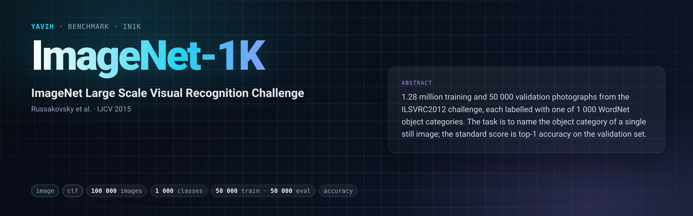

[Paper](https://arxiv.org/abs/1409.0575) · [Homepage](https://image-net.org/challenges/LSVRC/2012/) · [Dataset](https://image-net.org/download-images.php) · [setup.md](setup.md)

## Description

ImageNet-1K is the classification track of the ImageNet Large Scale Visual Recognition Challenge 2012
(ILSVRC2012; Russakovsky et al., IJCV 2015), drawn from the ImageNet database (Deng et al., CVPR 2009). Each
image is a still photograph labelled with one of 1 000 leaf WordNet synsets ("wnids"). The official splits are
train (1 281 167 images, 732–1 300 per class), val (50 000 images, 50 per class) and test (100 000 images,
labels withheld). The task is to predict the one object category of an image; the challenge scored top-5 error
on test, and top-1 accuracy on val is the usual report. The images are available from image-net.org under
its terms of access (non-commercial research and education; no redistribution).

## Citation

```bibtex
@article{russakovsky2015imagenet,
  title   = {{ImageNet} Large Scale Visual Recognition Challenge},
  author  = {Russakovsky, Olga and Deng, Jia and Su, Hao and Krause, Jonathan and Satheesh, Sanjeev and
             Ma, Sean and Huang, Zhiheng and Karpathy, Andrej and Khosla, Aditya and Bernstein, Michael and
             Berg, Alexander C. and Fei-Fei, Li},
  journal = {International Journal of Computer Vision},
  volume  = {115},
  number  = {3},
  pages   = {211--252},
  year    = {2015},
  doi     = {10.1007/s11263-015-0816-y}
}
@inproceedings{deng2009imagenet,
  title     = {{ImageNet}: A large-scale hierarchical image database},
  author    = {Deng, Jia and Dong, Wei and Socher, Richard and Li, Li-Jia and Li, Kai and Fei-Fei, Li},
  booktitle = {IEEE Conference on Computer Vision and Pattern Recognition (CVPR)},
  pages     = {248--255},
  year      = {2009}
}
```

## In yavih

### Protocol

Readout `clf` (attentive probe with cross-entropy and yavih's pinned `clf` `ProbeConfig`: 3+1 blocks, 16
heads, mlp 4, lr 1e-4, wd 1e-4, 30 epochs, batch 256, patience 5, cosine, `val_fraction` 0.1).
`protocol_version: 1`.

| manifest `split` | role | rows | note |
|---|---|---|---|
| `train` | train (probe val carved from it) | 50 000 | 50 per class: the seed-0 class-balanced draw (`protocol.train_draw`, cap 50 000) of the 1 281 167 train images, frozen into the manifest |
| `val` | eval (scored, never trained on, never capped) | 50 000 | ILSVRC2012 val, 50 per class |

Headline metric `acc` = micro top-1 over the 50 000 val images with a binomial 95 % CI; disclosure `n_eval`;
chance 0.001; floor `acc_floor` = majority-class rate of the train targets = 0.001 (every class has 50 rows, so
the floor equals chance). `controls: []`, `external: []`: the devkit's scorer counts flat top-k errors, and
yavih's `acc` is the same count at k = 1. `min_eval_coverage: 0.95`. The 1 000 classes are in sorted-wnid
order (`classes.csv` `index,name`, `name` = wnid), the torchvision `ImageFolder` order. Binomial SE at
n = 50 000 is 0.0022 (CI half-width ≈ 0.0044 at acc 0.5, 0.0027 at 0.1).

The bridge gets one stream `image`: the stored ILSVRC2012 JPEG, byte for byte, with its width, height,
container and size. Decoding, colour conversion, resize, crop and normalisation are the bridge's declared
choices. It returns `[N, D]` per image with no positional requirement. Contracts and data:
[`setup.md`](setup.md).

### Variants and aliases

Aliases `imagenet1k` and `imagenet` resolve here (`Benchmark.load("imagenet")`); the report collapses them.
One variant ships: the frozen 50-per-class train draw (50 000 rows) and the full 50 000-image val split; 20 per
class was judged too label-starved to rank models stably. Numbers are not comparable to full-train linear-probe
or fine-tuning ImageNet results. Not this benchmark: the full 1.28 M-image training protocol, ImageNet-21K,
ImageNet-V2, the ImageNet-ReaL relabelling, and k-NN or fine-tuning protocols.

### Reference numbers

No published numbers exist for this protocol (frozen 50-per-class draw, attentive probe on frozen features).
The floor is 0.001; `yavih.testing.random_bridge` lands on it.

### Re-freezing the manifest

`make_manifest.py` rebuilds `manifest.csv.gz`, `classes.csv` and `curation.json` byte-identically from public
files: the ILSVRC2012 devkit (`data/meta.mat` for the 1 000 wnids, `data/ILSVRC2012_validation_ground_truth.txt`
for the val labels) and the train file list, taken from an extracted torchvision root or from the member names
of `ILSVRC2012_img_train.tar` (`--train-tar`). The devkit sha256 and the sha256 of the sorted train list are
pinned. The train draw is `yavih.freeze.class_balanced_subsample(labels, 50000, 0)` over the sorted train list.
It needs torch and scipy.

```bash
FOLDER=$(yavih bench path in1k)
python "$FOLDER/make_manifest.py" --check    # exit 0 and "identical" when the committed files are reproduced
python "$FOLDER/make_manifest.py"            # writes manifest.csv.gz, classes.csv, curation.json into $FOLDER
python -m pytest "$FOLDER/tests" -q -p no:cacheprovider
```

The curation block (`manifest.upstream.curation`) sums as `total_upstream 1 331 167 = train.listed 50 000 +
val.listed 50 000 + excluded.draw_remainder 1 231 167`; train and val are disjoint by construction.
