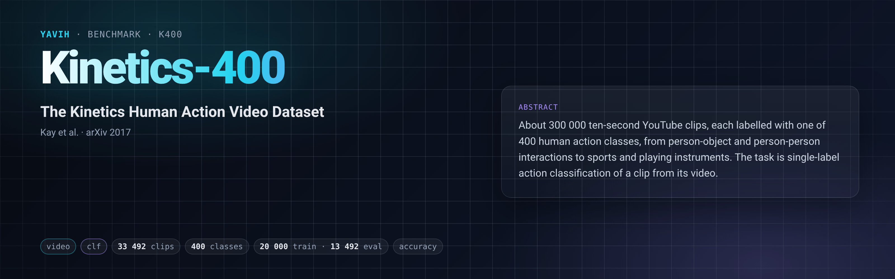

[Paper](https://arxiv.org/abs/1705.06950) · [Homepage](https://github.com/google-deepmind/kinetics-i3d) · [Dataset](https://academictorrents.com/details/184d11318372f70018cf9a72ef867e2fb9ce1d26) · [setup.md](setup.md)

## Description

Kinetics-400 (Kay et al., 2017) is a set of ~10-second YouTube clips, each labelled with one of 400 human-action
classes: person-object interactions such as playing instruments, person-person interactions such as hugging, and
sports. Every clip comes from a different YouTube video. The task is to predict the single action class of a clip;
the paper reports top-1 and top-5 accuracy. The official splits have 250–1 000 training clips per class, 50
validation clips per class and 100 test clips per class. The annotation CSVs list 246 534 train, 19 906 validation
and 39 805 test clips. Annotations are CC BY 4.0 (DeepMind). The videos stay on YouTube, so every copy of the media
is a re-download made by a third party.

## Citation

```bibtex
@article{kay2017kinetics,
  title   = {The Kinetics Human Action Video Dataset},
  author  = {Kay, Will and Carreira, Joao and Simonyan, Karen and Zhang, Brian and Hillier, Chloe and
             Vijayanarasimhan, Sudheendra and Viola, Fabio and Green, Tim and Back, Trevor and Natsev, Paul and
             Suleyman, Mustafa and Zisserman, Andrew},
  journal = {arXiv preprint arXiv:1705.06950},
  year    = {2017}
}
```

## In yavih

### Protocol

`scorer: clf` (single label, cross-entropy), `label.kind: single`, 400 classes, `protocol_version` 1. The media
come from the Academic-Torrents Kinetics-400 `_256` release (height 256, 157 GB). This is a frozen-feature probe on
the video only.

| split | role | rows | content |
|---|---|---|---|
| `train` | train (the probe carves its 10 % val from these) | 20 000 | seeded class-balanced draw, exactly 50 per class; id `<ytid>_<start6>_<end6>` (35 ids are `youtube-<ytid>-<start>-<end>`) |
| `val` | eval (never capped, never trained on) | 13 492 | every `.mp4` of the release's `val_256`, 11–48 per class; id = the ytid as the release names the file |

- **Headline** `acc` (exact top-1, micro). Chance is **0.0025** (1/400). `n_eval` is reported alongside, with a
  95 % Wilson interval (`metrics.ci: {acc: binomial}`). There are no `controls`.
- **Floor** `acc_floor` is the accuracy of the train-majority class on eval. The draw is exactly balanced, so over
  all 20 000 train rows the tie goes to index 0 (`abseiling`, 38 eval clips → **0.0028**). Over a 10 %-carved
  subset the majority is whichever class kept the most rows, so the floor lies in [0.0008, 0.0036] (the smallest
  and largest eval classes have 11 and 48 clips). A probe within about 0.01 of the floor has learned nothing.
- **Sampling noise** of this eval set: the Wilson 95 % half-width on 13 492 clips is ±0.0083 at acc 0.4, ±0.0068 at
  0.2 and ±0.0051 at 0.1. Run at least 2 probe seeds.
- **Train draw** `cap 20000, seed 0, balance: class`: `yavih.freeze.class_balanced_subsample` (torch
  `Generator(0)`, per-class `randperm` in sorted label order, round-robin) over all 240 618 train `.mp4` of the
  release. Rows are ordered by class (`classes.csv`), then by file name. `min_eval_coverage: 0.95`.
- **Divergences from the paper's protocol**: 13 492 of the 19 906 annotated validation clips (the release's `val_256`
  `.mp4` files only); single clip, single view; frozen features with yavih's pinned probe. Published Kinetics-400
  numbers (multi-view, full validation set, fine-tuned or the model's own probe recipe) are not comparable.

The bridge receives the stored mp4 of each clip, undecoded, with its header facts (`duration_s, fps, width, height,
container, bytes`). It decides and declares which frames, span, crop, resolution and normalization the model sees,
and returns one fixed `[N, D]` per clip (positions optional for `clf`). Details are in [setup.md](setup.md).

### Variants and aliases

No aliases; one variant ships. The following are NOT this benchmark:
- the full Kinetics-400 validation set, or the ~450 GB CVDF release (<https://github.com/cvdfoundation/kinetics-dataset>),
  which has different files, durations and containers and would need a new `protocol_version`;
- Kinetics-600 and Kinetics-700;
- a variant that also scores the 5 912 `.mkv`/`.webm` validation files of this release (19 404 eval clips, at least
  26 per class), which would be a future `protocol_version`.

### Reference numbers

No published number uses this protocol (frozen features, single view, 13 492-clip eval). Use the floor and chance
values above to read a result.

### Re-freezing the manifest

`make_manifest.py` rebuilds `manifest.csv.gz` byte for byte from public inputs:
- the release's file listing, read from the staged tree (`--media-root`, default the configured `media_root`) or
  straight from the two torrent zips (`--zips DIR`). It is pinned by sha256 and by its container census;
- the committed `classes.csv`, which gives the class order;
- optionally the Kinetics-400 annotation CSVs (`--annotations DIR` holding `train.csv` and `val.csv` from
  <https://s3.amazonaws.com/kinetics/400/annotations/>). With them, every frozen row must be an annotated clip of
  its split with the same label.

```sh
FOLDER=$(yavih bench path k400)
python "$FOLDER/make_manifest.py" --check                     # staged tree; exit 1 on drift
python "$FOLDER/make_manifest.py" --check --zips "$(yavih config get data.root)/k400_download/kinetics400_dataset"
python "$FOLDER/make_manifest.py" --check --annotations /path/to/k400_annotations
python "$FOLDER/make_manifest.py" --durations k400_durations.csv   # + PyAV header census (short clips, media bytes)
python -m pytest "$FOLDER/tests" -q -p no:cacheprovider
```

The script needs torch for the draw, and PyAV (`yavih[media]`) for `--durations`. Without `--check` it writes
`manifest.csv.gz` and prints the values that `benchmark.yaml` records (sha256s, `manifest.upstream`, curation). The
folder tests check the curation sums: 20 000 + 13 492 + 220 618 (draw remainder) + 5 912 (val `.mkv`/`.webm`) =
260 022 files.
