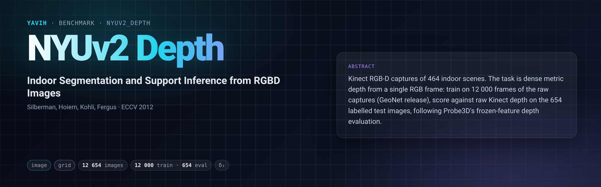

[Paper](https://cs.nyu.edu/~fergus/datasets/indoor_seg_support.pdf) · [Homepage](https://cs.nyu.edu/~fergus/datasets/nyu_depth_v2.html) · [GeoNet frames](https://github.com/xjqi/GeoNet) · [Probe3D](https://github.com/mbanani/probe3d) · [setup.md](setup.md)

## Description

NYU Depth Dataset V2 (Silberman et al., ECCV 2012) records 464 indoor scenes with a Microsoft Kinect as RGB and
depth video. Its 1 449 labelled frames carry aligned RGB, raw Kinect depth and an inpainted depth map; the
standard split puts 795 of them in train and 654 in test (`test_SN40.json`). The task here is dense metric depth
from a single RGB frame, in the frozen-feature form of Probe3D (El Banani et al., "Probing the 3D Awareness of
Visual Foundation Models", CVPR 2024, <https://github.com/mbanani/probe3d>): a probe on frozen features is trained
on frames of the raw captures released by GeoNet (Qi et al., CVPR 2018; 30 916 frames with depth) and scored on the
654 labelled test images against raw Kinect depth, inside the 480×480 centre square of each 480×640 frame.

## Citation

```bibtex
@inproceedings{silberman2012indoor,
  title     = {Indoor Segmentation and Support Inference from {RGBD} Images},
  author    = {Silberman, Nathan and Hoiem, Derek and Kohli, Pushmeet and Fergus, Rob},
  booktitle = {European Conference on Computer Vision (ECCV)},
  pages     = {746--760},
  year      = {2012}
}
@inproceedings{elbanani2024probing,
  title     = {Probing the {3D} Awareness of Visual Foundation Models},
  author    = {El Banani, Mohamed and Raj, Amit and Maninis, Kevis-Kokitsi and Kar, Abhishek and Li, Yuanzhen and
               Rubinstein, Michael and Sun, Deqing and Guibas, Leonidas and Johnson, Justin and Jampani, Varun},
  booktitle = {IEEE/CVF Conference on Computer Vision and Pattern Recognition (CVPR)},
  year      = {2024}
}
@inproceedings{qi2018geonet,
  title     = {{GeoNet}: Geometric Neural Network for Joint Depth and Surface Normal Estimation},
  author    = {Qi, Xiaojuan and Liao, Renjie and Liu, Zhengzhe and Urtasun, Raquel and Jia, Jiaya},
  booktitle = {IEEE/CVF Conference on Computer Vision and Pattern Recognition (CVPR)},
  year      = {2018}
}
```

## In yavih

### Protocol

Readout `grid`: the pinned `dense_query_v1` head places one query per cell of a 14×14 grid tiling
`protocol.target_region` = `[0.0, 0.125, 1.0, 0.875]` of the full frame (Probe3D's 480×480 centre square of the
480×640 image), reads the bridge's tokens through their full-frame `pos.(y, x)`, emits one log-depth per cell,
upsamples bilinearly in log space to 224×224, exponentiates, and trains with `l1_log` against the 224×224
targets (the nearest-exact raster of `target_region`; invalid = 0, valid `0 < d ≤ 10` m). `protocol_version: 1`.

| manifest `split` | role | rows | source |
|---|---|---|---|
| `train` | train (probe val carved from it) | 12 000 | GeoNet frames: the seed-0 session-balanced draw (`protocol.train_draw`, 342 capture sessions) |
| `eval` | eval (scored, never trained on, never capped) | 654 | labelled NYUv2 test images (`test_SN40.json`), raw Kinect depth, 234 sessions |

The train draw: the 30 916 GeoNet files minus 847 files of 6 label-less capture sessions that share a base name
with a test session (a conservative leakage exclusion; no capture session is shared by train and eval) minus
Probe3D's two positional deletes (both files unreadable in full) leave a 30 067-file pool, from which
`yavih.freeze.class_balanced_subsample` draws 12 000 frames with the capture session as the class (seed 0).

Headline metric `d1` = fraction of valid pixels with `max(gt/pred, pred/gt) < 1.25`, per image then averaged
over the 654 images, computed by **Probe3D's `evals.utils.metrics.evaluate_depth`** (`external: evals`, commit
`a1f14640`), 95 % CI by clip-level bootstrap; also `d2`, `d3`, `rmse` (metres; Probe3D), `absrel` (yavih's, not
in Probe3D's file), disclosure `n_eval`. No chance level; floor `d1_floor` = Probe3D `d1` of the per-pixel mean
TRAIN log-depth map = **0.4403** on the frozen targets (d2 0.7469, d3 0.9053, absrel 0.344, rmse 1.039 m).
`controls: []`. A `d1` that does not clear the floor plus its CI is not a depth result. The 95 % bootstrap
half-width of `d1` over the 654 images is ≈ 0.016 at the floor (per-image `d1` sd 0.216): a gap below ~0.02
between two models is not meaningful on one seed.

The bridge gets one stream `image`: a lossless PNG of the frame's exact upstream RGB (640×480), re-containered at
prepare time because both upstream containers also hold the depth, plus the fact `target_region`. It returns a
token grid with positions in full-frame coordinates (a pooled `N = 1` bridge is ineligible, recorded
`not_applicable`); decoding, crop, resize and normalisation are its declared choices. Contracts, data and
verification: [`setup.md`](setup.md).

Differences from Probe3D's published numbers: yavih's pinned attentive `dense_query_v1` head on frozen tokens
replaces Probe3D's DPT-style probe, targets are 224×224, and the floor is the log-mean map; numbers are not
comparable to Probe3D's tables.

### Variants and aliases

No aliases. One variant ships: GeoNet-12k train / labelled-654 test, 14×14 grid over Probe3D's centre square,
224×224 targets. Not this benchmark: the 795/654 labelled-only split of most monocular-depth papers, Eigen's crop
(Probe3D's `nyu_crop` `[45:471, 41:601]`, unused by its NYU depth probe and here), scale-invariant
(`match_scale_and_shift`) scoring, surface normals (Probe3D's other NYU task) and fine-tuned depth networks.

### Re-freezing the manifest

`make_manifest.py` rebuilds `manifest.csv.gz` and `curation.json` byte-identically from public inputs: the
listing of GeoNet's `nyu_geonet/` (names only, pinned by the sha256 of the sorted names) and `eval_meta.json` of
the eval index (prepare step 02, from `nyu_depth_v2_labeled.mat` and `test_SN40.json`; pinned without its
absolute `source_mat` path). It replays the draw above (needs torch) and asserts every count:

```bash
FOLDER=$(yavih bench path nyuv2_depth)
python "$FOLDER/make_manifest.py" --geonet-dir <GEONET_ROOT>/nyu_geonet --eval-meta <DERIVED_ROOT>/eval_meta.json --check   # "identical", exit 0
python "$FOLDER/make_manifest.py" --geonet-dir <GEONET_ROOT>/nyu_geonet --eval-meta <DERIVED_ROOT>/eval_meta.json            # writes into $FOLDER
```

Train `clip_id` = GeoNet stem; eval `clip_id = labeled_<1-based index, 6 digits>`; `eval_row` = row in
`eval_rgb.npy` / `eval_depth.npy` / `eval_depth_224.npy`. Manifest sha256
`0cbf32db5f6b21cb7899b686f06e1ffddeb67d74243b3181b3347ffb67996ac2`; curation `total_upstream 31 570 (30 916
GeoNet + 654 test) = train 12 000 + eval 654 + excluded {leakage 847, corrupt 2, draw_remainder 18 067}`. Leakage
is checked by capture session (`rawRgbFilenames`), never by the coarse `scenes` field (the two disagree on 250 of
the 1 449 labelled images); the excluded sessions are `bookstore_0001l, bookstore_0001m, classroom_0001b,
dining_room_0026b, living_room_0043c, living_room_0064b`. Probe3D deletes listing indices 6919 and 21181; both
files are unreadable in full (one truncated, one zlib error -3) and are counted as `excluded.corrupt: 2`.

Folder tests: `python -m pytest "$(yavih bench path nyuv2_depth)/tests" -q -p no:cacheprovider`.
