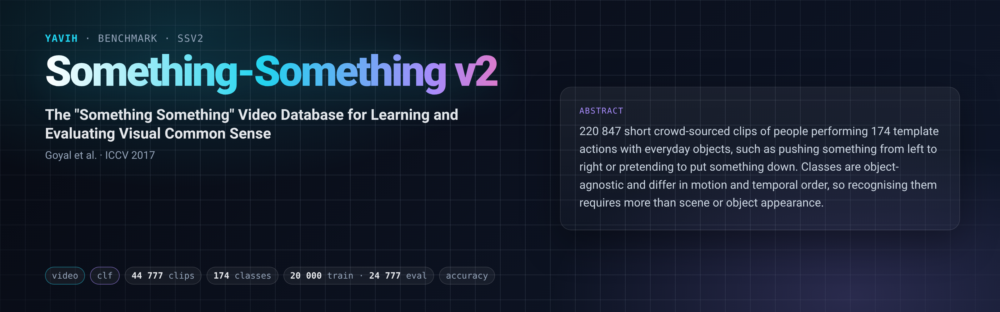

[Paper](https://arxiv.org/abs/1706.04261) · [Homepage](https://developer.qualcomm.com/software/ai-datasets/something-something) · [setup.md](setup.md)

## Description

Something-Something v2 (TwentyBN, now distributed by Qualcomm) holds 220 847 short crowd-sourced webm clips
of people performing one of 174 template actions with everyday objects ("Pushing something from left to
right", "Pretending to put something on a surface", …). The classes are object-agnostic and temporally
ordered (left vs right, putting vs pretending), so the action has to be recognised from motion and temporal
order, not from scene or object appearance. The clips are 240 pixels high, 12 fps, mostly 2–6 s long, and have
no audio track.

The official release splits the clips into train (168 913), validation (24 777) and test (27 157, labels
released later in `test-answers.csv`). Labels are the action templates with the object placeholders
(`[something]`) left generic; the release also lists the objects of each clip.

## Citation

```bibtex
@inproceedings{goyal2017something,
  title     = {The "Something Something" Video Database for Learning and Evaluating Visual Common Sense},
  author    = {Goyal, Raghav and Ebrahimi Kahou, Samira and Michalski, Vincent and Materzynska, Joanna and
               Westphal, Susanne and Kim, Heuna and Haenel, Valentin and Fruend, Ingo and Yianilos, Peter and
               Mueller-Freitag, Moritz and Hoppe, Florian and Thurau, Christian and Bax, Ingo and Memisevic, Roland},
  booktitle = {Proceedings of the IEEE International Conference on Computer Vision (ICCV)},
  pages     = {5842--5850},
  year      = {2017}
}
```

## In yavih

The motion and temporal-order probe: a frozen video encoder's features of one clip are read out into one of
the 174 classes. A model that sees frames as an unordered bag does poorly here and well on k400.

### Protocol

Readout `clf` (attentive probe, cross-entropy, yavih's pinned `clf` `ProbeConfig`: 3+1 blocks, 16 heads,
mlp 4, lr 1e-4, wd 1e-4, 30 epochs, batch 256, patience 5, cosine, `val_fraction` 0.1). `protocol_version: 1`.

| manifest `split` | role | rows | note |
|---|---|---|---|
| `train` | train (probe val carved from it, `val_fraction` 0.1) | 20 000 | frozen seed-0 class-balanced draw from the 168 913 `train.json` clips, ascending `train.json` order |
| `val` | eval (scored, never trained on, never capped) | 24 777 | the full official validation split, `validation.json` order (not sorted); 15–530 clips per class |

- Headline metric `acc` = micro top-1 over the 24 777 validation clips, binomial 95 % CI; disclosure `n_eval`
  (must read 24 777; the probe refuses below `min_eval_coverage: 0.95` unless `--allow-low-coverage`).
  Chance 1/174 = 0.005747; floor `acc_floor` (train-majority class scored on val) ≈ **0.0047**; `controls: []`.
- Frozen train draw: `cap: 20000, seed: 0, balance: class` over `labels/train.json` —
  `yavih.freeze.class_balanced_subsample` (`torch.Generator` seed 0, per-class `randperm` in sorted-label
  order, round-robin, result sorted): 154 classes × 115, 18 × 116, `Poking a hole into some substance` 91 and
  `Spilling something behind something` 111 (all their train clips).
- Classes: `classes.csv` `index,name`, 174 rows in the official `labels.json` order (Python-sorted: 0
  `Approaching something with your camera` … 173 `Wiping something off of something`); `name` = template
  with `[`/`]` stripped; 12 names contain a comma (CSV-quoted).
- The bridge gets one stream `video`: the stored webm byte for byte with its header facts (duration, fps, frame
  count, frame size). Which frames, at what times, at what size and with which normalisation is the bridge's
  declared decision. It returns `[N, D]` fixed per feature set, no position requirement. Details:
  [`setup.md`](setup.md) "Input contract" / "Output contract".
- `external: []`: the release ships no scorer; top-1 accuracy is yavih's registered `acc`.
- Not comparable to published SSv2 numbers, which fine-tune or probe on the full 168 913-clip train split.

Floor and chance: `acc_floor` is computed from train targets only — the train-majority class scored on val.
The frozen draw has 18 classes tied at 116; ties go to the lowest index, class 0 `Approaching something with
your camera`, which has 116 of 24 777 val clips → **0.00468** at full coverage (the probe's val carve and
missing rows can move the majority to another 115/116 class: any single class scores between 15/24 777 =
0.0006 and 530/24 777 = 0.0214 on val). The floor is below chance because val is imbalanced (15–530 per class)
while the train draw is balanced. A reading within ~0.01 of 0.005 is "no usable signal": check `.eval()`,
normalisation, frame count and the reported `used` times first.

Noise: binomial SE at n = 24 777 is 0.0021 at acc 0.12 (95 % CI half-width ≈ 0.004) and 0.0026 at 0.22
(±0.005). A gap under ~1 pt between two models is not meaningful.

### Variants and aliases

No aliases. This folder is the only SSv2 variant shipped: the frozen 20 000-clip class-balanced train draw
(not the full 168 913-clip train split) and the full validation split as eval.

- The official test split (27 157 clips, labels in `test-answers.csv`) is on disk after staging but not in the
  manifest.
- Full-train-split linear-probe or fine-tuning protocols (as in the V-JEPA and VideoMAE papers) are not this
  benchmark.
- Something-Something v1 (`20bn-something-something-v1`, JPEG frames) is a different release.
- WebDataset repackings of the release are not read here (`layout: dir`).

### Re-freezing the manifest

`make_manifest.py` re-derives every committed file from the official `labels/{labels,train,validation}.json`
(sha256 asserted): one row per entry (`label` = template with `[`/`]` stripped), the seed-0 cap-20 000
class-balanced draw over the 168 913 train rows, then all 24 777 val rows, gzip with `mtime=0`. It needs torch
(the draw uses `torch.Generator`) and the labels directory of a staged release.

```bash
FOLDER=$(yavih bench path ssv2)
python "$FOLDER/make_manifest.py" --check     # exit 0 + "identical": manifest.csv.gz, classes.csv, curation.json
python "$FOLDER/make_manifest.py"             # rewrites them (in a git checkout)
#   options: --labels <ROOT>/labels (default: <media_root>/labels)  --out <dir>
yavih bench prepare ssv2 04 -- [ROOT]          # --check, then bench verify --census
python -m pytest "$FOLDER/tests" -q -p no:cacheprovider   # folder tests
```

Frozen hashes: manifest `80def82d6f17565978e963312f048e92732dcb85fca2626bd26c462cc4ec4777`, classes
`cc184f05f25ec403848bbbb3b92cba9c0a103de986d5c7e7396bb49bb9c66552`.
