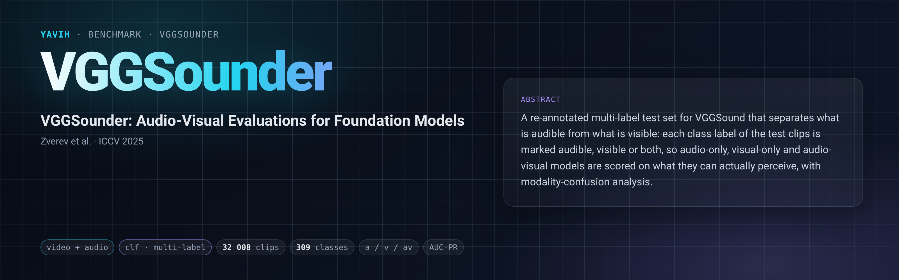

[Paper](https://vggsounder.github.io/static/vggsounder.pdf) · [Homepage](https://vggsounder.github.io) · [Dataset](https://github.com/Bizilizi/VGGSounder) · [setup.md](setup.md)

## Description

VGGSounder re-annotates the VGGSound test set as a multi-label benchmark for audio-visual foundation models.
Every label of a 10 s YouTube clip carries a modality tag: audible only (A), visible only (V) or both (AV), so a
model can be scored on what it should hear, what it should see, and everything present. The vocabulary is the
309 VGGSound classes. The annotations ship in the authors' `vggsounder` package (PyPI, Apache-2.0) together with
the official scorer, which reports top-k F1, accuracy and hit rate, macro AP and ROC-AUC per modality set and a
modality-confusion score `mu` from
the audio-only, video-only and audio-visual predictions of one model. The default variant excludes clips with
background music (12 014 videos); `vggsounder+background-music.csv` holds all 15 069. The media are the VGGSound
clips (Chen et al., ICASSP 2020): 199 176 YouTube segments listed in `vggsound.csv` with an official train
(183 730) / test (15 446) split.

## Citation

```bibtex
@inproceedings{zverevwiedemer2025vggsounder,
  author    = {Daniil Zverev and Thadd{\"a}us Wiedemer and Ameya Prabhu and Matthias Bethge and Wieland Brendel and A. Sophia Koepke},
  title     = {VGGSounder: Audio-Visual Evaluations for Foundation Models},
  booktitle = {Proceedings of the IEEE/CVF International Conference on Computer Vision (ICCV)},
  year      = {2025}
}

@inproceedings{chen2020vggsound,
  author    = {Honglie Chen and Weidi Xie and Andrea Vedaldi and Andrew Zisserman},
  title     = {VGGSound: A Large-scale Audio-Visual Dataset},
  booktitle = {IEEE International Conference on Acoustics, Speech and Signal Processing (ICASSP)},
  year      = {2020}
}
```

## In yavih

### Protocol

A frozen-feature attentive probe trained on VGGSound-train predicts the label set of each VGGSounder test clip;
the authors' package scores the predictions. `scorer: clf`, `label.kind: multi_sets`, BCE on one-hot train
targets, the pinned attentive probe. `protocol_version: 1`.

| split | role | rows | content |
|---|---|---|---|
| `train` | train (10 % carved as probe val) | 20 000 | class-balanced draw from the 183 730 `split == train` rows of `vggsound.csv` in file order (`cap 20000, seed 0, balance: class` → 64–65 clips per class); `label` = one class name |
| `test` | eval (never capped, never trained on) | 12 008 | VGGSounder 1.0, default variant without background music, minus 6 clips whose YouTube id is in VGGSound-train; disjoint `labels_a` / `labels_v` / `labels_av` |

`min_eval_coverage: 0.95`. One probe per reading. Every reported number is a value the official `vggsounder`
package returns (`external`, PyPI 1.0, assert-import; setup.md "## Dependencies"); yavih adds no floor, chance
level or disclosure of its own. Each reading is scored only on the package's ground-truth sets that the package
scores from that reading's logits: `a` (labels_a ∪ labels_av) and `a only` (labels_a) from the audio-only reading,
`v` (labels_v ∪ labels_av) and `v only` (labels_v) from the video-only reading, `av` (labels_av, both audible and
visible) from the audio-visual reading. Per set the package's `compare_labels_logits` returns 30 metrics, with
the package's names as metric ids: for k = 1, 3, 5, 10 `f1@k` (micro), `f1_macro@k`, `accuracy@k`, `jaccard@k`,
`precision@k`, `recall@k`, `hit_rate@k`, plus `auc_roc` and `auc_pr` (macro over classes with a positive). The id
is `<metric>` on the reading's own set and `<metric>_only` on its exclusive set (`a only` / `v only`); the `av`
reading has no exclusive set, so its `*_only` values are `null` (not applicable). Headline **`auc_pr`** (macro
average precision, the paper's mAP) on the reading's own set. The report's default table shows `auc_pr`,
`hit_rate@1` and `f1@1` (`metrics.table`); the other 57 are in `result.json`, the results store, json / csv output
and `report --detail`. No interval is defined (`metrics.ci: {}`): seeds are the noise estimate, run at least two.
The modality-confusion score `mu` needs all three readings: `yavih report build --join vggsounder a=RUN v=RUN
av=RUN` (the folder's `eval.py` `join()`) runs the package's `compute_all_results` on the three readings and
stores its whole output (the 30 metrics on all five sets, `mu` for `a`, `v` and `av`); its markdown shows rows A /
V / AV with mAP (`auc_pr`), HIT (`hit_rate@1`), F1 (`f1@1`) and `mu`, labelled A, V and A∩V for the package keys
`a`, `v` and `av` (A∩V: both A and V top-1 hit when AV top-1 fails).

A model is read three ways, audio only (`a`), video only (`v`) and both (`av`), as three bridges of one model
(one `describe()["model"]` name). Each bridge gets the stored VGGSound mp4 (`video`) and 16 kHz mono wav (`audio`)
of each row, undecoded, with their header facts, and returns a fixed `[N, D]` per clip; frames, window, padding
and audio front end are its declared choices (setup.md).

### Variants and aliases

No aliases. The `+background-music` variant (`vggsounder+background-music.csv`) and the pre-1.0 labels
(`vggsounder==0.1.6`) are not shipped. A reading is never scored on another reading's set (an audio-only reading
on the visible labels): the package does not route it so. The paper's per-routing evaluation with `mu` needs three
readings and is available only through `report --join`.
The paper scores each model's own predictions per routing; yavih trains a probe on frozen features, so its numbers
are not comparable to the paper's tables. Plain VGGSound single-label classification (309-way accuracy on the
15 446-clip VGGSound test split) is a different benchmark.

### Reference numbers

None published under this protocol.

### Re-freezing the manifest

`python "$(yavih bench path vggsounder)/make_manifest.py" --check` re-derives `manifest.csv.gz` and `classes.csv`
byte-identically from public files: the `vggsounder` 1.0 package's `data/vggsounder.csv` and `data/classes.csv`
(eval rows, labels, vocabulary) and the official `vggsound.csv` (train draw, leakage audit), each sha256-pinned.
It needs torch for the seeded draw and no media; given a staged media root it also prints the presence counts. It
prints the `manifest` and `upstream` (with `curation`) values `benchmark.yaml` carries.
`curation.short_clips` and the media facts in setup.md come from `yavih bench prepare vggsounder 04` (header
census of the 32 008 frozen rows). A different draw or eval population is a new `protocol_version`. The folder
tests are `pytest "$(yavih bench path vggsounder)/tests"`.
