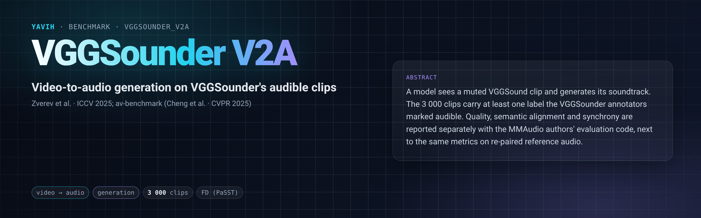

[Paper](https://vggsounder.github.io/static/vggsounder.pdf) · [Dataset](https://github.com/Bizilizi/VGGSounder) · [Evaluation code](https://github.com/hkchengrex/av-benchmark) · [setup.md](setup.md)

## Description

Video-to-audio generation: a model sees a muted video and generates its soundtrack. The clips are VGGSound test
clips (Chen et al., ICASSP 2020) re-annotated by VGGSounder, which marks every label of a clip as audible, visible or
both. Only clips with at least one audible label are used, so every clip has a soundtrack the video can be expected
to explain. A generation is compared with the clip's recorded audio (distributional quality and paired class
agreement) and with the video itself (semantic alignment and temporal synchrony), using the evaluation code the
MMAudio authors released for this task.

This folder follows the evaluation protocol and report format proposed in *Audio generative models in the multimodal
era* (Mitsufuji et al., in preparation): the evaluation manifest, annotation version and preprocessing are published
and frozen; semantic alignment and temporal synchrony are reported separately from quality; distributional distance is
reported under three embeddings and two estimators, FD and KAD; every alignment number is shown next to the same
number on real audio re-paired with the wrong video (a controlled error), and next to the correctly paired real audio;
the generation budget and selection rule are declared by every bridge and recorded with every number, and the
clip-level metrics carry bootstrap intervals and per-clip values for paired comparisons.

## Citation

```bibtex
@inproceedings{zverevwiedemer2025vggsounder,
  author    = {Daniil Zverev and Thadd{\"a}us Wiedemer and Ameya Prabhu and Matthias Bethge and Wieland Brendel and A. Sophia Koepke},
  title     = {VGGSounder: Audio-Visual Evaluations for Foundation Models},
  booktitle = {Proceedings of the IEEE/CVF International Conference on Computer Vision (ICCV)},
  year      = {2025}
}

@inproceedings{chen2020vggsound,
  author    = {Honglie Chen and Weidi Xie and Andrea Vedaldi and Andrew Zisserman},
  title     = {VGGSound: A Large-scale Audio-Visual Dataset},
  booktitle = {IEEE International Conference on Acoustics, Speech and Signal Processing (ICASSP)},
  year      = {2020}
}

@inproceedings{cheng2024taming,
  author    = {Ho Kei Cheng and Masato Ishii and Akio Hayakawa and Takashi Shibuya and Alexander Schwing and Yuki Mitsufuji},
  title     = {MMAudio: Taming Multimodal Joint Training for High-Quality Video-to-Audio Synthesis},
  booktitle = {CVPR},
  year      = {2025}
}

@article{mitsufuji2026audio,
  author  = {Yuki Mitsufuji and Takashi Shibuya and Prem Seetharaman and Tingle Li and Masato Ishii and Daniil Zverev and A. Sophia Koepke},
  title   = {Audio generative models in the multimodal era},
  note    = {in preparation},
  year    = {2026}
}
```

## In yavih

### Protocol

`scorer: vggsounder_v2a` (the folder's own scorer, `eval.py`, kind `direct`: nothing is trained). `protocol_version: 1`.

| split | role | rows | content |
|---|---|---|---|
| `test` | eval | 3 000 | VGGSounder 1.0 eval clips with at least one audible label (`labels_a` ∪ `labels_av`) that av-benchmark can score over 8 s (113 shorter clips excluded), class-balanced by the first audible label (cap 3 000, seed 0; 305 of 309 classes) |

The bridge receives the muted mp4 (the stored video stream copied without its audio track) and returns one mono
wav per clip: the first `audio_length` = 8 s. It declares its generation
budget in `describe()["sampling"]` (seed, steps, guidance, candidates per clip, selection rule); generation must be
seeded and reproducible, which `bridge check` verifies.

Every number is a value [av-benchmark](https://github.com/hkchengrex/av-benchmark) returns (`external`, a git
checkout pinned to commit `f351b9a`; setup.md "## Dependencies"), on the generations against the clips' recorded
audio and muted videos:

| metric | what it measures | better |
|---|---|---|
| `fd_passt` (headline), `fd_panns`, `fd_vgg` | Fréchet distance to the recorded audio in PaSST, PANNs and VGGish embeddings | lower |
| `kad_passt`, `kad_panns` | kernel audio distance to the recordings on the same PaSST and PANNs embeddings (kadtk's estimator: Gaussian kernel, median-distance bandwidth, ×100; computed by `eval.py` from av-benchmark's cached embeddings) | lower |
| `kl_passt`, `kl_panns` | mean paired KL between the recording's and the generation's class posteriors | lower |
| `is_passt`, `is_panns` | inception score of the generations (reference-free) | higher |
| `ib_score` | ImageBind cosine between the video and the generated audio (semantic alignment) | higher |
| `desync` | Synchformer's mean absolute audio-visual offset in seconds, first and last 4.8 s (synchrony) | lower |

Floors (`metrics.floors`): `ib_score_floor`, `desync_floor` and `kl_passt_floor` are the same metrics on the recorded
audio re-paired with another clip's video by a seeded derangement (`floor_seed: 0`). A generation that does not beat
real audio on the wrong video is not aligned, and the report greys it. Disclosures `ib_score_ref` and `desync_ref` are
the correctly paired recordings' values. The report's default table shows `fd_passt`, `kl_passt`, `ib_score` and
`desync`; the rest are in `result.json` and the results store. Intervals (`metrics.ci`, `metrics.bootstrap: {samples:
2000, seed: 0}`): `kl_passt`, `kl_panns`, `ib_score` and `desync` carry a 95 % clip-level percentile bootstrap over
their per-clip values, which `eval.py` recomputes from av-benchmark's cached features and checks against
av-benchmark's own means; `kad_passt` and `kad_panns` carry the same bootstrap with KAD recomputed on each resample.
FD and IS have no interval. `yavih eval run --log-samples` writes every clip's values to the samples file, so two
systems scored on the same clips can be compared by paired differences.

### Re-freezing the manifest

`make_manifest.py` re-derives `manifest.csv.gz` byte for byte from the packaged `vggsounder` folder's frozen
manifest (sha256-pinned; nothing is downloaded); `--check` confirms it. The folder tests pin the counts.
