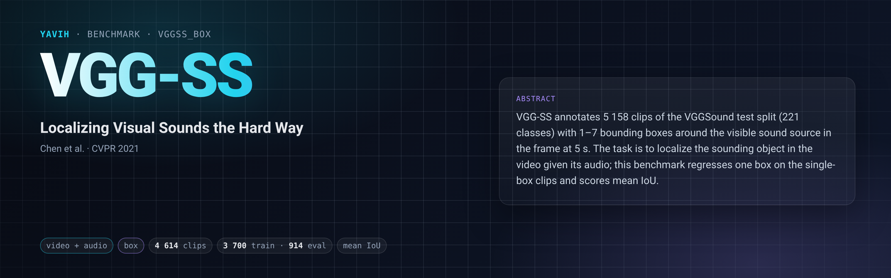

[Paper](https://arxiv.org/abs/2104.02691) · [Homepage](https://www.robots.ox.ac.uk/~vgg/research/lvs/) · [Dataset](https://github.com/hche11/Localizing-Visual-Sounds-the-Hard-Way) · [setup.md](setup.md)

## Description

"Where is the thing making this sound?" VGG-SS (Chen et al., CVPR 2021) annotates 5 158 clips of the VGGSound
**test** split (221 classes) with 1–7 bounding boxes around the sounding object in the frame at **t = 5.0 s**.
The annotations are one public JSON file (`vggss.json`); the media are the VGGSound clips themselves (YouTube,
10 s, video + audio). VGG-SS is an evaluation set: there is no official train split. The paper scores
sound-source localization heatmaps against the box union with consensus IoU (cIoU) and AUC over all 5 158 clips.

## Citation

```bibtex
@inproceedings{chen2021localizing,
  title     = {Localizing Visual Sounds the Hard Way},
  author    = {Chen, Honglie and Xie, Weidi and Afouras, Triantafyllos and Nagrani, Arsha and Vedaldi, Andrea and Zisserman, Andrew},
  booktitle = {Proceedings of the IEEE/CVF Conference on Computer Vision and Pattern Recognition (CVPR)},
  pages     = {16867--16876},
  year      = {2021}
}

@inproceedings{chen2020vggsound,
  title     = {VGGSound: A Large-scale Audio-Visual Dataset},
  author    = {Chen, Honglie and Xie, Weidi and Vedaldi, Andrea and Zisserman, Andrew},
  booktitle = {IEEE International Conference on Acoustics, Speech and Signal Processing (ICASSP)},
  pages     = {721--725},
  year      = {2020}
}
```

## In yavih

### Protocol

`protocol_version: 1`. `vggss_box` is a different readout on the VGG-SS annotations: on the **4 614 single-box**
clips, the `box` readout (`dense_av_v1`) regresses ONE box `(cx, cy, w, h)` in fractions of the full original
frame from a frozen audio-visual model's tokens. The video tokens are binned onto a 14 × 14 grid over the frame by
their positions (2 self-attention blocks over the cells), the cells cross-attend into the audio tokens (2 blocks),
and one learned box query reads them (MLP → 4 → sigmoid); loss mean-L1 + (1 − GIoU), pinned `ProbeConfig` (lr grid
1e-4 / 3e-4 / 1e-3 on a 10 % val split, ≤ 50 epochs, patience 10).

| split | role | rows | content |
|---|---|---|---|
| `train` | train (the probe carves its 10 % val split from these) | 3 700 | single-box clips on the train side of the source-level partition |
| `eval` | eval (never capped, never trained on) | 914 | single-box clips on the eval side (incl. 18 short-video clips outside the draw); 220 of the 221 classes |

- Headline **`metrics.headline: iou_mean`** (mean IoU on eval, bootstrap CI); also `acc@0.5`, `acc@0.3`,
  `center_in_gt` (Wilson CIs), `n_eval` (914), `n_excluded_degenerate` (0). All in full-frame fractions.
- No chance level (`metrics.chance: {}`). Floor **`iou_floor` = 0.343** (the mean train box
  `(0.500, 0.508, 0.506, 0.565)` predicted for every clip; bootstrap 95 % CI `[0.331, 0.355]`; through the same
  metrics `acc@0.5` 0.186, `acc@0.3` 0.625, `center_in_gt` 0.702). An `iou_mean` whose CI overlaps 0.343 is not a
  localization result.
- Control **`iou_shuffled` / `audio_blind`**: the same head trained and scored with every clip's audio tokens
  swapped for another clip's (seeded derangement, `shuffle_seed 20260913`); `audio_blind = true` means the audio
  did not help by more than 3 McNemar σ on paired `acc@0.5`. Then `iou_mean` measures visual saliency and box size,
  not audio-visual localization; say so.
- No train draw (`train_draw: null`): all 3 700 single-box train rows. The partition is a frozen source-video-level,
  class-stratified 80/20 split (`random.Random(20260913)`); 18 short-video entries outside the draw (no other entry
  of their source) are eval rows.
- Population: every VGG-SS entry not leaked into VGGSound train (4 entries, source level) with exactly one
  non-degenerate box (538 multi-box and 2 degenerate entries excluded). No crop or duration filter: it includes the
  35 boxes entirely outside a 224 centre crop and the videos shorter than 8.5 s.
- Noise at n_eval = 914: `iou_mean` bootstrap CI ≈ ±0.012, `acc@0.5` Wilson ≈ ±0.03. A gap below ≈ 0.02
  `iou_mean` is not meaningful without seeds; run ≥ 2 seeds and read `audio_blind` before calling a gap
  audio-visual.
- The bridge gets the stored VGGSound mp4 (`video`) and 16 kHz mono wav (`audio`), untouched, with media facts and
  the fact `annotated_second: 5.0`; frames, crop, audio span and front end are its decisions. It returns tokens of
  both streams with `(y, x)` in fractions of the ORIGINAL frame, covering ≥ 25 % of the 14 × 14 cells, and a video
  token within 0.5 s of the annotated frame. Details in [setup.md](setup.md).
- No `classes.csv`: the `box` label requires `classes: null`. A row's VGG-SS class is the `extra` column
  `class_name`, never handed over and never scored.

### Variants and aliases

- No aliases. This folder is the only shipped VGG-SS variant: single-box regression in full-frame coordinates.
- A square-geometry variant is not shipped: a squashing bridge declares `{"resize": {"size": [224, 224]}}` and is
  scored against the same full-frame boxes.
- The paper's heatmap / cIoU readout on all boxes (multi-box included) is not this benchmark; numbers are not
  row-for-row comparable with VGG-SS papers, which score all 5 158 clips with cIoU / AUC on heatmaps.

### Reference numbers

No published box-regression numbers exist for this protocol; the floor above is the only reference.

### Re-freezing the manifest

`make_manifest.py` re-derives `manifest.csv.gz` from the public `vggss.json` (annotations root, sha256-pinned),
VGGSound's `metadata/vggsound.csv` (leakage rule, pinned), the two geometry sidecars shipped in `prepare/`
(`frame_sizes.json`, `video_geometry.json`) and the pinned short-audio list; presence is read from the VGGSound
`video/` and `audio/` listings. `--check` (also `yavih bench prepare vggss_box 04`) compares the manifest bytes and
the yaml's `budget.clips` / `manifest.upstream` with a re-derivation, `--census` re-reads every wav header:

```sh
FOLDER=$(yavih bench path vggss_box)
python "$FOLDER/make_manifest.py" --check            # byte identity + yaml facts, exit 1 on drift
python "$FOLDER/make_manifest.py" --check --census   # + every wav header
python "$FOLDER/make_manifest.py"                    # rewrite manifest.csv.gz (in a git checkout)
pytest "$FOLDER/tests" -q -p no:cacheprovider        # folder tests; the re-derivation test skips without data
```

Curation: `3 700 + 914` listed `+ leakage 4 + multi_box 538 + degenerate_box 2 = 5 158` upstream entries.
`short_clips: 565` = rows whose audio (487, the pinned list) or video (221, `video_geometry.json`) is shorter than
`clip_seconds` 10 s (453 train / 112 eval); nothing is cut or padded. No frozen source is a VGGSound-train ytid and
no source straddles train/eval.
